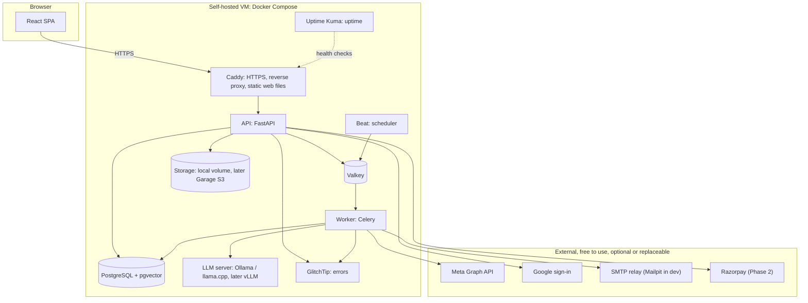
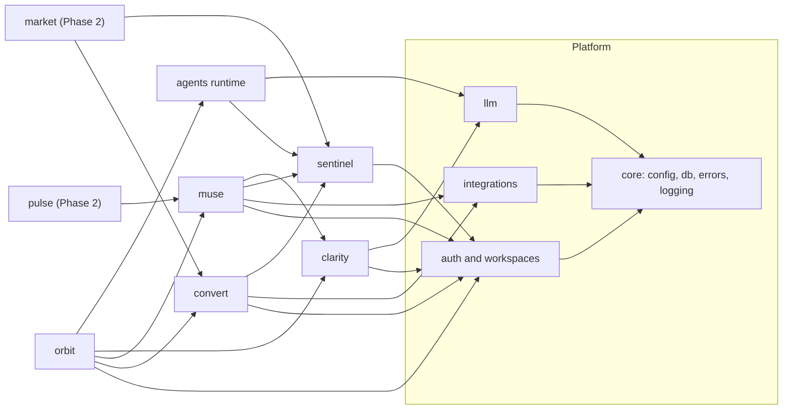
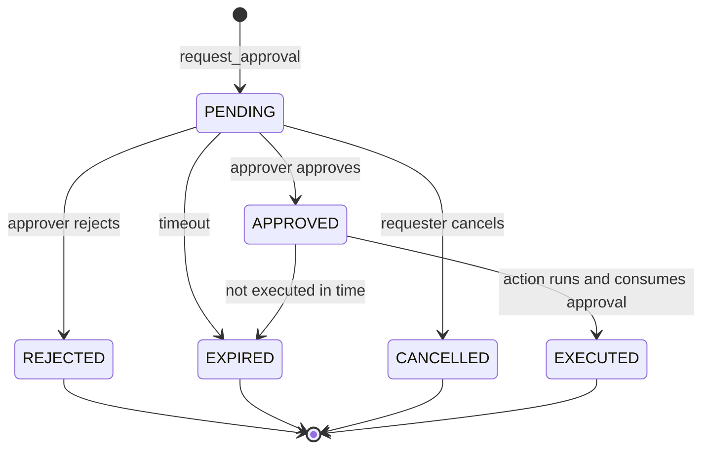
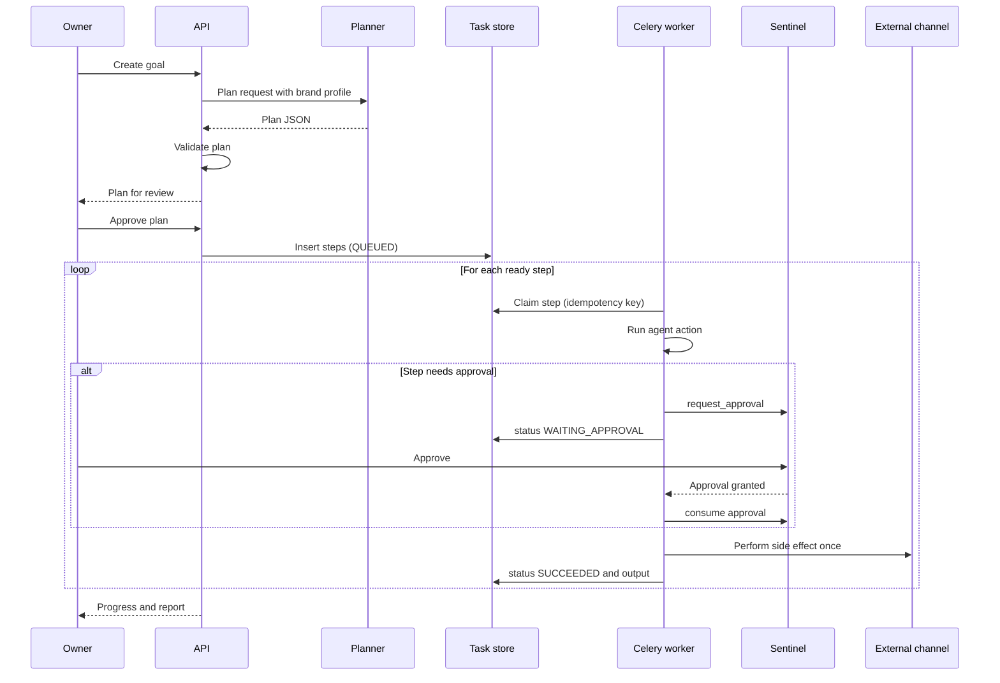
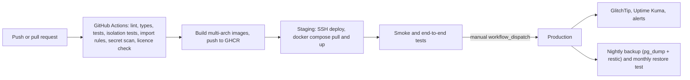

# ARCHITECTURE — Vistaro (FINAL, free and open source)

Version 1.1 · 2026-10-22 · Supersedes v1.0 (2026-10-18).
Authority: **the founder's instruction of 2026-10-22: everything we run must be free and open source.** Dimple chose the four main directions (self-hosted open-weight LLM, self-hosted Docker Compose on a free VM, free-to-use external APIs allowed, self-hosted open-source ops tools). The remaining choices were made under the delegated authority of v1.0. Anushka Varshney should acknowledge this version; the founders may veto or change any item.
Rules: `/CLAUDE.md`. Roadmap: `/docs/PROJECT_ROADMAP.md`. Warnings: `/docs/PROJECT_WARNINGS.md`. Build how-to: `/docs/DEVELOPMENT_GUIDE.md`. Product context: `STARTUP_AI_MASTER_CONTEXT.md`.

**Honesty note.** This is a *design*. No code exists or was inspected. Every "verify" item below must be checked when the relevant task starts: licences, free-tier limits, prices, versions and policies change, and the licences in Appendix A are stated from the author's knowledge, not checked against the projects today. Library and model versions are intentionally not pinned here: pin exact versions in lockfiles at install time, and prefer releases at least two weeks old.

**What changed from v1.0 (summary).** Removed: Render, Cloudflare Pages and R2, Resend, Sentry (cloud), Redis, Anthropic as the default LLM, platform secret stores. Added: self-hosted stack on one free VM with Docker Compose and Caddy, Valkey, Garage, GlitchTip, Uptime Kuma, self-hosted open-weight LLM (Ollama / llama.cpp-compatible server), SOPS + age for secrets, restic backups, a licence policy enforced in CI (ADR-021). Unchanged: modular monolith, Python/FastAPI, React/TypeScript, PostgreSQL with RLS, Sentinel design, agent runtime design.

---

## 0. Licence policy ("free and open source" defined)

1. **Everything Vistaro runs or links into its own code** must be under an OSI-approved open-source licence. Preferred: MIT, BSD, Apache-2.0, ISC, MPL-2.0, PostgreSQL licence.
2. **Copyleft (GPL, AGPL) is allowed only for standalone services we run unmodified** and talk to over the network (for example Garage, Grafana). It is never linked into or copied into Vistaro's code.
3. **Not allowed:** source-available or restricted licences (SSPL, BUSL, FSL, RSAL, Elastic-style, non-commercial Creative Commons), and any component whose free use can be withdrawn.
4. **Model weights are held to the same standard.** Prefer Apache-2.0 or MIT models. Models under custom licences with usage restrictions need an explicit ADR before use. Check each model's licence file when it is selected (`DEC-002`).
5. **External services are not "components".** Hosted APIs we call (Google sign-in, Meta, Razorpay, an SMTP relay, GitHub) are allowed if they are free to use, are optional or replaceable behind an interface, and are never required for the core product loop to work.
6. **Enforced in CI** (ADR-021). Exceptions need an ADR in `docs/adr/`.

---

## 1. Decision summary (ADR register)

| ADR | Decision | Main alternatives rejected | Why | Reversibility |
|---|---|---|---|---|
| ADR-001 | **Modular monolith in one monorepo** (`apps/web`, `apps/api`, `infra`, `docs`) | Microservices; separate repos | Two builders; one deploy; strong module boundaries without network cost | Easy to split later |
| ADR-002 | **Backend: Python 3.12, FastAPI, SQLAlchemy 2.x, Alembic, Pydantic v2**; tooling `uv`, Ruff, mypy, pytest | Node/NestJS; Django | Matches Dimple's stack; best AI/LLM ecosystem; OpenAPI for free | Medium |
| ADR-003 | **Frontend: React + TypeScript + Vite (SPA), Tailwind, shadcn/ui, TanStack Query, React Router**; generated API client (`openapi-typescript`); Vitest, Testing Library, Playwright | Next.js; Vue | Matches Anushka's stack; app is behind login so SSR/SEO is unnecessary | Medium |
| ADR-004 | **PostgreSQL only** (JSONB for semi-structured data; `pgvector` when retrieval is needed). **MongoDB not used.** | Postgres + MongoDB; MongoDB only | One datastore, transactions, RLS, constraints; JSONB covers flexible data | Hard once data exists |
| ADR-005 | **Multi-tenancy: shared schema, `workspace_id` on every tenant row, Postgres Row-Level Security enforced** | Schema-per-tenant; DB-per-tenant | Simple operations; RLS gives defense in depth beyond app code | Hard |
| ADR-006 | **Background jobs: Celery + Valkey (Celery Beat for schedules)**; Valkey also for rate limits and short-lived cache. A dedicated `llm` queue with its own concurrency limit | Redis; Arq; RQ; Dramatiq; Postgres queues; Temporal | Celery has the largest documentation base and built-in retries, ETA, periodic tasks. **Valkey** is the BSD-licensed, Redis-protocol-compatible fork, so no licence risk (Redis's licence changed in 2024). State lives in Postgres, so the queue is replaceable. Verify Celery + Valkey compatibility at `INFRA-001` | Easy |
| ADR-007 | **Auth: own session auth** — email+password (Argon2id) is the primary method; Google sign-in (Authlib) is an optional extra; server-side sessions in HttpOnly Secure SameSite cookies, CSRF protection, email verification | Third-party auth SaaS; JWT-in-localStorage | Keeps roles and Sentinel central, no vendor cost or lock-in; cookies avoid token theft via XSS | Medium |
| ADR-008 | **Sentinel is an in-process module with a synchronous policy API**; approvals and an append-only audit log persisted in Postgres | External policy engine | One enforcement point, testable, no extra service | Easy |
| ADR-009 | **Orchestration: custom planner-executor over a Postgres task store**; no LangChain, LangGraph, CrewAI | Agent frameworks | Full control of approvals, idempotency, token budgets; fewer dependencies; framework churn risk avoided | Easy |
| ADR-010 | **LLM: self-hosted open-weight models behind a provider-agnostic interface that speaks the OpenAI-compatible HTTP protocol.** Development and launch serving: **Ollama** (or a llama.cpp server); when a GPU is available: **vLLM** (Apache-2.0). Two tiers (`large`, `small`) that may map to the same model at launch. Exact models chosen at `DEC-002` from models with permissive licences | Paid APIs (Anthropic, OpenAI, Gemini) as the default; hosted free tiers as the default | Meets the free and open-source requirement; data stays on our server; one OpenAI-compatible adapter works for Ollama, llama.cpp, vLLM and any hosted service we may add later | Easy |
| ADR-011 | **Structured outputs: JSON schema (constrained decoding where the server supports it) validated with Pydantic, with one bounded repair retry** | Free-text parsing | Small open models are less reliable at format; constrained decoding plus validation rejects invalid output | Easy |
| ADR-012 | **First integrations:** `ManualPublish` connector (always available); lead-form webhook; SMTP email through a `Mailer` interface (Mailpit in development, a free-tier SMTP relay in production). **Optional, free to use:** Meta Graph API for Instagram/Facebook Pages (development mode first), Google sign-in. **Later:** Razorpay (Phase 2), Google Calendar (Phase 4), WhatsApp Cloud API (Phase 4 or later, likely not free: per-message charges) | Waiting on platform approvals; self-hosting a mail server | The manual connector means the MVP cannot be blocked by app review. Self-hosted mail rarely reaches inboxes (IP reputation, SPF/DKIM) | Easy |
| ADR-013 | **Hosting: self-hosted Docker Compose on a free VM (default candidate: Oracle Cloud Always Free; any VPS, college server or own machine also works).** **Caddy** as reverse proxy with automatic HTTPS and static web hosting. Staging and production are separate Compose projects | Render, Fly, Vercel, Cloudflare; Kubernetes; Coolify as a required layer | Free and open source end to end. Images are multi-arch (`linux/arm64` and `linux/amd64`) because free VMs are often ARM. Verify the free allowance, idle-reclamation rules and terms at `DEC-005` | Easy (Docker) |
| ADR-014 | **CI/CD: GitHub Actions (free tier) with all steps written as plain scripts in `infra/scripts` so they can move to Forgejo Actions or any runner. Images in GitHub Container Registry. Staging auto-deploys on merge; production deploys only through a manually triggered workflow** | Manual deploys; automatic production deploys | Safety (CLAUDE.md rule 12). GitHub is a free service, not a component; nothing depends on it that cannot be moved | Easy |
| ADR-015 | **Observability: structured JSON logs (structlog) read through Docker logs; GlitchTip (Sentry-SDK-compatible, open source) for errors; Uptime Kuma for uptime and alert checks; `agent_runs` and a token ledger in Postgres. Grafana + Loki + Prometheus and OpenTelemetry deferred to Phase 2** | Sentry cloud; full APM stack early | Enough for MVP; token and latency visibility is critical for AI | Easy |
| ADR-016 | **API: REST + OpenAPI; polling for task status in Phase 1, Server-Sent Events from Phase 2** | GraphQL; WebSockets | Simplicity | Easy |
| ADR-017 | **Module boundaries enforced by `import-linter` in CI** | Convention only | Protects constraint C-03 automatically | Easy |
| ADR-018 | **Secrets: SOPS + age (encrypted secret files in the repo, decrypted at deploy time) or untracked `.env` files on the VM with restricted permissions; connection tokens encrypted at app level (AES-GCM or Fernet) with key IDs for rotation** | Plain storage; paid secret managers | Open source, no vendor; limits blast radius of a DB leak | Medium |
| ADR-019 | **Feature flags: simple `feature_flags` table plus env defaults** | Third-party flag service | Minimal | Easy |
| ADR-020 | **Embeddings and vector search deferred to Phase 3** (needed first by the support agent); an open-weight embedding model served by the same LLM server, vectors in `pgvector` | Choose now; hosted embedding API | Not needed for the MVP; avoids early cost and dependency | Easy |
| ADR-021 | **Licence policy enforced in CI:** Python (`pip-licenses`) and JavaScript (`license-checker`) dependency licences are checked against the allow-list in §0; container image list reviewed against Appendix A | Trust by convention | The free and open-source requirement is a founder constraint, so it is tested, not assumed | Easy |
| ADR-022 | **Object storage behind a `Storage` interface:** `local` volume backend for the MVP, S3-compatible **Garage** backend when files grow (SeaweedFS is the alternative). **MinIO not chosen:** its community edition has had licence and feature changes (verify), so long-term open-source status is uncertain | Cloudflare R2; AWS S3; MinIO | Free and open source; S3-compatible so code stays portable. Verify presigned URL and multipart support at `INT-004` | Easy |
| ADR-023 | **Backups are our job: nightly `pg_dump` plus `restic` (encrypted) to a destination off the VM; monthly restore test; backup before every production migration.** WAL archiving (pgBackRest or WAL-G) for point-in-time recovery is a Phase 2 task | Rely on provider snapshots; no backups | Self-hosting removes the managed-backup safety net | Easy |

Alternatives are not "bad"; they cost more for this team and stage or break the free and open-source rule. Section 15 lists triggers to revisit.

---

## 2. System architecture

### 2.1 Containers

Everything inside the dashed boundary runs as containers on one VM per environment. Only Caddy publishes ports (80 and 443). Every other container is on an internal Docker network, including the LLM server, Postgres and Valkey.



### 2.2 Inside the API application (modular monolith)



**Dependency rules (enforced by import-linter, ADR-017):**
1. Arrows show allowed imports. Anything not drawn is forbidden. No cycles.
2. A module may import another module **only** from its public `service.py` (and `schemas.py` types). Never its `models.py` or tables (constraint C-03).
3. `core` imports nothing from other modules.
4. Routers call services; services call repositories; only repositories touch SQL.
5. Only `sentinel` decides approvals. No other module implements approval logic (warning WARN-B-001).

---

## 3. Repository layout (target)

```
vistaro/
├── CLAUDE.md  AGENTS.md
├── STARTUP_AI_MASTER_CONTEXT.md  STARTUP_MASTER_BLUEPRINT.md
├── docs/  (ARCHITECTURE.md, DEVELOPMENT_GUIDE.md, PROJECT_ROADMAP.md,
│           ACTIVE_TASKS.md, PROJECT_WARNINGS.md, adr/)
├── apps/
│   ├── api/
│   │   ├── pyproject.toml  uv.lock  alembic.ini
│   │   ├── alembic/versions/
│   │   ├── src/vistaro/
│   │   │   ├── main.py  worker.py
│   │   │   ├── core/         (config, db, security, errors, logging, ids, storage, mailer)
│   │   │   ├── auth/         (users, sessions, oauth, workspaces, memberships, rbac)
│   │   │   ├── sentinel/     (policies, approvals, audit)
│   │   │   ├── agents/       (runtime, registry, tasks, budgets)
│   │   │   ├── llm/          (client interface, openai_compatible provider, prompts/, schemas, router)
│   │   │   ├── integrations/ (base, manual_publish, meta, webhooks)
│   │   │   ├── orbit/  clarity/  muse/  convert/   (each: models, schemas, repo, service, router, tasks)
│   │   │   └── market/  pulse/                      (Phase 2)
│   │   └── tests/ (unit, integration, tenancy, evals)
│   └── web/
│       ├── package.json  vite.config.ts
│       └── src/ (app, routes, features/<module>, components, lib/api, lib/auth, tests)
├── infra/
│   ├── compose.base.yml  compose.dev.yml  compose.staging.yml  compose.prod.yml
│   ├── Caddyfile  Dockerfile.api  Dockerfile.web
│   ├── secrets/            (SOPS-encrypted files only; `.sops.yaml` at repo root)
│   └── scripts/            (deploy.sh, backup.sh, restore.sh, license_check.sh, smoke.sh)
└── .github/workflows/ (ci.yml, deploy-staging.yml, deploy-prod.yml)
```

---

## 4. Request lifecycle and tenancy

```mermaid
sequenceDiagram
    participant B as Browser
    participant A as FastAPI
    participant S as Session store
    participant D as PostgreSQL
    B->>A: Request with session cookie
    A->>S: Load session
    S-->>A: user_id, active workspace
    A->>A: Check role for this route
    A->>D: BEGIN; set_config app.workspace_id (local)
    A->>D: Queries (RLS filters rows)
    D-->>A: Rows for this workspace only
    A->>D: COMMIT
    A-->>B: JSON
```

**Tenancy rules (ADR-005):**
- Workspace comes from the **server-side session**, never from a client-supplied ID alone. If a route has `{workspace_id}`, it must equal the session's active workspace or the user's membership is verified.
- Each request runs in one transaction. `set_config('app.workspace_id', :id, true)` (transaction-local) is set at the start. Never use a session-level setting with pooled connections.
- Tables carry `workspace_id UUID NOT NULL`, with RLS enabled **and forced**, and policy `workspace_id = current_setting('app.workspace_id')::uuid`.
- The application connects as a non-owner role (`vistaro_app`) with no `BYPASSRLS`. Migrations run as a separate role (`vistaro_migrator`). GlitchTip uses its own database and role, never the application database.
- Workers set the same setting from the task's `workspace_id` before any query.
- A mandatory test creates two workspaces and proves cross-reads fail even when application filters are removed (`TEST-001`).

---

## 5. Authentication and authorization

| Topic | Design |
|---|---|
| Sign-in | Email+password (Argon2id) always available; Google OAuth optional. Email verification required before publishing or connecting channels |
| Sessions | Server-side rows (`sessions`), opaque random ID in an HttpOnly, Secure, SameSite=Lax cookie; idle and absolute expiry; rotate on login; revoke on logout and password change |
| CSRF | Double-submit token or same-site header check on state-changing requests |
| Rate limiting | Valkey-backed limits on login, signup, password reset, and webhook endpoints |
| Roles | `owner`, `admin`, `editor`, `approver`, `viewer` on `memberships` |
| Permission checks | Route-level dependency calls `sentinel.permissions.require(user, action, workspace)`. Role-to-action map lives in one file |
| Approvers | Only `owner`, `admin`, `approver` can approve. A requester cannot approve their own agent-initiated request unless they hold an approver role |

---

## 6. Sentinel design

### 6.1 Approval state machine



### 6.2 Rules

- **Gate API (internal):** `request_approval(workspace, action_type, payload, requested_by)` returns an approval ID; `consume(approval_id, expected_payload_hash)` atomically moves `APPROVED` to `EXECUTED` and fails otherwise.
- **Payload binding:** the approval stores a hash of the exact payload shown to the approver. Executing a changed payload fails. This prevents "approve one thing, send another".
- **One-time use:** an approval can be consumed once (idempotency).
- **Default policy (Phase 1):** all `content.publish`, `message.send`, `message.bulk_send`, `connection.link`, and any financial action require approval. No relaxation in Phase 1.
- **Phase 2:** owners may relax approval for low-risk classes (for example, replies to inbound customer messages from approved templates), with the relaxation itself audited.
- **Audit:** every request, decision, execution, permission denial, and policy change writes to `audit_logs`. The app role has **INSERT and SELECT only** on `audit_logs` (no UPDATE or DELETE).
- **Expiry:** pending approvals expire after a configurable time (initial default 7 days; tune with pilots). Expiry never auto-approves.

---

## 7. Agent runtime and Orbit

### 7.1 Concepts

| Concept | Meaning |
|---|---|
| Goal | Owner's stated objective, with optional metric, target, deadline |
| Plan | A validated, owner-approved DAG of steps for a goal |
| Step (task row) | One unit of work for one agent action, with inputs, outputs, status |
| Agent | A registered handler for specific actions (for example `muse.generate_post`) |
| Agent run | A trace record of each LLM or tool call within a step |

### 7.2 Plan validation (deterministic code, not AI)

The planner (LLM) returns JSON. The system **rejects** a plan unless it passes:
1. Schema valid.
2. Every `agent.action` is in the registry whitelist.
3. Graph is acyclic and every dependency exists.
4. Step count ≤ the configured cap (initial 12).
5. Any step whose action type needs approval is flagged `requires_approval` by the **registry**, not by the model (the model cannot waive approvals).
6. Estimated token use within the workspace budget.

Because small open models plan less reliably than large hosted ones, a rejected plan gets one bounded repair attempt, then fails visibly to the owner. The system never substitutes a canned plan.

### 7.3 Execution



### 7.4 Reliability rules

- **Idempotency:** every step has a unique `idempotency_key`. Side-effecting calls (publish, send) record the external ID **before** acknowledging success and check for it on retry.
- **Retries:** capped (`max_attempts`, initial 3) with exponential backoff; transient errors only. Permanent errors fail the step visibly.
- **Limits:** per-goal step cap, per-step timeout, per-workspace token budget; exceeding a budget pauses the goal and notifies the owner.
- **No agent chat:** agents do not call each other. Orbit's executor passes outputs between steps through the task store.
- **Untrusted text:** inbound customer or web text is wrapped as data in prompts and agents handling it have a restricted tool set (WARN-C-004).
- **Celery settings:** acks late, visibility timeout longer than the longest step, one step per task message, results not trusted as state (the DB is the source of truth). LLM calls run on a dedicated `llm` queue whose concurrency equals what the LLM server can serve in parallel (initially 1 on a CPU-only VM), so inference never starves the API.
- **LLM server unavailable:** the step waits and retries within the cap, then fails visibly ("AI engine unavailable"). Agents never return fabricated or canned output.

---

## 8. LLM layer

| Topic | Design |
|---|---|
| Interface | `LLMClient.generate(messages, schema=None, tools=None, model_tier, budget)`. The default provider adapter speaks the OpenAI-compatible HTTP protocol with a configurable base URL, so Ollama, llama.cpp servers and vLLM all work through one adapter. Other providers are optional plug-ins, never required |
| Serving | Development and launch: Ollama (or a llama.cpp server) in the Compose stack, internal network only. With a GPU: vLLM. The server is never exposed to the internet |
| Hardware reality | A free CPU-only VM can serve only small, quantized models, slowly and with little parallelism. This is acceptable for development, the SEVA prototype and a small pilot. Serving many workspaces needs a GPU or a different decision (WARN-F-007). Measure at `INFRA-002` before promising anything |
| Tiers | `large` (planning, content generation) and `small` (classification, scoring, extraction). Mapping tier to model name is configuration, set at `DEC-002`; both tiers may point to the same model at launch |
| Model policy | Only models allowed by §0 rule 4. Candidates are evaluated in `DEC-002` from permissively licensed open-weight families available then (verify current releases and licences; do not choose from memory) |
| Structured output | Request JSON matching a Pydantic-derived schema, using the server's JSON-schema or grammar-constrained decoding where available (verify per server); validate; on failure one repair retry with the validation error; then fail the step |
| Prompts | Files under `llm/prompts/`, versioned (`name@version`); the version is stored in `agent_runs`. Prompts are written for the chosen small model and re-evaluated when the model changes |
| Safety | System prompt separates instructions from data; delimiters around untrusted text; output never executed as code |
| Budgets | Estimate tokens before a call; record tokens and latency after; block when the workspace token budget is exhausted. Money cost is recorded only if a paid provider is ever configured |
| Caching | Cache deterministic, repeatable calls within a window; never cache across workspaces |
| Evaluation | Fixed eval sets in `tests/evals/`; scores stored per prompt version and model; required before changing a prompt, model or quantization (`TEST-002`) |
| PII | Customer data stays on our own server for inference. Still send the minimum necessary and redact where possible (WARN-E-002) |

---

## 9. Data model (Phase 1, final)

Types are PostgreSQL. All tenant tables enable and force RLS on `workspace_id`. IDs are UUIDs (v7 preferred if available, else v4). Timestamps are `timestamptz`.

```sql
-- Identity and tenancy
CREATE TABLE users (
  id UUID PRIMARY KEY, email CITEXT UNIQUE NOT NULL, password_hash TEXT,
  google_sub TEXT UNIQUE, email_verified_at TIMESTAMPTZ,
  created_at TIMESTAMPTZ NOT NULL DEFAULT now()
);
CREATE TABLE workspaces (
  id UUID PRIMARY KEY, name TEXT NOT NULL, created_by UUID NOT NULL REFERENCES users(id),
  created_at TIMESTAMPTZ NOT NULL DEFAULT now()
);
CREATE TABLE memberships (
  workspace_id UUID NOT NULL REFERENCES workspaces(id),
  user_id UUID NOT NULL REFERENCES users(id),
  role TEXT NOT NULL CHECK (role IN ('owner','admin','editor','approver','viewer')),
  PRIMARY KEY (workspace_id, user_id)
);
CREATE TABLE sessions (
  id_hash TEXT PRIMARY KEY, user_id UUID NOT NULL REFERENCES users(id),
  active_workspace_id UUID REFERENCES workspaces(id),
  created_at TIMESTAMPTZ NOT NULL DEFAULT now(),
  last_seen_at TIMESTAMPTZ NOT NULL, expires_at TIMESTAMPTZ NOT NULL
);

-- Connections (encrypted tokens)
CREATE TABLE connections (
  id UUID PRIMARY KEY, workspace_id UUID NOT NULL REFERENCES workspaces(id),
  provider TEXT NOT NULL, external_account_id TEXT,
  token_ciphertext BYTEA, key_id TEXT, scopes TEXT[],
  status TEXT NOT NULL CHECK (status IN ('active','expired','revoked','error')),
  created_at TIMESTAMPTZ NOT NULL DEFAULT now(),
  UNIQUE (workspace_id, provider, external_account_id)
);

-- Clarity
CREATE TABLE brand_profiles (
  id UUID PRIMARY KEY, workspace_id UUID NOT NULL REFERENCES workspaces(id),
  version INT NOT NULL, tone JSONB NOT NULL, audience JSONB,
  banned_terms TEXT[] NOT NULL DEFAULT '{}', required_elements JSONB, examples JSONB,
  status TEXT NOT NULL CHECK (status IN ('draft','approved','superseded')),
  approved_by UUID REFERENCES users(id), approved_at TIMESTAMPTZ,
  UNIQUE (workspace_id, version)
);
CREATE TABLE brand_scores (
  id UUID PRIMARY KEY, workspace_id UUID NOT NULL REFERENCES workspaces(id),
  content_item_id UUID NOT NULL, profile_version INT NOT NULL,
  score NUMERIC(5,2) NOT NULL, rubric JSONB NOT NULL, created_at TIMESTAMPTZ NOT NULL DEFAULT now()
);

-- Orbit and agent runtime
CREATE TABLE goals (
  id UUID PRIMARY KEY, workspace_id UUID NOT NULL REFERENCES workspaces(id),
  text TEXT NOT NULL, target_metric TEXT, target_value NUMERIC, deadline DATE,
  status TEXT NOT NULL CHECK (status IN ('draft','planning','awaiting_plan_approval','active','paused','done','cancelled')),
  created_by UUID NOT NULL REFERENCES users(id), created_at TIMESTAMPTZ NOT NULL DEFAULT now()
);
CREATE TABLE plans (
  id UUID PRIMARY KEY, workspace_id UUID NOT NULL REFERENCES workspaces(id),
  goal_id UUID NOT NULL REFERENCES goals(id), version INT NOT NULL,
  plan JSONB NOT NULL, status TEXT NOT NULL CHECK (status IN ('proposed','approved','superseded','rejected')),
  approved_by UUID REFERENCES users(id), approved_at TIMESTAMPTZ,
  UNIQUE (goal_id, version)
);
CREATE TABLE tasks (
  id UUID PRIMARY KEY, workspace_id UUID NOT NULL REFERENCES workspaces(id),
  plan_id UUID NOT NULL REFERENCES plans(id), step_key TEXT NOT NULL,
  agent_action TEXT NOT NULL, depends_on TEXT[] NOT NULL DEFAULT '{}',
  status TEXT NOT NULL CHECK (status IN ('queued','running','waiting_approval','succeeded','failed','cancelled')),
  attempt INT NOT NULL DEFAULT 0, max_attempts INT NOT NULL DEFAULT 3,
  idempotency_key TEXT NOT NULL UNIQUE,
  input JSONB NOT NULL, output JSONB, error TEXT,
  started_at TIMESTAMPTZ, finished_at TIMESTAMPTZ,
  UNIQUE (plan_id, step_key)
);
CREATE TABLE agent_runs (
  id UUID PRIMARY KEY, workspace_id UUID NOT NULL REFERENCES workspaces(id),
  task_id UUID REFERENCES tasks(id), kind TEXT NOT NULL,   -- llm_call | tool_call
  model TEXT, prompt_version TEXT, input_tokens INT, output_tokens INT,
  cost_micro BIGINT,                                       -- NULL unless a paid provider is configured
  latency_ms INT, ok BOOLEAN NOT NULL, error TEXT,
  created_at TIMESTAMPTZ NOT NULL DEFAULT now()
);
CREATE TABLE workspace_budgets (
  workspace_id UUID PRIMARY KEY REFERENCES workspaces(id),
  monthly_token_limit BIGINT NOT NULL, period_start DATE NOT NULL
);

-- Muse
CREATE TABLE content_items (
  id UUID PRIMARY KEY, workspace_id UUID NOT NULL REFERENCES workspaces(id),
  task_id UUID REFERENCES tasks(id), channel TEXT NOT NULL,
  body JSONB NOT NULL, status TEXT NOT NULL
    CHECK (status IN ('draft','scored','awaiting_approval','approved','scheduled','published','failed','rejected')),
  scheduled_for TIMESTAMPTZ, external_post_id TEXT, published_at TIMESTAMPTZ,
  created_at TIMESTAMPTZ NOT NULL DEFAULT now()
);

-- Convert
CREATE TABLE contacts (
  id UUID PRIMARY KEY, workspace_id UUID NOT NULL REFERENCES workspaces(id),
  name TEXT, email CITEXT, phone TEXT, opted_out_at TIMESTAMPTZ,
  created_at TIMESTAMPTZ NOT NULL DEFAULT now()
);
CREATE TABLE leads (
  id UUID PRIMARY KEY, workspace_id UUID NOT NULL REFERENCES workspaces(id),
  contact_id UUID NOT NULL REFERENCES contacts(id), source TEXT NOT NULL,
  stage TEXT NOT NULL CHECK (stage IN ('new','contacted','interested','negotiating','won','lost')),
  score INT NOT NULL DEFAULT 0, last_activity_at TIMESTAMPTZ,
  created_at TIMESTAMPTZ NOT NULL DEFAULT now()
);
CREATE TABLE lead_events (
  id BIGSERIAL PRIMARY KEY, workspace_id UUID NOT NULL REFERENCES workspaces(id),
  lead_id UUID NOT NULL REFERENCES leads(id), kind TEXT NOT NULL, detail JSONB,
  at TIMESTAMPTZ NOT NULL DEFAULT now()
);

-- Sentinel
CREATE TABLE policies (
  id UUID PRIMARY KEY, workspace_id UUID NOT NULL REFERENCES workspaces(id),
  action_type TEXT NOT NULL, requires_approval BOOLEAN NOT NULL DEFAULT true,
  approver_roles TEXT[] NOT NULL DEFAULT '{owner,admin,approver}',
  UNIQUE (workspace_id, action_type)
);
CREATE TABLE approval_requests (
  id UUID PRIMARY KEY, workspace_id UUID NOT NULL REFERENCES workspaces(id),
  action_type TEXT NOT NULL, payload JSONB NOT NULL, payload_hash TEXT NOT NULL,
  requested_by TEXT NOT NULL, task_id UUID REFERENCES tasks(id),
  status TEXT NOT NULL CHECK (status IN ('pending','approved','rejected','expired','cancelled','executed')),
  expires_at TIMESTAMPTZ NOT NULL, created_at TIMESTAMPTZ NOT NULL DEFAULT now()
);
CREATE TABLE approval_decisions (
  id UUID PRIMARY KEY, workspace_id UUID NOT NULL REFERENCES workspaces(id),
  approval_id UUID NOT NULL REFERENCES approval_requests(id),
  decided_by UUID NOT NULL REFERENCES users(id), decision TEXT NOT NULL CHECK (decision IN ('approve','reject')),
  note TEXT, at TIMESTAMPTZ NOT NULL DEFAULT now()
);
CREATE TABLE audit_logs (
  id BIGSERIAL PRIMARY KEY, workspace_id UUID NOT NULL,
  actor TEXT NOT NULL, action TEXT NOT NULL, resource TEXT, detail JSONB,
  at TIMESTAMPTZ NOT NULL DEFAULT now()
);
```

**Indexes (start minimal; add from measured query plans):** `(workspace_id, status)` on `tasks`, `content_items`, `approval_requests`; `(workspace_id, stage)` on `leads`; `(workspace_id, at)` on `audit_logs`; unique constraints as shown.

**Later phases (outline, schemas written when the phase starts):** `conversations`, `messages` (Convert, Phase 2); `products`, `inventory`, `orders`, `order_items` (Market, Phase 2); `metrics`, `experiments`, `experiment_variants`, `competitor_observations` (Pulse); `visibility_queries`, `visibility_runs`, `visibility_results` (Clarity, Phase 2); `memory_items` with pgvector (Phase 3); `feature_flags`.

**Lead scoring v1 (deterministic):** points for source quality, form completeness, replied, recency, explicit interest keywords; thresholds map to hot, warm, cold. Weights are initial defaults tuned from pilot data. An LLM intent classifier may be added after evaluation.

**Brand scoring v1:** deterministic checks first (banned terms, length, required elements, language), then a small-tier LLM rubric score. Initial pass threshold 70 of 100, tuned from evals. Deterministic checks matter more now: they do not depend on a small model's judgment.

---

## 10. API conventions and Phase 1 endpoints

- Base path `/api/v1`. JSON. Errors: `{ "error": { "code", "message", "details" } }`. OpenAPI generated; the web client is generated from it in CI (contract drift fails the build).
- Pagination: cursor-based. Idempotency: `Idempotency-Key` header on endpoints that cause external effects.
- Long operations return a task or goal ID; the client polls (Phase 1).

| Group | Endpoints (Phase 1) |
|---|---|
| Auth | `POST /auth/signup`, `/auth/login`, `/auth/logout`, `/auth/google/*` (optional), `POST /auth/verify-email` |
| Workspaces | `POST /workspaces`, `GET /workspaces`, `POST /workspaces/{id}/switch`, `POST /workspaces/{id}/members` |
| Clarity | `GET/PUT /brand-profile`, `POST /brand-profile/approve`, `POST /content/{id}/score` |
| Orbit | `POST /goals`, `GET /goals/{id}`, `GET /goals/{id}/plan`, `POST /plans/{id}/approve`, `POST /plans/{id}/reject` |
| Muse | `GET /content`, `PATCH /content/{id}`, `POST /content/{id}/request-approval` |
| Sentinel | `GET /approvals`, `POST /approvals/{id}/decision` |
| Convert | `POST /public/lead-forms/{token}` (public, rate limited), `GET /leads`, `PATCH /leads/{id}` |
| Integrations | `GET /connections`, `POST /connections/{provider}/start`, `DELETE /connections/{id}` |
| System | `GET /healthz`, `GET /readyz` (reports LLM server reachability as degraded, not down) |

---

## 11. Integrations (final choices)

"Cost status" says whether using it is free. Anything not free is deferred and optional.

| Integration | Choice | Phase | Cost status | Notes and risks |
|---|---|---|---|---|
| Publishing, always available | `ManualPublish`: generates the post package; owner confirms publication manually; system records it | 1 | Free, open source | Guarantees the MVP works without platform approval |
| Instagram and Facebook Pages | Meta Graph API | 1 (dev mode), prod after app review | Free to use (verify) | Review requirements and limits: verify at `INT-002` (WARN-C-005). Optional |
| Lead capture | Embeddable form plus signed webhook | 1 | Free, open source | Spam protection, rate limits, validation |
| Email | `Mailer` interface over SMTP. Development: Mailpit. Production: a free-tier SMTP relay | 1 | Free tier only (verify limits) | Needs a domain with SPF and DKIM. Self-hosting a mail server is not recommended. Choose the relay at `INT-003` |
| Google sign-in | Google OAuth through Authlib | 1, optional | Free to use | Needs a real domain for redirect URIs. Email+password works without it |
| File storage | `Storage` interface: local volume first, Garage (S3-compatible) later | 1 (local), 2 (Garage) | Free, open source | Size and type limits; presigned URLs verified at `INT-004` |
| Payments | Razorpay | 2 | Free to integrate; **per-transaction fees apply** (verify) | Compliance and fees: verify at `MKT-003`. Vistaro is not the merchant (WARN-C-010) |
| WhatsApp | WhatsApp Cloud API | 4 or later | **Likely per-message charges** (verify) | Templates, opt-in, cost: verify at `LEGAL-001` and `CON-006`. Deferred; may be dropped if it cannot be free (WARN-C-010) |
| Calendar | Google Calendar API | 4 | Free to use | OAuth scopes review |
| AI visibility | `VisibilityProvider` interface; official APIs where they exist; **no scraping** | 2 | Unknown | Feasibility pending `RES-001`; API answers may differ from consumer apps; AI Overviews may be unsupported (WARN-C-001) |

Connector interface: `connect()`, `refresh()`, `revoke()`, `publish()`, `fetch_metrics()`, with typed errors (`AuthError`, `RateLimited`, `Transient`, `Permanent`) and a circuit breaker.

---

## 12. Security and privacy controls

| Area | Control |
|---|---|
| Transport | HTTPS only through Caddy (automatic certificates); HSTS; secure cookies |
| Host hardening | Only ports 80, 443 and a key-only SSH port open; firewall on; SSH password login off; automatic security updates; fail2ban or equivalent; Postgres, Valkey, LLM server and GlitchTip never published to the internet (WARN-E-007) |
| Secrets | SOPS + age or restricted `.env` on the VM; never in the repo unencrypted; `.env.example` with names only; secret scanning in CI; age private key kept off the repo and backed up separately (WARN-E-008) |
| Token encryption | AES-GCM or Fernet with `key_id`; rotation supported |
| Input | Pydantic validation everywhere; size limits; upload type checks; output encoding on the frontend; Content-Security-Policy |
| Abuse | Rate limits (login, signup, public forms, webhooks); lead-form spam checks |
| Tenancy | RLS plus tests (section 4) |
| AI safety | Section 7.4 and 8 |
| Logging | Structured logs; never log tokens, passwords, message bodies, or full prompts containing personal data; redaction filter; log rotation configured so logs cannot fill the disk |
| Data lifecycle | Soft-delete plus scheduled hard delete after a retention period set by `LEGAL-001`; deletion-on-request path; backups follow the same retention |
| Dependencies | Lockfiles, pinned versions, automated vulnerability alerts, licence check (ADR-021) |
| Compliance | Applicability of India's data protection law and platform policies decided by `LEGAL-001` (not assumed) |

---

## 13. Observability and cost

- Logs: structlog JSON with `request_id`, `workspace_id`, `task_id`, read through Docker logs with rotation. Errors go to GlitchTip (Sentry SDK pointed at our own server).
- Uptime Kuma checks `/healthz`, the web app and the TLS certificate expiry, and alerts by email or chat webhook.
- Metrics tracked from `agent_runs` and `tasks`: success rate, retries, latency, tokens, per goal and per workspace, plus LLM queue depth.
- Alerts (initial): task failure spikes, LLM queue backlog or timeout rate, token budget thresholds, 5xx rate, backup failure, disk usage, certificate expiry.
- "Cost" now means **tokens, latency and server resources**, not a bill. The token ledger is derived from `agent_runs`; budgets are enforced before LLM calls. Money cost is recorded only if a paid provider is configured.
- Phase 2: Prometheus, Grafana and Loki if log searching or dashboards become necessary (all open source).

---

## 14. Deployment



| Item | Decision |
|---|---|
| Environments | `local` (compose.dev.yml), `staging`, `production` (separate Compose projects). At launch they may share one VM, with CPU and memory limits per container. Split onto a second VM when available (WARN-F-009) |
| Images | Built for `linux/arm64` and `linux/amd64`; every base image and dependency must have an arm64 build (WARN-F-010) |
| Migrations | Run as a release step with the migrator role; backwards-compatible (expand, then contract); **backup before production migrations** |
| Rollback | Redeploy the previous image tag; database changes designed to tolerate the previous version for one release |
| Secrets | SOPS-encrypted files per environment, decrypted on deploy; separate values per environment |
| Deploy access | A dedicated deploy SSH key with a restricted command; no root login |
| Cost control | Single instance each for API, worker, beat, LLM server at launch; container CPU and memory limits so the LLM server cannot starve Postgres or the API |
| Backups | ADR-023. Destination chosen at `DEC-006`; must be off the VM |

---

## 15. Scaling path, non-goals, and when to revisit

**Scaling path (only when measured need appears):** move the LLM server to a GPU machine or a second VM (first and most likely step); add API instances; split worker queues by priority (interactive vs batch); add a Postgres read replica; move large metric tables to partitioning; extract a module into a service only if it needs independent scaling.

**Non-goals (first release):** microservices; Kubernetes; native mobile apps; payment processing by Vistaro as merchant; autonomous publishing without approval; multi-region; paid LLM APIs as the default.

**Revisit triggers:**

| Decision | Revisit if |
|---|---|
| Self-hosted LLM (ADR-010) | `INFRA-002` shows unacceptable latency or quality, or a pilot needs more capacity than the VM can serve |
| Free VM (ADR-013) | The free allowance, terms or availability change, the instance is reclaimed, or uptime requirements grow |
| Celery + Valkey (ADR-006) | Task semantics or maintenance become a recurring problem, or Valkey compatibility problems appear |
| Own auth (ADR-007) | Enterprise SSO, MFA, or compliance requirements appear |
| Postgres RLS (ADR-005) | A customer requires physical isolation |
| Custom orchestration (ADR-009) | Plan complexity outgrows the executor and a framework would reduce risk |
| Garage (ADR-022) | Licence, maintenance or compatibility problems; switch to SeaweedFS or keep the local backend |
| Free SMTP relay (ADR-012) | Volume or limits exceed the free tier |
| Free-only rule (§0) | Founders decide a paid component is worth its cost (needs an ADR) |

---

## 16. Approval, open items and change control

This architecture is final for planning. Changing any ADR needs the proposal process in `CLAUDE.md` §9 and a new entry under `docs/adr/`. Items marked "verify" are not changes; they are checks when the related task begins, and any surprise is recorded in `docs/PROJECT_WARNINGS.md`.

**Items still open (none block the design; each has a default):**

| Item | Default if not decided | Task |
|---|---|---|
| Which open-weight model(s) and quantization | Evaluate candidates on a fixed task set; pick the best permissively licensed one that runs acceptably | `DEC-002` |
| VM provider, region and domain name (needed for HTTPS, Google sign-in and email) | Oracle Cloud Always Free candidate; a free or low-cost subdomain/domain | `DEC-005` |
| Off-VM backup destination | A second free storage location the founders already control | `DEC-006` |
| Anushka Varshney's acknowledgment of v1.1 | Treated as pending | `DEC-001` note |
| Local development hardware (can laptops run the small model?) | Developers use the smallest evaluated model locally | `INFRA-002` |

---

## Appendix A. Component licences (to verify at adoption)

Stated from the author's knowledge, not checked today. The CI licence check (ADR-021) and each project's own licence file are the authority. "Service" means we run it unmodified and talk to it over the network (§0 rule 2).

| Component | Role | Licence as understood | Note |
|---|---|---|---|
| Python, FastAPI, SQLAlchemy, Alembic, Pydantic, Celery, Authlib, structlog | Backend | PSF, MIT, BSD family | Verify each at install |
| React, Vite, Tailwind CSS, shadcn/ui, TanStack Query, React Router | Frontend | MIT | shadcn/ui components are copied into the repo |
| Vitest, Testing Library, Playwright, pytest, Ruff, mypy, uv, import-linter | Testing and tooling | MIT, Apache-2.0, BSD family | |
| PostgreSQL, pgvector | Database | PostgreSQL licence | |
| Valkey | Queue and cache | BSD-3-Clause | Replaces Redis |
| Caddy | Reverse proxy, HTTPS | Apache-2.0 | |
| Ollama, llama.cpp | LLM serving | MIT | |
| vLLM | LLM serving (GPU) | Apache-2.0 | |
| Open-weight models | LLM | **Varies per model** | Check each model's licence; §0 rule 4 |
| GlitchTip | Error tracking | MIT | Sentry-SDK compatible |
| Uptime Kuma | Uptime monitoring | MIT | |
| Mailpit | Dev mail catcher | MIT | |
| Garage | S3-compatible storage (service) | AGPL-3.0 | Allowed as a standalone service only |
| SeaweedFS | Storage alternative | Apache-2.0 | |
| restic | Encrypted backups | BSD-2-Clause | |
| SOPS, age | Secrets | MPL-2.0, BSD-3-Clause | |
| Docker Engine, Docker Compose | Containers | Apache-2.0 | Docker Desktop is not open source; use Engine or Podman on developer machines if the rule must hold |
| Grafana, Loki, Prometheus (Phase 2) | Dashboards, logs, metrics | AGPL-3.0, AGPL-3.0, Apache-2.0 | Services only |
| GitHub (Actions, GHCR) | CI and registry | Proprietary free service | Allowed under §0 rule 5; scripts stay portable |
| Google sign-in, Meta Graph API, Razorpay, SMTP relay | External services | Proprietary free-to-use services | Allowed under §0 rule 5; see §11 for cost status |

---

## Change log

| Date | Version | Change |
|---|---|---|
| 2026-10-18 | 1.0 | Initial final architecture by delegated authority |
| 2026-10-22 | 1.1 | Free and open source only. Replaced Render, Cloudflare Pages and R2, Resend, Sentry cloud, Redis and the Anthropic default with a self-hosted Compose stack (Caddy, Valkey, Garage or local storage, GlitchTip, Uptime Kuma), a self-hosted open-weight LLM, SOPS + age, restic backups. Added licence policy (§0, ADR-021), ADR-022, ADR-023, Appendix A. Token budgets replace money budgets. Removed the v1.0 Anthropic disclosure because Anthropic is no longer the default |
