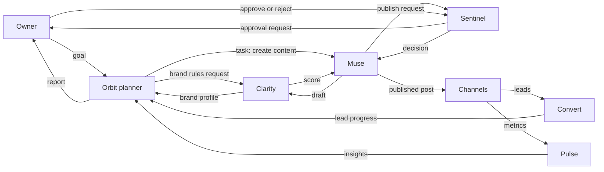
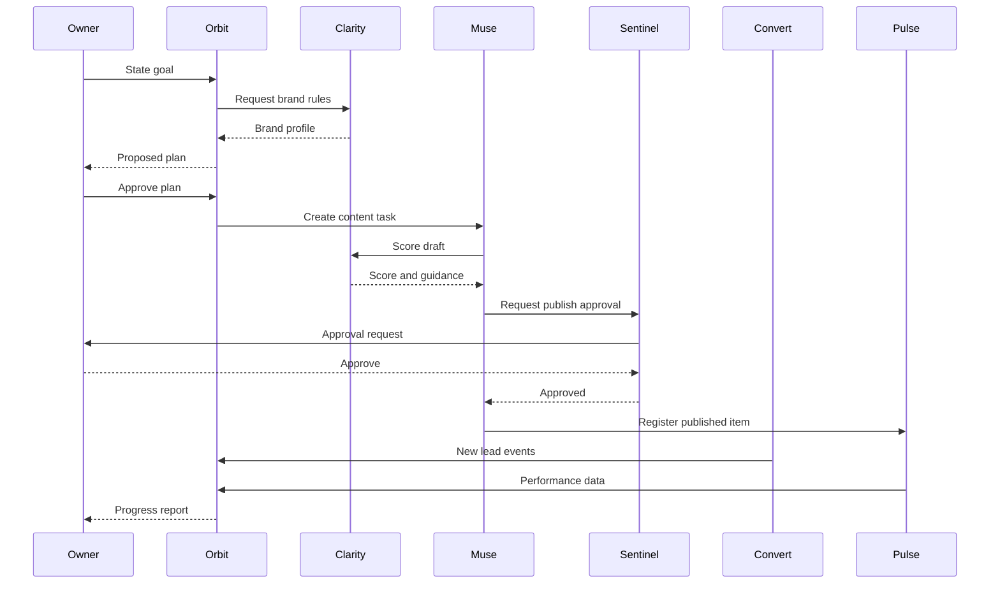
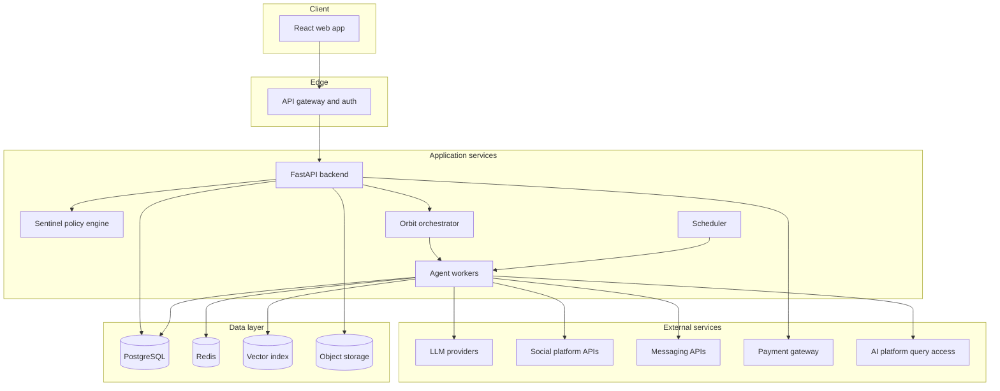
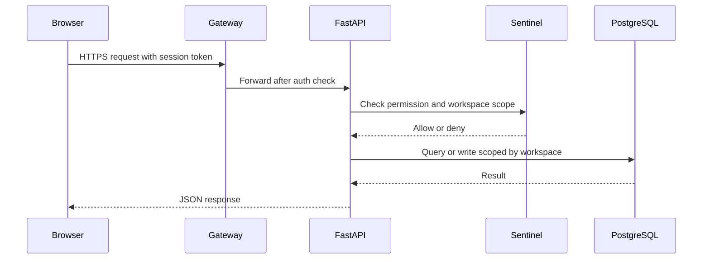
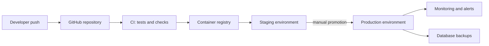
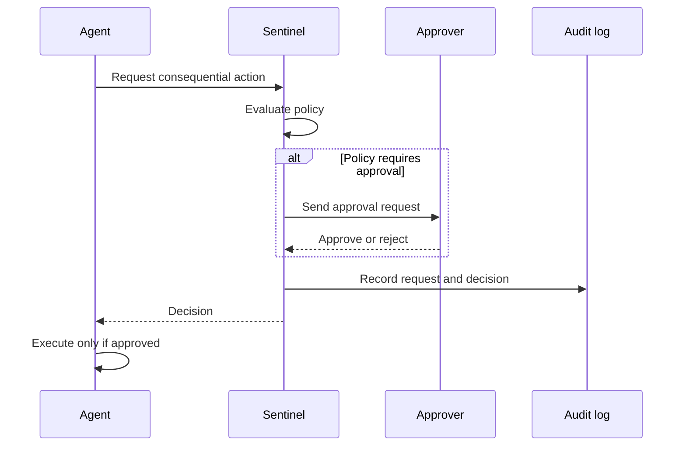
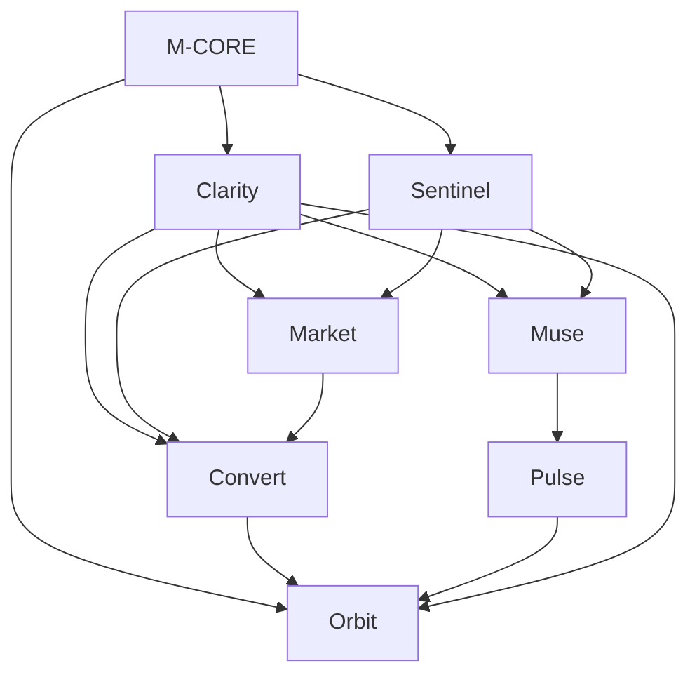

# VISTARO — AI MASTER CONTEXT

```yaml
document: STARTUP_AI_MASTER_CONTEXT.md
audience: AI systems and coding agents (Claude, ChatGPT, Cursor, Copilot, future agents)
document_version: 1.1
generated_on: 2026-10-17
revised_on: 2026-10-18
revision_note: architecture and tech stack finalized under founder delegation; see docs/ARCHITECTURE.md
startup: Vistaro
companion_document: STARTUP_MASTER_BLUEPRINT.md
```

## 0. READ THIS FIRST

### 0.1 Status labels used throughout

| Label | Meaning |
|---|---|
| `CONFIRMED` | The founder explicitly stated or chose it. |
| `IMPLEMENTED` | Exists as working code. **Nothing is currently marked IMPLEMENTED** because no repository or build evidence has been provided. |
| `IN PROGRESS` | Actively being built (no evidence provided for any item). |
| `PLANNED` | Intended to be built; scope stated by the founder or in the founder's feature spec. |
| `PROPOSED` | Suggested by an AI assistant in conversation and **not** confirmed by the founder. |
| `ASSUMPTION` | Believed true, not verified. |
| `NEEDS VALIDATION` | Must be tested with real users, data, or sources before relying on it. |
| `UNKNOWN` | No information available. Do not guess. |
| `DEPRECATED` | Superseded by a later decision. |

### 0.2 Source basis and limits of this document

This document was built from only two sources:

1. **The conversation** in which the founder shared a 7-item agent feature list, then requested a problem statement, brand names, a "challenges" write-up, a technology list, a logo prompt, taglines, a SEVA 2026 submission pack, a CRM feature explanation, and finally these master documents.
2. **Stored project notes** about Vistaro, which summarize a founder-authored document called the *"Vistaro Product Features & Functional Responsibilities Report"*.

**Limits (do not overlook):**
- The full text of the *Product Features & Functional Responsibilities Report* was **not available** when this document was written. Only a short summary in project notes was available. Where this document describes module scope in detail, the detail comes from the conversation's 7-item feature list and is **not** guaranteed to match the report. Re-reconcile against the report when available.
- No repository, code, database, deployment, customer, revenue, survey, or interview data was provided. Everything about implementation is `UNKNOWN`.
- No market research was performed in producing this document. Market statements are limited to founder-provided references (see §3.5) and are `NEEDS VALIDATION`.

### 0.3 Known contradiction (module naming) — flagged, not silently resolved

The conversation used one set of product names; the later stored project notes use another. The later notes are more recent, so they are treated as **canonical**, but the mapping between old and new names is an **inference** by the assistant, marked `NEEDS VALIDATION` with the founders.

| Canonical name (later, stored notes) | Earlier name (this conversation) | Mapping status |
|---|---|---|
| **Orbit** | Orbit | Same name. `CONFIRMED` |
| **Clarity** (brand intelligence / auditing) | Lens | Inferred: same role. `NEEDS VALIDATION` |
| **Muse** (content creation / publishing) | Dream | Inferred: same role. `NEEDS VALIDATION` |
| **Convert** (lead management / CRM) | Lead Master | Inferred: same role. `NEEDS VALIDATION` |
| **Market** (e-commerce / store operations) | Store Manager | Inferred: same role. `NEEDS VALIDATION` |
| **Pulse** (social listening / performance intelligence) | Engagement Tracking | Inferred: overlapping role. `NEEDS VALIDATION` |
| **Sentinel** (governance / permissions / approvals / audit) | *(no earlier module; approval gates were mentioned inside Orbit)* | New in stored notes. `CONFIRMED` as existing in the spec |

Also: product names still need trademark and domain checks (stated in the spec summary). Always use canonical names in new work and mention the earlier name only for traceability.

---

## 1. STARTUP IDENTITY AND CORE CONTEXT

### 1.1 Identity table

| Field | Value | Status |
|---|---|---|
| Startup / brand name | **Vistaro** | `CONFIRMED` (founder selected it from candidate names) |
| Name origin | Coined word, built from Hindi *vistar* (expansion) plus an English-style ending | Etymology proposed by assistant, adopted by choice. `CONFIRMED` as chosen; etymology is `PROPOSED` |
| Tagline | None selected. Several options were generated (see §2.4). | `UNKNOWN` (open decision) |
| Logo | Image-generation prompt drafted ("V" formed from two curved orbit lines with a rising dot; indigo / violet with orange accent). No final logo exists. | `PROPOSED` |
| Trademark / domain availability | Not checked | `NEEDS VALIDATION` |
| Industry / domain | AI software for small-business marketing, sales, commerce and operations | `CONFIRMED` (scope stated by founder) |
| Business category | B2B SaaS, agentic AI | `ASSUMPTION` |
| Platform description | "Agentic AI business management platform" of 7 products | `CONFIRMED` (stored notes) |
| Target market | Small and mid-sized businesses; India emphasis (WhatsApp channel idea, Hindi-English content idea) | Segment breadth `CONFIRMED`; India-first focus `PROPOSED`; exact first niche `UNKNOWN` |
| Stage | Idea / pre-build. Entering DTU SEVA 2026 ideation round (Stage 1, Screen-1). | `CONFIRMED` |
| Implementation status | `UNKNOWN`. No evidence of any built component. | `UNKNOWN` |

### 1.2 Team and organizational context

| Item | Value | Status |
|---|---|---|
| Competition team name | Midnight Slayers | `CONFIRMED` |
| Competition | DTU SEVA 2026 (Seva First Innovation Challenge), Stage 1 Screen-1, Diploma & Higher Education track, Category II | `CONFIRMED` |
| Team size | 2 members | `CONFIRMED` (stored notes) |
| Member 1 | Anushka Varshney. 3rd-year B.Tech IT, IGDTUW. Frontend and platform lead. | `CONFIRMED` |
| Member 2 | Dimple. 3rd-year B.Tech IT, IGDTUW. AI and backend lead. | `CONFIRMED` |
| Other roles (product, design, marketing, ops, legal, finance) | Not filled | `UNKNOWN` |
| Mentor | Not identified | `UNKNOWN` |
| Legal entity / funding / incorporation | Not discussed | `UNKNOWN` |

Note: an earlier draft in this conversation suggested a five-role split for the SEVA team. That suggestion is `DEPRECATED` because the team has two members.

### 1.3 Descriptions

**One-line pitch (`PROPOSED`):** Vistaro is an AI growth platform where a business owner states a goal and coordinated agents plan and execute marketing, lead follow-up and operations, with human approval on anything consequential.

**Elevator pitch (`PROPOSED`):** Small businesses run marketing, sales and operations through disconnected tools, so the owner becomes the integration layer. Vistaro replaces that with one system. The owner states a goal, such as "get 50 qualified leads this month." Orbit, the orchestration layer, plans the work and delegates to specialized products: Clarity keeps the brand consistent and measures AI-platform visibility, Muse creates and publishes content, Convert manages and nurtures leads, Market runs the store, and Pulse measures performance. Sentinel enforces permissions and approval gates so nothing public or financial happens without the owner's consent.

**Detailed product definition:** see §4.

### 1.4 Core differentiation (all `PROPOSED` positioning; `NEEDS VALIDATION`)

1. One shared brand context used by every agent.
2. Goal-to-execution orchestration instead of task-by-task tools.
3. Per-platform AI-visibility tracking aimed at small businesses.
4. Approval gates and audit enforced centrally (Sentinel) so autonomy stays controllable.
5. Fit for Indian small businesses (WhatsApp, Hindi-English content). Not yet validated.

---

## 2. COMPLETE STARTUP HISTORY AND DECISION LOG

### 2.1 Evolution of the idea

| Step | What happened | Source |
|---|---|---|
| H-01 | Founder supplied a 7-item list of agent features, with five existing products named Lens, Dream, Lead Master, Engagement Tracking and Store Manager, plus Orbit as the umbrella. Items cited external references. | Conversation |
| H-02 | Founder asked for the problem the features solve. A problem statement was drafted, then trimmed to under 1,000 characters on request. | Conversation |
| H-03 | Founder requested unique brand names across several rounds (generic, stylish, Hindi-English). Vistaro was chosen. | Conversation |
| H-04 | A hackathon "challenges we ran into" write-up was drafted. It was **explicitly illustrative** and not based on real build events. | Conversation |
| H-05 | A "Built with" technology list was drafted. It was **proposed**, not the actual stack. | Conversation |
| H-06 | A logo prompt and multiple tagline sets were generated. None selected. | Conversation |
| H-07 | SEVA 2026 Screen-1 requirements were shared. A full 12-point dossier draft was produced with `[bracket]` gaps for real data. | Conversation |
| H-08 | CRM scope was explained in terms of Convert (earlier "Lead Master") features. | Conversation |
| H-09 | Stored notes show the product set was restated with new names (Clarity, Muse, Convert, Market, Sentinel, Pulse, Orbit) from the *Product Features & Functional Responsibilities Report*, with a four-phase build plan. | Stored notes |
| H-10 | This document was requested as the consolidated source of truth. | Conversation |

### 2.2 Features: accepted, rejected, deferred

| Item | Disposition | Notes |
|---|---|---|
| Seven agent features (AG-01 to AG-07, see §5) | **Accepted.** Founder stated "these will be the features of our startup project." | `CONFIRMED` |
| Seven-product ecosystem (Orbit, Clarity, Muse, Convert, Market, Sentinel, Pulse) | **Accepted** as the feature spec | `CONFIRMED` |
| WhatsApp as a communication channel | Raised as a suggestion, "not from the research" | `PROPOSED` |
| Hindi-English content and taglines | Explored in naming and tagline rounds only | `PROPOSED` |
| Any feature explicitly rejected | None recorded | `UNKNOWN` |
| Any feature explicitly deferred | Spec phases 2 to 4 defer later items (see §10), but individual deferral choices are not recorded | `PLANNED` |

### 2.3 Superseded or changed items

| Earlier | Later | Handling |
|---|---|---|
| Module names Lens, Dream, Lead Master, Store Manager, Engagement Tracking | Clarity, Muse, Convert, Market, Pulse (plus Sentinel) | Later names canonical. Mapping needs founder confirmation (§0.3). |
| Five suggested SEVA roles | Team of two (Anushka, Dimple) | Earlier role split `DEPRECATED`. |
| "Approval gates for public actions" as a rule inside Orbit | Sentinel as a dedicated governance product | Approval logic now belongs to Sentinel. Orbit consumes it. |

### 2.4 Branding artifacts generated (none finalized)

Tagline candidates generated, none chosen: "Set the goal. We handle the rest."; "Your growth team, always on."; "Goal aapka, growth hamara."; "Business ka vistar, ab automatic."; "Grow without the grind." The tagline is an **open decision** (OQ-04).

### 2.5 Constraints and non-negotiables

| ID | Constraint | Source | Status |
|---|---|---|---|
| C-01 | Consequential actions (publishing, outbound communication, financial) require configurable approval checks | Spec summary | `CONFIRMED` |
| C-02 | Orbit coordinates modules without replacing them | Spec summary | `CONFIRMED` |
| C-03 | Each product owns its own domain data and workflows | Spec summary | `CONFIRMED` |
| C-04 | Sentinel enforces permissions and approvals across the whole ecosystem | Spec summary | `CONFIRMED` |
| C-05 | Never fabricate market data, customers, metrics, or implementation progress | Founder instruction in the documentation request | `CONFIRMED` |
| C-06 | The founder prefers to validate her own code rather than receive wholesale replacement solutions | Founder preference | `CONFIRMED` — coding agents should propose focused changes and explain them, and avoid rewriting large areas unprompted |
| C-07 | Product names need trademark and domain checks | Spec summary | `CONFIRMED` |

### 2.6 Decision log

| ID | Decision | Rationale | Status | Implications |
|---|---|---|---|---|
| D-001 | Brand name is **Vistaro** | Short, easy to pronounce, Hindi meaning of expansion | `CONFIRMED` | Run trademark, domain, handle checks (OQ-01) |
| D-002 | Build the seven agent capabilities in §5 | Founder stated they are the project's features | `CONFIRMED` | Defines scope ceiling |
| D-003 | Product ecosystem = Orbit + Clarity + Muse + Convert + Market + Sentinel + Pulse | Founder's feature report | `CONFIRMED` | Canonical names |
| D-004 | Human approval required for public, outbound, and financial actions | Safety and trust | `CONFIRMED` | Sentinel is on the critical path of every action-taking agent |
| D-005 | Phase plan: P1 core platform; P2 Market, Pulse, Sentinel approvals/audit; P3 goal-driven orchestration and shared memory; P4 advanced automation | Spec summary | `CONFIRMED` | See §10 for reconciliation with the SEVA 75-day window |
| D-006 | Enter DTU SEVA 2026 Stage 1 as team Midnight Slayers | Founder's action | `CONFIRMED` | Needs deck and 12-point dossier |
| D-007 | Technology stack | Not decided in conversation | `UNKNOWN` | A proposed stack exists in §6 |
| D-008 | Pricing | Not decided | `UNKNOWN` | Hypotheses in §9 only |
| D-009 | First target niche | Not decided | `UNKNOWN` | Needs interviews |
| D-010 | Tagline | Not decided | `UNKNOWN` | Candidates in §2.4 |
| D-011 | Old-to-new module name mapping | Inferred by assistant | `NEEDS VALIDATION` | See §0.3 |
| D-012 | **Architecture and tech stack finalized** as the ADR register in `docs/ARCHITECTURE.md` (modular monolith; Python/FastAPI; React/TypeScript/Vite; PostgreSQL only with RLS; Celery+Redis; own session auth; custom planner-executor; provider-agnostic LLM layer; Cloudflare Pages + Render + R2; GitHub Actions) | Founders delegated the decision to Claude on 2026-10-18 | `CONFIRMED` (by delegation; founders may change via the CLAUDE.md §9 process) | Supersedes §6.2 proposals. MongoDB is not used. Embeddings deferred to Phase 3 |
| D-013 | Minimal approval step ships in Phase 1 (resolves OQ-07) | Constraint C-01 requires approvals for public actions | `CONFIRMED` (by delegation) | `SEN-001` is P0 and blocks publishing |
| D-014 | Competitor monitoring lives in Pulse (resolves OQ-06) | Matches Pulse's listening and performance role | `CONFIRMED` (by delegation) | `PUL-005`, feeds Clarity and Muse via services |
| D-015 | LLM: provider-agnostic interface with Anthropic default; model names chosen after evaluation (`DEC-002`) | Swappable, evaluation before commitment | `CONFIRMED` as default; model names `UNKNOWN` | Disclosed conflict of interest in ARCHITECTURE.md |
| D-016 | Full roadmap with task IDs, acceptance criteria and phases 0 to 5 is in `docs/PROJECT_ROADMAP.md` | Founders asked for a final roadmap | `CONFIRMED` (by delegation) | This document's §10 is a summary; the roadmap file is authoritative for tasks |

### 2.7 Open questions

See the complete register in §15.6.

---

## 3. PROBLEM DEFINITION AND MARKET OPPORTUNITY

### 3.1 Problem statement (founder-approved draft, `CONFIRMED` as the working statement)

Small businesses run marketing, sales and operations by hand across disconnected tools. Content tools, spreadsheets, storefronts, analytics and support inboxes do not talk to each other, so the owner becomes the integration layer. Brand voice drifts, leads go cold without timely follow-up, and analytics explain the past but trigger no action. Separately, customers increasingly discover brands through AI assistants and AI search, yet most businesses cannot see whether they are mentioned or why competitors are recommended instead.

### 3.2 Problem inventory

| ID | Problem | Root cause | Who is affected | Addressed by |
|---|---|---|---|---|
| P-01 | No visibility into how AI platforms represent the brand | AI answers differ by platform and run; no accessible measurement tools for small businesses | Small-business owners, marketers | AG-01, Clarity |
| P-02 | No single owner for outcomes | Tools execute tasks; none turns a goal into a plan and execution | Owners with no marketing team | AG-02, Orbit |
| P-03 | Decisions are made after the fact | Analytics are descriptive; testing is manual | Owners, marketers | AG-03, Pulse |
| P-04 | Leads are scored but not converted | Follow-up is manual, slow, generic | Owners, sales staff | AG-04, Convert |
| P-05 | Slow, off-brand customer support | No shared brand voice and live store data | Owners, customers | AG-05, Market and Convert |
| P-06 | Blind spots on competitors and the market | No time or tooling to monitor | Owners | AG-06, Pulse (mapping proposed) |
| P-07 | Operational overhead | Inventory, invoicing, reminders handled manually | Owners | AG-07, Orbit |
| P-08 | Brand inconsistency across channels | Brand rules live in the owner's head | Owners, any staff or freelancers | Clarity |
| P-09 | Risk of delegating to AI | Owners fear unauthorized public or financial actions | Owners | Sentinel |

### 3.3 Why it matters (`ASSUMPTION`, `NEEDS VALIDATION`)

Owner time is the scarcest resource in a small business; every hour spent operating tools is an hour not spent on product and customers. This claim has **not** been validated with data from real owners.

### 3.4 Current alternatives (illustrative, from general knowledge, not researched in this session)

| Category | Examples | Limitation relative to Vistaro's proposition |
|---|---|---|
| Content creation and scheduling | Canva, Buffer, Hootsuite | Not tied to a goal plan or brand rules across modules |
| CRM | HubSpot, Zoho | Store and score leads; follow-up largely manual; heavy for tiny shops |
| Store builders | Shopify and similar | Not connected to marketing or lead workflows |
| Chatbots | Tidio and similar | Generic unless fed brand voice and live data |
| AI-visibility tools | Enterprise SEO suites | Cost and complexity not suited to small businesses (`NEEDS VALIDATION`) |

These claims about competitors are **not verified** and must be researched before external use.

### 3.5 Founder-provided references (not independently verified)

| Ref | Claimed content | Used for |
|---|---|---|
| arXiv 2606.20065 | Research indicating AI brand visibility can be measured and differs by platform | AG-01 justification |
| interviewkickstart.com agentic-AI-for-marketing article | Agentic platforms already design, run and analyze experiments; Marketo-style adaptive lead nurturing | AG-03, AG-04 justification |
| tech4ssd.beehiiv.com article | Tools like Tidio described as virtual team members | AG-05 justification |

### 3.6 Market opportunity

No quantified market size, growth rate, or willingness-to-pay data exists. Status: `UNKNOWN`. Do not state any figure without a cited, dated source.

### 3.7 Jobs to be done (`PROPOSED`)

- "Help me get a measurable number of customers this month without hiring a marketing team."
- "Keep everything I post and say sounding like my brand."
- "Make sure no enquiry is left unanswered."
- "Tell me how I appear when customers ask AI tools for recommendations."
- "Do routine admin so I can focus on the product."
- "Never let software post or message customers without my say."

### 3.8 Assumptions requiring validation

| ID | Assumption |
|---|---|
| A-01 | Owners experience tool fragmentation as a top pain |
| A-02 | Owners will trust agents to draft and execute with approval gates |
| A-03 | AI-visibility is a pain owners recognize and will pay to track |
| A-04 | WhatsApp is the dominant follow-up channel for the target segment |
| A-05 | Reliable, legal programmatic access to AI-platform answers exists for visibility tracking |
| A-06 | Owners will pay a recurring fee for the combined product |
| A-07 | A small team can deliver a convincing end-to-end slice quickly |

---

## 4. PRODUCT AND SOLUTION SPECIFICATION

### 4.1 Overall solution

An agentic platform with a central workspace (Orbit) and six domain products. The owner sets goals and approves actions; agents plan and execute across the domain products using a shared brand context and shared memory; Sentinel governs every consequential action.

### 4.2 Product principles (`PROPOSED`, consistent with confirmed constraints)

1. **Owner stays in control:** approvals on consequential actions (C-01).
2. **Brand-first:** every generated output is checked against the brand profile.
3. **Orchestrate, don't replace:** Orbit coordinates; domain products own their data (C-02, C-03).
4. **Deterministic where possible:** use code for scheduling, state, permissions, and arithmetic; use AI for language, judgement, and planning (see §5.8).
5. **Explainable:** every agent action records what it did and why.
6. **Honest scope:** uncertain AI outputs are flagged or escalated, never presented as fact.

### 4.3 Modules and relationships

| Module ID | Canonical name | Domain | Earlier name | Owns (data) |
|---|---|---|---|---|
| M-CORE | Core platform | Auth, workspaces, integrations framework, basic RBAC, agent task runtime | n/a | Users, workspaces, connections |
| M-ORB | Orbit | Orchestration, central workspace, goals, business ops | Orbit | Goals, plans, tasks, shared memory |
| M-CLA | Clarity | Brand intelligence and auditing, AI visibility | Lens | Brand profiles, scores, visibility checks |
| M-MUS | Muse | Content creation and publishing | Dream | Content items, schedules |
| M-CON | Convert | Lead management and CRM | Lead Master | Leads, contacts, conversations, pipeline |
| M-MKT | Market | E-commerce and store operations | Store Manager | Products, inventory, orders |
| M-SEN | Sentinel | Governance, permissions, approvals, audit | (new) | Roles, policies, approvals, audit logs |
| M-PUL | Pulse | Social listening and performance intelligence | Engagement Tracking | Metrics, experiments, competitor observations |

**Relationships (`PLANNED`):**
- Orbit → all modules: delegates tasks and reads results.
- Clarity → Muse, Convert, Market (support): supplies brand rules and scoring.
- Muse → Clarity: submits content for scoring before approval.
- Muse → Pulse: publishes content; Pulse measures it.
- Pulse → Muse and Orbit: sends insights and recommendations.
- Convert ↔ Market: link leads to orders; purchase updates lead status.
- Convert and Market → customer support agent: shared conversation and product data.
- Sentinel → every module: permission and approval checks, audit logging.

### 4.4 Feature inventory with specifications

All features below are `PLANNED` unless stated. Inputs, processing and outputs are **proposed designs**, not implemented behavior. IDs are stable.

#### M-CORE

| ID | Feature | Inputs | Processing | Outputs |
|---|---|---|---|---|
| F-CORE-01 | Authentication and accounts | Email or social identity | Verify identity, create session | Authenticated user session |
| F-CORE-02 | Workspaces | Business profile data | Create tenant boundary, assign owner | Isolated workspace |
| F-CORE-03 | Integrations framework | OAuth or API credentials per provider | Store credentials securely, expose a uniform connector interface | Connected accounts available to agents |
| F-CORE-04 | Basic RBAC | User, role, resource | Evaluate permission | Allow or deny |
| F-CORE-05 | Agent task execution runtime | Task definition, tools, context | Run agent steps with retries, limits, logging | Task result, trace |

#### M-ORB Orbit

| ID | Feature | Inputs | Processing | Outputs |
|---|---|---|---|---|
| F-ORB-01 | Goal intake and planning (AG-02) | Natural-language goal, constraints, deadline | Decompose into typed steps, request brand rules from Clarity | Reviewable plan |
| F-ORB-02 | Cross-module delegation | Approved plan | Dispatch steps to Muse, Convert, Pulse, Market; track state; handle failures | Executed steps, status |
| F-ORB-03 | Central workspace dashboard | Data from all modules | Aggregate | Single view of goals, tasks, approvals, results |
| F-ORB-04 | Weekly "state of the business" summary (AG-07) | Store, lead and engagement data | Aggregate, narrate | Weekly report |
| F-ORB-05 | Business ops alerts (AG-07) | Inventory levels, invoices, payment status | Rule-based triggers with AI-written messages | Reorder alerts, payment reminders |
| F-ORB-06 | Shared memory | Outcomes, preferences, past decisions | Store and retrieve context | Context for future plans (spec Phase 3) |

#### M-CLA Clarity

| ID | Feature | Inputs | Processing | Outputs |
|---|---|---|---|---|
| F-CLA-01 | Brand profile | Owner answers, sample content, uploads | Structure into tone, audience, banned words, examples | Brand profile record |
| F-CLA-02 | Brand consistency scoring and audit | Any draft or live content | Compare against the profile | Score and rewrite guidance |
| F-CLA-03 | AI-visibility tracking (AG-01) | Brand, competitors, query set | Run queries per platform (ChatGPT, Gemini, Perplexity, Google AI Overviews), repeat runs, parse mentions | Per-platform mention rate and sentiment vs competitors |
| F-CLA-04 | Content-fix recommendations (AG-01) | Visibility results | Identify gaps | Prioritized fix list |

#### M-MUS Muse

| ID | Feature | Inputs | Processing | Outputs |
|---|---|---|---|---|
| F-MUS-01 | On-brand content generation | Goal, brand profile, product data | Generate drafts, self-check with Clarity | Drafts |
| F-MUS-02 | Auto-generated visibility fixes | F-CLA-04 output | Generate pages, FAQs, posts addressing gaps | Fix drafts |
| F-MUS-03 | Scheduling and publishing | Approved content, channel connections | Schedule and publish via connectors | Published posts |
| F-MUS-04 | Approval-gated publishing | Draft | Route through Sentinel | Publish only after approval |

#### M-CON Convert

| ID | Feature | Inputs | Processing | Outputs |
|---|---|---|---|---|
| F-CON-01 | Lead capture and unified inbox | Forms, DMs, WhatsApp, storefront, campaigns | Normalize and tag source | Single lead inbox |
| F-CON-02 | Lead scoring | Lead behavior and attributes | Score (rules plus model, hybrid proposed) | Hot, warm, cold ranking |
| F-CON-03 | Contact profiles and pipeline | Lead and conversation data | Maintain stages | Pipeline view |
| F-CON-04 | Lead nurture and follow-up (AG-04) | Lead state, brand profile | Draft personalized follow-ups, route via Sentinel | Sent or pending messages |
| F-CON-05 | Reply handling | Incoming customer messages | Classify, answer common questions, escalate others | Responses or escalations |
| F-CON-06 | Call and meeting booking | Calendar availability | Propose slots, confirm | Booked events |
| F-CON-07 | Cold-lead re-engagement | Inactive leads | Time-based triggers, tailored nudges | Re-engagement messages |
| F-CON-08 | WhatsApp channel | Business API connection | Send and receive via the API | Messages (`PROPOSED`) |

#### M-MKT Market

| ID | Feature | Inputs | Processing | Outputs |
|---|---|---|---|---|
| F-MKT-01 | Catalog and order management | Product and order data | CRUD, status tracking | Storefront data |
| F-MKT-02 | Inventory management | Stock levels | Track, threshold alerts | Reorder alerts (to Orbit) |
| F-MKT-03 | Customer support agent (AG-05) | Customer query, product, order, FAQ data, brand profile | Retrieve then answer, or hand off | Grounded answers or escalation |

#### M-SEN Sentinel

| ID | Feature | Inputs | Processing | Outputs |
|---|---|---|---|---|
| F-SEN-01 | Permissions | Role, action, resource | Policy evaluation | Allow or deny |
| F-SEN-02 | Configurable approval workflows | Action request plus policy | Route to approver, wait, record decision | Approved or rejected action |
| F-SEN-03 | Audit log | Every consequential event | Append-only record | Reviewable history |

#### M-PUL Pulse

| ID | Feature | Inputs | Processing | Outputs |
|---|---|---|---|---|
| F-PUL-01 | Engagement tracking | Platform metrics | Collect, aggregate | Performance views |
| F-PUL-02 | Forecasting (AG-03) | Historical metrics, planned content | Predict reach and conversion before posting | Forecasts with uncertainty |
| F-PUL-03 | Automated experiments (AG-03) | Hypotheses on hooks and timing | Run A/B tests and analyze | Winning variants |
| F-PUL-04 | Anomaly detection (AG-03) | Metric streams | Flag deviations, suggest actions | Alerts |
| F-PUL-05 | Competitor and market watch (AG-06) | Competitor posts, pricing, campaigns | Monitor and summarize | Insights to Clarity and Muse (module placement `PROPOSED`) |

### 4.5 User journeys

**J-01 Onboarding (`PROPOSED`)**
1. Owner signs up (F-CORE-01) and creates a workspace (F-CORE-02).
2. Owner connects channels (F-CORE-03).
3. Clarity interviews owner and ingests samples to build the brand profile (F-CLA-01).
4. Owner reviews and approves the profile.
5. Orbit dashboard shows readiness and suggests a first goal.

**J-02 Goal execution (core flow, `PROPOSED`)**
1. Owner states a goal (F-ORB-01).
2. Orbit asks Clarity for brand rules and drafts a plan.
3. Owner approves the plan.
4. Muse generates on-brand content, Clarity scores it (F-MUS-01, F-CLA-02).
5. Sentinel routes public items for approval (F-SEN-02).
6. Muse publishes approved items (F-MUS-03).
7. Convert captures leads and nurtures them (F-CON-01 to F-CON-04).
8. Pulse measures results (F-PUL-01).
9. Orbit reports progress against the goal (F-ORB-04).

**J-03 AI-visibility improvement (`PROPOSED`)**
1. Owner enters brand, competitors, key customer questions.
2. Clarity runs repeated per-platform checks (F-CLA-03).
3. Clarity produces a gap analysis and fix list (F-CLA-04).
4. Muse drafts fixes (F-MUS-02); owner approves; Muse publishes.
5. Clarity re-measures and reports the change.

**J-04 Customer enquiry (`PROPOSED`)**
1. Customer asks a question through the storefront or WhatsApp.
2. Support agent retrieves product and order data (F-MKT-03).
3. If grounded, it replies in brand voice; if not, it escalates to the owner.
4. Conversation is stored in Convert; lead status updates.

### 4.6 Edge cases to handle (`PROPOSED`)

- Brand profile missing or thin: block autonomous generation, ask for more input.
- Approver unavailable: escalate, expire, or hold per policy; never auto-approve.
- Platform API failure or rate limit: retry with backoff, then surface the failure; do not silently skip.
- Conflicting actions (two plans posting at the same time): Orbit resolves scheduling conflicts before dispatch.
- Customer asks something outside store data: hand off, never invent.
- Visibility results vary run to run: report rates with sample sizes, not single answers.
- Duplicate leads across channels: merge on identity keys with human review of ambiguous merges.
- Revoked integration credentials: pause dependent tasks and notify.

### 4.7 Dependencies between modules

| Dependent | Requires |
|---|---|
| Muse | Clarity (brand profile), Sentinel (approvals), integrations framework |
| Convert follow-ups | Clarity, Sentinel, messaging connectors |
| Orbit planning | Clarity at minimum; all modules for full coverage |
| Pulse experiments | Muse (publishing), platform metrics access |
| Market support agent | Market data, Clarity |
| Everything | M-CORE |

### 4.8 MVP versus later (`PROPOSED`; Phase labels from the confirmed spec)

| Scope | Contents |
|---|---|
| **Spec Phase 1 (`CONFIRMED`)** | Auth, workspaces, integrations framework, basic RBAC, agent task execution, initial Orbit dashboard, initial Clarity, Muse, Convert |
| **Proposed prototype slice for the 75-day SEVA window** | Goal → plan → brand-aware content → approval → lead capture → drafted follow-up → progress report (see §10) |
| **Spec Phase 2 (`CONFIRMED`)** | Market, Pulse, Sentinel approvals and audit |
| **Spec Phase 3 (`CONFIRMED`)** | Goal-driven orchestration and shared memory |
| **Spec Phase 4 (`CONFIRMED`)** | Advanced automation |

Observation: the spec places Sentinel approvals in Phase 2, but constraint C-01 requires approvals for consequential actions. Therefore any Phase 1 or prototype that publishes or sends anything must include at least a minimal approval step. See open question OQ-07.

### 4.9 Explicit exclusions

None have been confirmed. The following are `PROPOSED` exclusions for the first release: autonomous publishing without approval; processing payments directly; advertising-spend management; multi-language beyond English and Hindi-English; mobile native apps.

---
## 5. AI AND AGENT ARCHITECTURE

**Implementation status of everything in this section: `PLANNED` or `PROPOSED`. Nothing is confirmed built.** Models, prompts, frameworks and thresholds below are design proposals.

### 5.1 Agent inventory

| ID | Agent | Home module | Purpose | Status |
|---|---|---|---|---|
| AG-01 | AI Visibility Agent | Clarity | Measure whether and how AI platforms mention the brand versus competitors; recommend content fixes | `PLANNED` |
| AG-02 | Autopilot / Goal Agent | Orbit | Turn an owner goal into a plan and coordinate execution across modules | `PLANNED` |
| AG-03 | Predictive and Experiment Agent | Pulse | Forecast reach and conversions, run A/B tests on hooks and timing, flag anomalies with suggested actions | `PLANNED` |
| AG-04 | Lead Nurture and Follow-up Agent | Convert | Personalized follow-ups, reply handling, call booking, cold-lead re-engagement | `PLANNED` |
| AG-05 | Customer Support Agent | Market and Convert | Answer product, order and FAQ queries in brand voice | `PLANNED` |
| AG-06 | Competitor and Market Watch Agent | Pulse (`PROPOSED` placement) | Monitor competitor posts, pricing and campaigns; feed insights into brand scoring and content ideas | `PLANNED` |
| AG-07 | Business Ops Agent | Orbit | Inventory reorder alerts, invoice and payment reminders, weekly business summary | `PLANNED` |

### 5.2 Per-agent boundaries

| Agent | Inputs | Outputs | Tools (proposed) | Must never |
|---|---|---|---|---|
| AG-01 | Brand, competitor list, query set | Mention rates per platform, gap analysis, fix list | Platform query connectors, parser, Clarity store | Report a single run as a stable result; scrape in violation of platform terms |
| AG-02 | Goal text, constraints, brand rules, module capabilities | Plan, task graph, status, final report | Task dispatcher, module APIs, shared memory | Execute public or financial steps without approval |
| AG-03 | Metrics history, planned content | Forecasts with intervals, experiment results, anomaly alerts | Metrics store, stats library, scheduler | Present forecasts as guarantees |
| AG-04 | Lead record, history, brand profile, calendar | Drafted or sent messages, bookings | Messaging connectors, calendar, Convert store | Send without policy-required approval; contact leads who opted out |
| AG-05 | Customer query, product and order data | Grounded answer or escalation | Retrieval over Market data, Convert history | Invent product details, prices, delivery promises |
| AG-06 | Competitor sources | Summaries, change alerts | Public-source monitors | Access private data or violate terms |
| AG-07 | Inventory, invoice, payment, engagement data | Alerts, reminders, weekly summary | Market, Convert, Pulse reads | Move money or change financial records |

### 5.3 Orchestration model (`PROPOSED`)

Orbit uses a **planner-executor** pattern rather than free-form agent chat:

1. Planner produces an explicit step list with typed inputs and outputs.
2. Each step is executed once by the owning module's agent with a retry cap.
3. State lives in a single task store, not in agent conversations.
4. A step limit and timeout prevent runaway loops.
5. Anything consequential is paused until Sentinel returns an approval.

Rationale: agent-to-agent free-form coordination commonly causes loops and conflicting actions. This rationale is a design argument, not an observed project incident.

### 5.4 Models, prompts, retrieval, memory (`UNKNOWN` / `PROPOSED`)

| Concern | State |
|---|---|
| LLM provider(s) and model names | `UNKNOWN`. Not chosen. Proposed: use a provider-agnostic interface so models can be swapped. |
| Prompts | Not written. Proposed: versioned prompt templates stored in the repository with structured (JSON) outputs validated against schemas. |
| Retrieval | Proposed for Clarity brand rules and Market support answers: retrieval over workspace-scoped documents with a vector or hybrid index. Store choice `UNKNOWN`. |
| Memory | Spec Phase 3 includes "shared memory." Proposed: structured workspace memory (decisions, preferences, outcomes) plus retrieval; scoped per workspace. |
| Context management | Proposed: load only the brand profile slice and task context an agent needs; never mix data across workspaces. |

### 5.5 Data flow



### 5.6 Agent interaction sequence (goal execution)



### 5.7 Human-in-the-loop, failure handling, fallbacks (`PROPOSED`, consistent with C-01)

| Situation | Handling |
|---|---|
| Action is public, outbound, or financial | Sentinel approval required (C-01). Default policy: owner approval. |
| Low brand score | Auto-rewrite up to a cap; then ask the owner. |
| Model output fails schema validation | Retry with error feedback; on repeated failure, mark the task failed and notify. |
| Low confidence or ungrounded answer (support) | Escalate to owner; do not answer. |
| Tool or API failure | Exponential backoff, capped retries, visible error state. |
| Approval timeout | Remain pending or expire per policy; never auto-approve. |
| Suspected prompt injection in inbound customer text | Treat inbound content as data, never as instructions; restrict tool access for reply-handling agents. |

Confidence thresholds: `UNKNOWN`. Values must be set empirically after evaluation.

### 5.8 Deterministic versus AI-driven

| Deterministic code | AI-driven |
|---|---|
| Permissions, approvals, state transitions | Plan decomposition |
| Scheduling and time triggers | Content drafting and rewriting |
| Inventory thresholds, arithmetic, reminders' timing | Message personalization, reply drafting |
| Lead deduplication keys, score thresholds | Intent classification, sentiment, summarization |
| Audit logging | Insight narration, recommendations |

### 5.9 Evaluation, observability, cost (`PROPOSED`)

- **Evals:** golden test sets per agent: brand-consistency rating, support groundedness, plan validity, visibility-parser accuracy.
- **Observability:** trace every agent run (inputs, tool calls, outputs, latency, tokens, cost, approver).
- **Cost control:** per-workspace usage budgets, caching of repeated visibility queries, cheaper models for classification, hard limits on steps per goal.
- **Reliability:** idempotent task steps so retries do not duplicate posts or messages.

---

## 6. COMPLETE TECHNICAL ARCHITECTURE

### 6.1 Confirmed versus proposed

| Layer | Confirmed | Proposed (not confirmed) |
|---|---|---|
| Stack and architecture | **Decided 2026-10-18 by delegation: see `docs/ARCHITECTURE.md` (authoritative)** | The table in §6.2 below is the earlier proposal and is **superseded** |
| Founders' general skill set (not a project decision) | Python, React, Node.js, FastAPI, MongoDB, PostgreSQL, PyTorch, Hugging Face, scikit-learn | Used only to suggest a plausible stack |

### 6.2 Earlier proposed stack (SUPERSEDED by `docs/ARCHITECTURE.md`)

> Differences in the final decision: MongoDB is not used (PostgreSQL only); background jobs are Celery + Redis; `pgvector` is deferred to Phase 3; hosting is Cloudflare Pages + Render + Cloudflare R2; integration workers are Python (Celery), not Node.js. If this table and `docs/ARCHITECTURE.md` differ, the architecture file wins.

| Area | Proposal | Rationale |
|---|---|---|
| Frontend | React with TypeScript and Tailwind CSS | Matches stated skills; component reuse across module UIs |
| Backend API | FastAPI (Python) | Matches stated skills; strong fit with AI code |
| Integration workers | Node.js or Python workers | Choose based on connector SDK availability |
| Primary database | PostgreSQL | Relational integrity for tenants, leads, orders, approvals, audit |
| Document or event store | MongoDB (optional) | Only if semi-structured logs prove awkward in Postgres |
| Cache and queue | Redis | Job queue, rate limits, short-lived state |
| Vector retrieval | pgvector or a dedicated vector store | Keep operations simple initially |
| Background jobs | Celery, RQ, or equivalent | Scheduling, retries |
| Object storage | S3-compatible storage | Brand assets, uploads |
| Hosting | Cloud provider `UNKNOWN` | Choose by cost and credits |
| CI/CD | GitHub Actions | Common default |

### 6.3 High-level system architecture



### 6.4 Component responsibilities

| Component | Responsibility |
|---|---|
| React app | UI for workspace, dashboards, approvals, module screens |
| API gateway and auth | Session handling, rate limiting, request routing |
| FastAPI backend | Business endpoints, validation, tenant scoping |
| Sentinel policy engine | Central permission and approval decisions, audit writes |
| Orbit orchestrator | Plan storage, task graph, dispatch, status |
| Agent workers | Run agent steps with tools and retries |
| Scheduler | Time-based triggers (posting, follow-ups, reminders, visibility checks) |
| PostgreSQL | Source of truth for structured data |
| Redis | Queue and ephemeral state |
| Vector index | Retrieval for brand and support context |
| Object storage | Files and media |

### 6.5 Request lifecycle (proposed)



### 6.6 API structure (proposed conventions)

- REST over HTTPS, versioned (`/api/v1/...`), JSON bodies, OpenAPI generated by FastAPI.
- All resources scoped by `workspace_id`; the server derives workspace from the session, never trusts client-supplied scope alone.
- Idempotency keys on any endpoint that triggers external side effects.
- Long operations return a task ID; clients poll or subscribe to status.
- Standard error envelope: `{ "error": { "code": "...", "message": "...", "details": {} } }`.

Illustrative endpoint groups (`PROPOSED`, none implemented):

| Group | Examples |
|---|---|
| Auth | `POST /auth/login`, `POST /auth/logout` |
| Workspaces | `POST /workspaces`, `GET /workspaces/{id}` |
| Goals and plans | `POST /goals`, `GET /goals/{id}/plan`, `POST /goals/{id}/plan/approve` |
| Approvals | `GET /approvals`, `POST /approvals/{id}/decision` |
| Clarity | `GET/PUT /brand-profile`, `POST /visibility/runs`, `GET /visibility/results` |
| Muse | `POST /content/generate`, `POST /content/{id}/schedule` |
| Convert | `GET /leads`, `PATCH /leads/{id}`, `POST /leads/{id}/followups` |
| Market | `GET/POST /products`, `GET /orders`, `POST /support/query` |
| Pulse | `GET /metrics`, `POST /experiments` |

### 6.7 Authentication, authorization, roles (`PROPOSED`)

| Item | Proposal |
|---|---|
| Authentication | Email plus password or OAuth; sessions with short-lived tokens |
| Roles | Owner, Admin, Editor, Approver, Viewer |
| Authorization | RBAC evaluated centrally by Sentinel; resource-level checks scoped to workspace |
| Multi-tenancy | Single database with `workspace_id` on every row and enforced in queries (row-level security recommended) |

### 6.8 Background jobs, queues, events

Scheduled jobs: post publishing, follow-up timers, cold-lead sweeps, visibility re-runs, weekly summary, inventory checks. Events: lead created, order placed, content approved, goal updated. Delivery semantics: at-least-once with idempotent handlers.

### 6.9 Integrations, storage, search

See §8 for integrations. Files go to object storage with workspace-prefixed keys. Retrieval and caching described in §5.4 and §5.9.

### 6.10 Logging, monitoring, error tracking

Structured logs with trace IDs across API, workers and agent runs. Metrics on queue depth, task success rate, latency, model cost. Error tracking tool `UNKNOWN`. Audit logs are separate from operational logs and written by Sentinel.

### 6.11 Deployment architecture



Environments: development, staging, production. Secrets in a managed secret store, never in the repository. Hosting provider, regions, and networking `UNKNOWN`.

### 6.12 Security, privacy, compliance

| Area | Requirement (`PROPOSED`) |
|---|---|
| Transport and storage | TLS in transit; encryption at rest |
| Secrets | Secret manager; rotate integration tokens; encrypt stored OAuth tokens |
| Tenant isolation | Enforced in queries and tests; no cross-workspace retrieval |
| AI safety | Treat inbound content as untrusted; output schema validation; approval gates |
| PII | Minimize collection; retention limits; deletion on request |
| Compliance | India's data protection law and each platform's API terms apply; applicability and requirements `NEEDS VALIDATION` with qualified advice |
| Messaging | Honor opt-in and opt-out; follow channel provider rules |

### 6.13 Scalability, availability, recovery

Start as a modular monolith with workers; separate services only when load demands. Targets for availability and recovery time are `UNKNOWN` (see §13). Daily database backups with restore tests are proposed.

### 6.14 Authentication and approval flow



---

## 7. DATABASE AND DATA MODEL SPECIFICATION

**Entire section is `PROPOSED`. No schema is confirmed.** Types are indicative (PostgreSQL style).

### 7.1 Entities

| Entity | Purpose | Owner module |
|---|---|---|
| `users` | People who sign in | M-CORE |
| `workspaces` | Tenant boundary per business | M-CORE |
| `memberships` | User-to-workspace role | M-SEN |
| `connections` | Linked external accounts (encrypted tokens) | M-CORE |
| `brand_profiles` | Tone, audience, rules, examples | M-CLA |
| `brand_scores` | Scores of content against profile | M-CLA |
| `visibility_queries` | Query set per brand | M-CLA |
| `visibility_runs` | One execution per platform | M-CLA |
| `visibility_results` | Parsed mentions per run | M-CLA |
| `goals` | Owner goals | M-ORB |
| `plans` | Plan for a goal | M-ORB |
| `tasks` | Steps in a plan | M-ORB |
| `agent_runs` | Execution traces | M-CORE |
| `memory_items` | Shared workspace memory | M-ORB |
| `content_items` | Drafts and published content | M-MUS |
| `schedules` | Planned publish times | M-MUS |
| `contacts` | People known to the business | M-CON |
| `leads` | Lead state and score | M-CON |
| `conversations`, `messages` | Customer communication | M-CON |
| `products`, `inventory`, `orders`, `order_items` | Commerce | M-MKT |
| `metrics`, `experiments`, `experiment_variants` | Performance | M-PUL |
| `competitor_observations` | Competitor monitoring records | M-PUL |
| `approval_requests`, `approval_decisions` | Governance | M-SEN |
| `policies` | Approval rules | M-SEN |
| `audit_logs` | Append-only history | M-SEN |

### 7.2 Example schemas (pseudostructures)

```sql
-- PROPOSED: not implemented
CREATE TABLE workspaces (
  id            UUID PRIMARY KEY,
  name          TEXT NOT NULL,
  created_at    TIMESTAMPTZ NOT NULL DEFAULT now()
);

CREATE TABLE memberships (
  workspace_id  UUID NOT NULL REFERENCES workspaces(id),
  user_id       UUID NOT NULL REFERENCES users(id),
  role          TEXT NOT NULL CHECK (role IN ('owner','admin','editor','approver','viewer')),
  PRIMARY KEY (workspace_id, user_id)
);

CREATE TABLE brand_profiles (
  id            UUID PRIMARY KEY,
  workspace_id  UUID NOT NULL REFERENCES workspaces(id),
  version       INT  NOT NULL,
  tone          JSONB NOT NULL,
  audience      JSONB,
  banned_terms  TEXT[],
  examples      JSONB,
  approved_by   UUID REFERENCES users(id),
  UNIQUE (workspace_id, version)
);

CREATE TABLE goals (
  id            UUID PRIMARY KEY,
  workspace_id  UUID NOT NULL REFERENCES workspaces(id),
  text          TEXT NOT NULL,
  target_metric TEXT,
  target_value  NUMERIC,
  deadline      DATE,
  status        TEXT NOT NULL
);

CREATE TABLE approval_requests (
  id            UUID PRIMARY KEY,
  workspace_id  UUID NOT NULL REFERENCES workspaces(id),
  action_type   TEXT NOT NULL,
  payload       JSONB NOT NULL,
  requested_by  TEXT NOT NULL,   -- agent id or user id
  status        TEXT NOT NULL CHECK (status IN ('pending','approved','rejected','expired')),
  created_at    TIMESTAMPTZ NOT NULL DEFAULT now()
);

CREATE TABLE audit_logs (
  id            BIGSERIAL PRIMARY KEY,
  workspace_id  UUID NOT NULL,
  actor         TEXT NOT NULL,
  action        TEXT NOT NULL,
  resource      TEXT,
  detail        JSONB,
  at            TIMESTAMPTZ NOT NULL DEFAULT now()
);
```

### 7.3 Ownership and access boundaries

Each module owns its tables (C-03). Other modules access data only through that module's service interface, not by reading its tables directly. Every table carries `workspace_id` and is filtered by it.

### 7.4 Lifecycle and retention (`PROPOSED`)

Audit logs: append-only, long retention. Conversations and contacts: retained while the workspace is active; deleted on request. Visibility run raw responses: short retention, keep aggregates. Retention periods `UNKNOWN`.

### 7.5 Migrations, validation, integrity

Versioned migrations (Alembic or equivalent) reviewed in pull requests; foreign keys and check constraints enforced in the database; Pydantic models validate API input; agent outputs validated against JSON schemas before persistence.

---

## 8. API AND INTEGRATION INVENTORY

**No integration has been established.** No credentials, accounts, or endpoints exist in the provided context. Do not invent any.

| ID | Integration | Purpose | Needed by | Auth (expected) | Limits and risks | Status |
|---|---|---|---|---|---|---|
| INT-01 | LLM provider(s) | Generation, planning, classification | All agents | API key | Cost, latency, rate limits; provider `UNKNOWN` | `PLANNED` (provider `UNKNOWN`) |
| INT-02 | Instagram / Meta Graph API | Publish and read engagement | Muse, Pulse | OAuth | App review requirements and permission limits `NEEDS VALIDATION` | `PROPOSED` |
| INT-03 | WhatsApp Business API | Follow-ups, replies, support | Convert, support agent | Provider credentials | Template approval, opt-in rules, per-message cost `NEEDS VALIDATION` | `PROPOSED` |
| INT-04 | AI-platform query access (ChatGPT, Gemini, Perplexity, Google AI Overviews) | Visibility tracking | Clarity | Varies | Official programmatic access per platform `NEEDS VALIDATION`; terms of service compliance required; results vary by run | `PLANNED` (access method `UNKNOWN`) |
| INT-05 | Payment gateway | Store payments | Market | Gateway keys | Gateway `UNKNOWN`; compliance requirements | `UNKNOWN` |
| INT-06 | Calendar provider | Call booking | Convert | OAuth | Provider `UNKNOWN` | `PROPOSED` |
| INT-07 | Email provider | Follow-ups, notifications | Convert, Orbit | API key or SMTP | Deliverability | `PROPOSED` |
| INT-08 | Website form and storefront webhooks | Lead and order capture | Convert, Market | Signed webhooks | Spam, validation | `PLANNED` |
| INT-09 | Other social platforms | Publishing and metrics | Muse, Pulse | OAuth | Not specified | `UNKNOWN` |

Error handling standard for all connectors: typed errors (auth, rate limit, transient, permanent), capped retries with backoff, circuit breaker on repeated failure, surfaced status in the workspace, token-expiry detection with user prompt to reconnect.

---
## 9. BUSINESS MODEL AND COMMERCIAL STRATEGY

**Nothing in this section has been decided or validated.** All items are `PROPOSED` hypotheses unless stated.

### 9.1 Customer segments

| Segment | Status | Notes |
|---|---|---|
| Small and micro businesses, general | `CONFIRMED` as the broad target | Stated in problem statement |
| First niche (e.g., local retailers, D2C sellers, home-based sellers, campus entrepreneurs) | `UNKNOWN` | Must be chosen from interviews |
| Agencies or freelancers serving small businesses | `PROPOSED` secondary | Possible multiplier channel |

### 9.2 Value propositions (`PROPOSED`)

Save owner time; keep the brand consistent; respond to leads faster; see and improve AI-platform visibility; keep control through approvals.

### 9.3 Revenue streams under consideration (`PROPOSED`)

| Model | Description | Considerations |
|---|---|---|
| Tiered subscription | Plans by modules, seats, workspaces | Simple to explain; fit with a modular product |
| Usage-based AI credits | Meter generation, visibility runs, agent actions | Aligns price to model cost |
| Pass-through messaging | WhatsApp or SMS cost plus margin | Provider pricing `NEEDS VALIDATION` |
| Add-on modules | Market, Pulse experiments, visibility as paid extras | Land and expand |
| Agency plan | Multi-workspace management | Needs validation |
| Commission on store orders | Percentage of Market sales | Likely sensitive for small sellers; not recommended before validation |

Price points: `UNKNOWN`. No figure should be stated without willingness-to-pay evidence.

### 9.4 Acquisition, retention, expansion (`PROPOSED`)

- **Acquisition:** founder-led outreach to local businesses; campus and incubator networks; content on AI visibility; partnerships with agencies and local business associations.
- **Retention:** weekly business summary, visible goal progress, saved time shown in-product.
- **Expansion:** module upsell (Market, Pulse), more workspaces, agency tier.

### 9.5 Unit economics and cost drivers

Primary variable costs: LLM tokens, visibility query runs, messaging fees, hosting, storage, support. Margins `UNKNOWN`. Required analysis: cost per active workspace per month under realistic usage (see §13 metrics).

### 9.6 Partnerships, sales, distribution (`PROPOSED`)

Agencies, e-commerce platform ecosystems, messaging providers, incubators, local business chambers. Sales motion: assisted onboarding first (high-touch to learn), self-serve later.

### 9.7 Assumptions to validate

Willingness to pay; acceptable price; adoption of approval-gated autonomy; channel mix; AI-visibility demand; sustainable gross margin after model costs.

---

## 10. DEVELOPMENT ROADMAP

Phases adapt the confirmed 4-phase spec (D-005) and add a validation phase and the SEVA window. Dates beyond the SEVA 75-day window are `UNKNOWN`.

| Phase | Name | Status |
|---|---|---|
| Phase 0 | Validation and definition | `PROPOSED` |
| Phase 1 | Core platform (spec) | `PLANNED` |
| Phase 1-S | SEVA prototype slice (75 days if selected) | `PROPOSED` |
| Phase 2 | Market, Pulse, Sentinel approvals and audit (spec) | `PLANNED` |
| Phase 3 | Goal-driven orchestration and shared memory (spec) | `PLANNED` |
| Phase 4 | Advanced automation (spec) | `PLANNED` |
| Phase 5 | Beta, hardening, launch | `PROPOSED` |

### Phase 0 — Validation and definition
- **Objectives:** confirm the problem with real owners; choose first niche; reconcile naming and the feature report; run name checks.
- **Deliverables:** interview notes; survey results; chosen niche; trademark and domain check results; reconciled feature spec.
- **Dependencies:** access to business owners.
- **Acceptance criteria:** interviews completed with a number the founders set in advance; top three pains ranked from evidence; niche selected.
- **Testing:** none (research phase). Verify interview coverage against a written script.
- **Risks:** owners unavailable; biased sample.
- **Definition of done:** findings documented and the assumptions register (§15.6) updated.

### Phase 1 — Core platform (spec)
- **Objectives:** auth, workspaces, integrations framework, basic RBAC, agent task runtime, initial Orbit dashboard, initial Clarity, Muse, Convert.
- **Deliverables:** deployed web app with workspace creation; connector framework with at least one working connector; brand profile; content generation; lead inbox.
- **Dependencies:** repository, infrastructure account, LLM access.
- **Acceptance criteria:** a user can register, create a workspace, build a brand profile, generate content scored against it, and capture a lead; every query is workspace-scoped (tested).
- **Testing:** unit tests for permissions and scoring; integration tests for connector and task runtime; tenant-isolation tests.
- **Risks:** scope too large; connector approval delays.
- **Definition of done:** acceptance criteria pass in staging; documented; no known cross-tenant leak.

### Phase 1-S — SEVA prototype slice (`PROPOSED`)
Aligned to a 75-day window; only if the team is selected. Scope is the single flow in J-02, reduced to what two builders can finish.

| Days | Focus | Deliverable |
|---|---|---|
| 1–15 | Validate and design: interviews, architecture, brand-profile schema, repo and cloud setup | Interview summary, architecture doc, running skeleton |
| 16–40 | Build core: workspaces, Clarity brand profile, Muse generation, Orbit planner, minimal approval step | Goal to plan to approved content working in staging |
| 41–60 | Add Convert lead capture and drafted follow-ups, Pulse basic tracking, first visibility check on available platforms | End-to-end flow demo |
| 61–75 | Pilot with a small number of real businesses, measure, fix, prepare demo | Pilot results and demo |

- **Acceptance criteria:** the J-02 flow completes with real data; approvals enforced; pilot feedback captured honestly.
- **Risks:** two-person team capacity; AI-visibility access (INT-04); connector approvals.
- **Contingency:** simulate unavailable external connectors with clearly labeled sandbox data; never present simulated results as real.
- **Definition of done:** demo recorded; pilot data documented; limitations stated.

### Phase 2 — Market, Pulse, Sentinel approvals and audit
- **Objectives:** commerce basics, performance tracking and experiments, full approval and audit capability.
- **Deliverables:** catalog, orders, inventory alerts; metrics ingestion and forecasting baseline; configurable approvals; audit viewer.
- **Dependencies:** Phase 1; payment gateway decision (INT-05).
- **Acceptance criteria:** approvals configurable per action type; audit log complete and tamper-evident; Market order flow works end to end in test mode.
- **Testing:** policy tests, audit completeness tests, integration tests with sandbox payments.
- **Risks:** payment compliance; metrics API limits.
- **Definition of done:** all consequential actions pass through Sentinel (verified by test).

### Phase 3 — Goal-driven orchestration and shared memory
- **Objectives:** full AG-02 behavior; shared workspace memory.
- **Deliverables:** planner across all modules; memory store and retrieval.
- **Acceptance criteria:** goals produce valid multi-module plans in an evaluation set; memory improves a measured planning benchmark.
- **Testing:** plan-validity evals; regression suites; loop and step-limit tests.
- **Risks:** plan quality; cost growth.
- **Definition of done:** eval thresholds (to be set) met and monitored.

### Phase 4 — Advanced automation
- **Objectives:** experiments, anomaly handling, competitor monitoring, business ops automation (AG-03, AG-06, AG-07 in full).
- **Acceptance criteria:** experiments run autonomously within policy; alerts include suggested actions; weekly summary generated.
- **Risks:** over-automation harming trust.
- **Definition of done:** pilot users confirm usefulness; no policy violations in audit review.

### Phase 5 — Beta, hardening, launch
- **Objectives:** security review, performance, billing, support.
- **Deliverables:** beta with named pilot users; billing; runbooks.
- **Acceptance criteria:** security checklist complete; backup restore tested; support process defined.
- **Definition of done:** go or no-go decision documented.

---

## 11. ENGINEERING STANDARDS AND AI AGENT INSTRUCTIONS

### 11.1 Before changing anything

1. Read this document and `STARTUP_MASTER_BLUEPRINT.md`.
2. **Inspect the actual repository.** This document does not describe real files, schemas, or modules. Do not claim any exist until you have seen them.
3. Identify the module (M-*) and feature IDs (F-*) your change touches.
4. Check constraints C-01 to C-07.
5. If requirements are missing or conflict, stop and ask, or record the assumption in the pull request description. Do not invent.

### 11.2 Working style for this founder

C-06: the founder prefers to validate her own code. Prefer small, focused diffs with clear explanations, tests, and rationale over wholesale rewrites. Offer to explain changes. Do not replace large areas of working code unprompted.

### 11.3 Design principles

Modular boundaries per module; each module owns its data (C-03); cross-module calls through defined interfaces; Sentinel in front of every consequential action (C-01, C-04); idempotent side effects; configuration over hard-coding; secrets never in code.

### 11.4 Conventions (`PROPOSED`; adapt to the repository once it exists)

| Area | Convention |
|---|---|
| Python | Type hints, Pydantic models, Ruff and mypy |
| TypeScript | Strict mode, ESLint, Prettier |
| Structure | One package or folder per module; shared core separated |
| Naming | Module and feature IDs in docstrings or comments where useful |
| Config | Environment variables validated at startup |

### 11.5 Testing and validation

Every change: unit tests; integration tests when touching connectors, tasks, or approvals; tenant-isolation tests for any new data access; AI changes require running the relevant eval set and recording results. A change that weakens an approval or permission path needs explicit human review.

### 11.6 API and database changes

Version APIs; never break a published contract without a deprecation path. Schema changes via migrations only, reversible where possible, reviewed for locks and data loss, tested on a copy of realistic data. Update §7 of this document when schemas are confirmed.

### 11.7 Security, errors, logging, docs

No secrets in logs; log trace IDs; typed errors; never swallow exceptions around external actions; document new endpoints, env vars, and decisions; update the decision log.

### 11.8 Git practices

Short-lived branches; descriptive commits; pull requests reference feature IDs; CI must pass; no force-push to shared branches.

### 11.9 Avoid breaking existing behavior

Read tests before editing; add a failing test first for bugs; run the full suite; keep changes behind flags when risky.

### 11.10 Reporting

At completion state: what changed, which feature IDs, tests run and results, what remains, new risks, and any assumptions made. State clearly what was **not** verified.

### 11.11 Prohibited

Inventing files, endpoints, data, customers, metrics, or integrations; marking anything `IMPLEMENTED` without evidence; silently resolving contradictions; bypassing Sentinel.

---

## 12. SECURITY, PRIVACY, AND RISK REGISTER

Likelihood and impact are the author's qualitative judgments (L = low, M = medium, H = high), **not measured data**. Owners are unassigned unless stated; a proposed owner reflects stated team roles only.

| ID | Category | Risk | L | I | Mitigation | Remaining uncertainty | Owner |
|---|---|---|---|---|---|---|---|
| R-01 | Technical | Scope too large for a two-person team | H | H | Build one vertical slice; defer modules per roadmap | Real velocity unknown | Both founders |
| R-02 | AI | Hallucinated customer replies | M | H | Retrieval grounding; escalate when ungrounded; evals | Residual error rate unknown | Proposed: AI and backend lead |
| R-03 | AI | Agents loop or conflict | M | M | Planner-executor, step caps, single task store | Behavior under real load unknown | Proposed: AI and backend lead |
| R-04 | AI | Prompt injection via inbound messages | M | H | Treat inbound text as data; limit tools; output validation | Evolving attack methods | Proposed: AI and backend lead |
| R-05 | Technical | AI-platform visibility data hard to obtain legally or reliably | H | H | Verify access methods and terms first; start with platforms that allow it; report as rates | Access may be restricted | UNASSIGNED |
| R-06 | Technical | Social and messaging API approvals delayed or limited | H | M | Sandbox data for demo; apply early | Approval timelines unknown | UNASSIGNED |
| R-07 | Security | Cross-tenant data leak | L | H | `workspace_id` everywhere; row-level security; isolation tests | Not yet built | Proposed: AI and backend lead |
| R-08 | Security | Stolen integration tokens | M | H | Encrypt at rest; least privilege; rotation | Hosting and secrets tooling undecided | UNASSIGNED |
| R-09 | Legal | Data protection obligations for customer data | M | H | Minimize data; consent; deletion path; get qualified advice | Applicability details unknown | UNASSIGNED |
| R-10 | Legal | Messaging consent and spam rules | M | H | Opt-in tracking; honor opt-out; provider rules | Rules vary by channel | UNASSIGNED |
| R-11 | Legal | Name conflicts (trademark, domain) | M | M | Run searches; register early | Not yet checked | Both founders |
| R-12 | Commercial | Owners do not value or pay for the product | M | H | Early interviews and paid pilots | No pricing evidence | Both founders |
| R-13 | Commercial | Incumbents bundle similar features | M | M | Focus on niche and integrated workflow | Competitive landscape not researched | Both founders |
| R-14 | Financial | Model and messaging costs exceed revenue | M | H | Usage budgets; caching; model tiering; pricing from cost data | No cost data | UNASSIGNED |
| R-15 | Adoption | Owners distrust autonomous actions | M | H | Approval-first defaults; transparency; audit | Trust threshold unknown | Both founders |
| R-16 | Operational | Single points of failure with a tiny team | H | M | Managed services; simple architecture; runbooks | Capacity unknown | Both founders |
| R-17 | Product | Naming inconsistency causes confusion in docs and code | M | M | Canonical names; resolve OQ-02 | Pending founder confirmation | Both founders |
| R-18 | Commercial | Unvalidated claims in submissions | M | H | Label assumptions; use only real evidence | Depends on founders' discipline | Both founders |

---

## 13. METRICS AND SUCCESS CRITERIA

All targets are `UNKNOWN` until baselines exist. Do not invent historical values.

| Area | Metric | Definition |
|---|---|---|
| North star (`PROPOSED`) | Goals achieved per active workspace per month | Count of goals reaching their stated target |
| Activation | Time to first approved publish | From signup to first approved and published item |
| Activation | Brand profile completion rate | Workspaces with an approved profile |
| Engagement | Weekly active workspaces | Distinct workspaces with an agent task or approval in the week |
| Engagement | Approvals handled and median decision time | From Sentinel records |
| Retention | Week-4 and week-12 workspace retention | Standard cohort retention |
| Conversion | Trial to paid | After pricing exists |
| Product value | Lead response time; share of leads followed up within a set window | From Convert |
| Product value | Owner hours saved (self-reported) | Survey |
| Revenue | MRR, ARPA, churn | After monetization |
| Unit economics | Variable cost per active workspace | Tokens, messaging, hosting divided by active workspaces |
| AI quality | Brand-consistency score distribution; support groundedness rate; plan-validity rate; visibility parser accuracy | Eval sets |
| AI ops | Latency per agent step; cost per goal; retry and failure rates | Traces |
| Reliability | Task success rate; incident count; restore-test success | Operations |
| MVP acceptance | The J-02 flow completes with real data in staging, with approvals enforced and zero cross-tenant leaks in tests | Binary |

---

## 14. CURRENT STATUS AND IMMEDIATE NEXT ACTIONS

### 14.1 Status

| Category | State |
|---|---|
| Completed | Brand name chosen; problem statement drafted; feature scope defined (7 agents, 7 products); SEVA Stage 1 dossier drafted with gaps; these master documents |
| Partially complete | SEVA submission (deck and real evidence outstanding); branding (no tagline, no final logo) |
| Unbuilt (as far as known) | All software. Repository state `UNKNOWN`. |
| Blockers | No real user evidence; unresolved naming map; unchosen niche; no tech decisions; two-person capacity |
| Pending decisions | OQ-01 to OQ-12 in §15.6 |

### 14.2 Recommended execution order (`PROPOSED`)

1. Confirm old-to-new module name mapping and obtain the full Product Features Report text (OQ-02).
2. Run interviews with real business owners (target number set by founders) and record verbatim evidence.
3. Choose the first niche (OQ-03).
4. Run name checks: web, domains, handles, trademark, app stores (OQ-01).
5. Finalize SEVA deck and dossier using only real evidence; correct team roles to the two-person team.
6. Decide the stack and create the repository; record decisions in §2.6.
7. Validate access methods and terms for AI-platform visibility data (OQ-05) before committing to AG-01 scope.
8. Build the J-02 slice with a minimal approval step.

---

## 15. STRUCTURED MACHINE-READABLE REFERENCE

### 15.1 Canonical startup profile

```yaml
startup:
  name: Vistaro
  name_status: CONFIRMED
  tagline: null
  tagline_status: UNKNOWN
  category: agentic AI platform for small-business growth and operations
  stage: idea_pre_build
  implementation_status: UNKNOWN
  target_market:
    broad: small and mid-sized businesses
    first_niche: null
    geography_focus: India (PROPOSED)
  team:
    competition_team_name: Midnight Slayers
    size: 2
    members:
      - name: Anushka Varshney
        role: frontend and platform lead
        program: B.Tech IT, IGDTUW, 3rd year
      - name: Dimple
        role: AI and backend lead
        program: B.Tech IT, IGDTUW, 3rd year
  competition:
    name: DTU SEVA 2026
    stage: Stage 1 Screen-1 ideation
    track: Diploma and Higher Education (Category II)
  products:
    canonical: [Orbit, Clarity, Muse, Convert, Market, Sentinel, Pulse]
  confirmed_constraints:
    - approvals required for publishing, outbound communication, financial actions
    - Orbit coordinates modules and does not replace them
    - each product owns its domain data
    - Sentinel enforces permissions and approvals ecosystem-wide
    - no fabricated metrics, customers, revenue, or progress
    - founder prefers to validate own code over wholesale replacement
  pricing: UNKNOWN
  stack: decided_2026-10-18_by_delegation (see docs/ARCHITECTURE.md)
  repository: UNKNOWN
```

### 15.2 Feature inventory (stable IDs)

```yaml
features:
  - {id: F-CORE-01, name: Authentication and accounts, module: M-CORE, status: PLANNED, phase: 1}
  - {id: F-CORE-02, name: Workspaces, module: M-CORE, status: PLANNED, phase: 1}
  - {id: F-CORE-03, name: Integrations framework, module: M-CORE, status: PLANNED, phase: 1}
  - {id: F-CORE-04, name: Basic RBAC, module: M-CORE, status: PLANNED, phase: 1}
  - {id: F-CORE-05, name: Agent task execution runtime, module: M-CORE, status: PLANNED, phase: 1}
  - {id: F-ORB-01, name: Goal intake and planning, module: M-ORB, agent: AG-02, status: PLANNED, phase: 1}
  - {id: F-ORB-02, name: Cross-module delegation, module: M-ORB, agent: AG-02, status: PLANNED, phase: 3}
  - {id: F-ORB-03, name: Central workspace dashboard, module: M-ORB, status: PLANNED, phase: 1}
  - {id: F-ORB-04, name: Weekly business summary, module: M-ORB, agent: AG-07, status: PLANNED, phase: 4}
  - {id: F-ORB-05, name: Business ops alerts, module: M-ORB, agent: AG-07, status: PLANNED, phase: 4}
  - {id: F-ORB-06, name: Shared memory, module: M-ORB, status: PLANNED, phase: 3}
  - {id: F-CLA-01, name: Brand profile, module: M-CLA, status: PLANNED, phase: 1}
  - {id: F-CLA-02, name: Brand consistency scoring, module: M-CLA, status: PLANNED, phase: 1}
  - {id: F-CLA-03, name: AI visibility tracking, module: M-CLA, agent: AG-01, status: PLANNED, phase: 2}
  - {id: F-CLA-04, name: Content fix recommendations, module: M-CLA, agent: AG-01, status: PLANNED, phase: 2}
  - {id: F-MUS-01, name: On-brand content generation, module: M-MUS, status: PLANNED, phase: 1}
  - {id: F-MUS-02, name: Auto-generated visibility fixes, module: M-MUS, status: PLANNED, phase: 3}
  - {id: F-MUS-03, name: Scheduling and publishing, module: M-MUS, status: PLANNED, phase: 1}
  - {id: F-MUS-04, name: Approval-gated publishing, module: M-MUS, status: PLANNED, phase: 1}
  - {id: F-CON-01, name: Lead capture and unified inbox, module: M-CON, status: PLANNED, phase: 1}
  - {id: F-CON-02, name: Lead scoring, module: M-CON, status: PLANNED, phase: 1}
  - {id: F-CON-03, name: Contact profiles and pipeline, module: M-CON, status: PLANNED, phase: 1}
  - {id: F-CON-04, name: Nurture and follow-up, module: M-CON, agent: AG-04, status: PLANNED, phase: 2}
  - {id: F-CON-05, name: Reply handling, module: M-CON, agent: AG-04, status: PLANNED, phase: 3}
  - {id: F-CON-06, name: Call and meeting booking, module: M-CON, agent: AG-04, status: PLANNED, phase: 4}
  - {id: F-CON-07, name: Cold lead re-engagement, module: M-CON, agent: AG-04, status: PLANNED, phase: 4}
  - {id: F-CON-08, name: WhatsApp channel, module: M-CON, status: PROPOSED, phase: null}
  - {id: F-MKT-01, name: Catalog and order management, module: M-MKT, status: PLANNED, phase: 2}
  - {id: F-MKT-02, name: Inventory management, module: M-MKT, status: PLANNED, phase: 2}
  - {id: F-MKT-03, name: Customer support agent, module: M-MKT, agent: AG-05, status: PLANNED, phase: 3}
  - {id: F-SEN-01, name: Permissions, module: M-SEN, status: PLANNED, phase: 1}
  - {id: F-SEN-02, name: Configurable approval workflows, module: M-SEN, status: PLANNED, phase: 2}
  - {id: F-SEN-03, name: Audit log, module: M-SEN, status: PLANNED, phase: 2}
  - {id: F-PUL-01, name: Engagement tracking, module: M-PUL, status: PLANNED, phase: 2}
  - {id: F-PUL-02, name: Forecasting, module: M-PUL, agent: AG-03, status: PLANNED, phase: 4}
  - {id: F-PUL-03, name: Automated experiments, module: M-PUL, agent: AG-03, status: PLANNED, phase: 4}
  - {id: F-PUL-04, name: Anomaly detection, module: M-PUL, agent: AG-03, status: PLANNED, phase: 4}
  - {id: F-PUL-05, name: Competitor and market watch, module: M-PUL, agent: AG-06, status: PROPOSED, phase: 4}
```

Phase values in the inventory are `PROPOSED` placements except where the confirmed spec names the module (Phase 1: core, initial Clarity/Muse/Convert; Phase 2: Market, Pulse, Sentinel approvals and audit; Phase 3: orchestration and shared memory; Phase 4: advanced automation). Individual feature placement within a phase is not confirmed.

### 15.3 Technology inventory

Final decisions are in `docs/ARCHITECTURE.md`. "DECIDED" means decided by delegated authority and **not yet verified in a running system**.

| Technology | Role | Status |
|---|---|---|
| Python 3.12, FastAPI, SQLAlchemy 2, Alembic, Pydantic v2 | Backend | `DECIDED` |
| React, TypeScript, Vite, Tailwind, shadcn/ui, TanStack Query | Frontend | `DECIDED` |
| PostgreSQL (JSONB, RLS; pgvector from Phase 3) | Only database | `DECIDED` |
| MongoDB | Not used | `REJECTED` (ADR-004) |
| Redis | Broker, rate limits, cache | `DECIDED` |
| Celery + Celery Beat | Jobs and schedules | `DECIDED` |
| Own session auth (Argon2id, Authlib Google sign-in) | Authentication | `DECIDED` |
| Custom planner-executor on Postgres task store | Orchestration | `DECIDED` |
| LLM provider interface, Anthropic default | Generation and reasoning | `DECIDED` as default; models `UNKNOWN` until `DEC-002` |
| Cloudflare Pages, Render, Cloudflare R2 | Hosting and storage | `DECIDED`; plan and region to verify in `INFRA-001` |
| GitHub, GitHub Actions, Docker | Source control, CI, packaging | `DECIDED` |
| Sentry, structlog | Errors and logs | `DECIDED` |
| Resend | Email | `DECIDED` |
| Meta Graph API (dev mode), ManualPublish | Publishing | `DECIDED`; Meta requirements to verify |
| Razorpay | Payments (Phase 2) | `DECIDED`; compliance to verify |
| WhatsApp Cloud API, Google Calendar | Phase 4 and later | `PLANNED` |
| Embeddings provider | Retrieval (Phase 3) | `UNKNOWN` (`DEC-005`) |

### 15.4 Decision register

See §2.6 (D-001 to D-016).

### 15.5 Risk register

See §12 (R-01 to R-18).

### 15.6 Assumptions and open questions

| ID | Open question | Why it matters | Proposed next step |
|---|---|---|---|
| OQ-01 | Is "Vistaro" free to use (web, domain, handles, trademark, app stores)? | Brand and legal risk | Run searches and trademark class checks |
| OQ-02 | Confirm old-to-new module mapping; obtain full Product Features Report | Consistency of all docs and code | Founders confirm; share report |
| OQ-03 | Which first niche? | Focus of MVP and go-to-market | Interviews across candidate niches |
| OQ-04 | Which tagline? | Branding | Founders choose after niche decision |
| OQ-05 | How will AI-platform visibility data be obtained legally and reliably? | Feasibility of AG-01 | Review each platform's access and terms |
| OQ-06 | ~~Where does competitor monitoring live?~~ **RESOLVED by D-014: Pulse** | Architecture clarity | Done (delegated) |
| OQ-07 | ~~Minimal approval in Phase 1?~~ **RESOLVED by D-013: yes** | Safety versus scope | Done (delegated) |
| OQ-08 | ~~Which tech stack and hosting?~~ **RESOLVED by D-012** (hosting plan, region and credits still to verify in `INFRA-001`) | Build start | Done (delegated); verify |
| OQ-09 | Pricing model and price points? | Business viability | Willingness-to-pay research |
| OQ-10 | Default provider chosen (D-015); **model names and tiers still need evaluation (`DEC-002`)** | Cost, quality | Evaluate on a fixed task set |
| OQ-11 | Who else joins (mentor, design, business)? | Capacity | Founders decide |
| OQ-12 | What is the legal and compliance position for customer data and messaging? | Risk | Seek qualified advice |

Assumption IDs A-01 to A-07 are defined in §3.8.

### 15.7 Glossary

| Term | Meaning |
|---|---|
| Agent | A software component using an LLM plus tools to perform a defined task |
| Orbit | Orchestration layer and central workspace |
| Clarity | Brand intelligence and AI-visibility module |
| Muse | Content creation and publishing module |
| Convert | Lead management and CRM module |
| Market | E-commerce and store operations module |
| Sentinel | Governance, permissions, approvals, audit module |
| Pulse | Social listening and performance intelligence module |
| AI visibility | How and how often AI assistants and AI search mention a brand relative to competitors |
| Approval gate | A required human decision before an action executes |
| Workspace | Tenant boundary for one business |
| SEVA | DTU's Seva First Innovation Challenge, 2026 |
| TRL | Technology Readiness Level |

### 15.8 Dependency map



### 15.9 Prioritized backlog (`PROPOSED`)

| Priority | Item | Reason |
|---|---|---|
| P0 | Resolve OQ-01, OQ-02, OQ-03 | Everything depends on them |
| P0 | Collect real interview evidence | SEVA and product validation |
| P1 | Repository, CI, environments | Build foundation |
| P1 | F-CORE-01 to F-CORE-05 | Platform base |
| P1 | F-CLA-01, F-CLA-02 | Brand context for all agents |
| P1 | F-SEN-01 plus minimal F-SEN-02 | Safety before any publishing |
| P1 | F-MUS-01, F-MUS-03, F-MUS-04 | Visible value |
| P1 | F-ORB-01, F-ORB-03 | Goal flow and dashboard |
| P2 | F-CON-01 to F-CON-04 | Lead loop |
| P2 | F-PUL-01 | Measurement |
| P2 | F-CLA-03 after OQ-05 | Differentiator, feasibility dependent |
| P3 | Market, forecasting, experiments, competitor watch, ops automation | Later phases |

### 15.10 Facts that must never be assumed

- That any code, repository, database, or deployment exists.
- That any customer, pilot, interview, survey, or revenue exists.
- That the old and new module names map exactly as listed in §0.3.
- That any market statistic is true without a cited, dated source.
- That the decided stack has been verified in a running system, or that provider plans, prices, or approvals (Render, Meta, Razorpay, WhatsApp) are as assumed.
- That any integration, account, API key, or approval (for example Meta or WhatsApp) has been obtained.
- That a tagline, logo, or pricing is final.
- That the Product Features Report matches this document in detail.
- That the SEVA team has more than two members or has been selected for later rounds.
- That AI-platform visibility data can be obtained through official access.
- That Vistaro is trademark- or domain-clear.

---

*End of STARTUP_AI_MASTER_CONTEXT.md*
