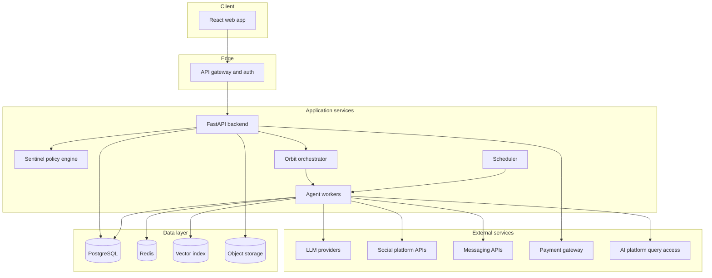
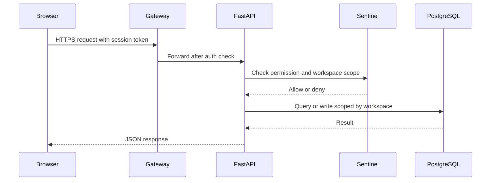
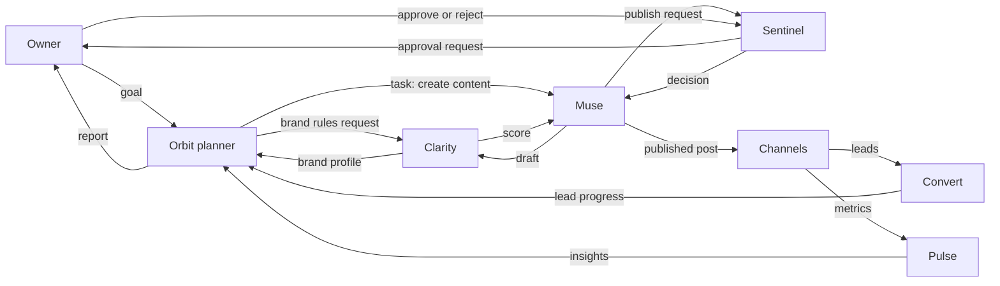
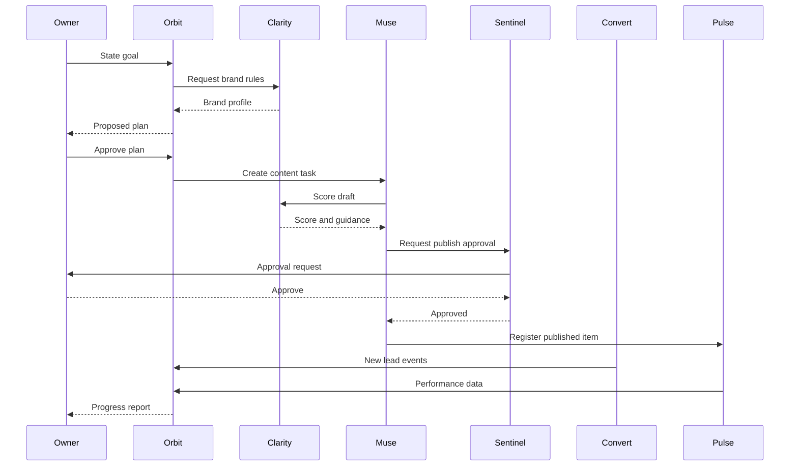
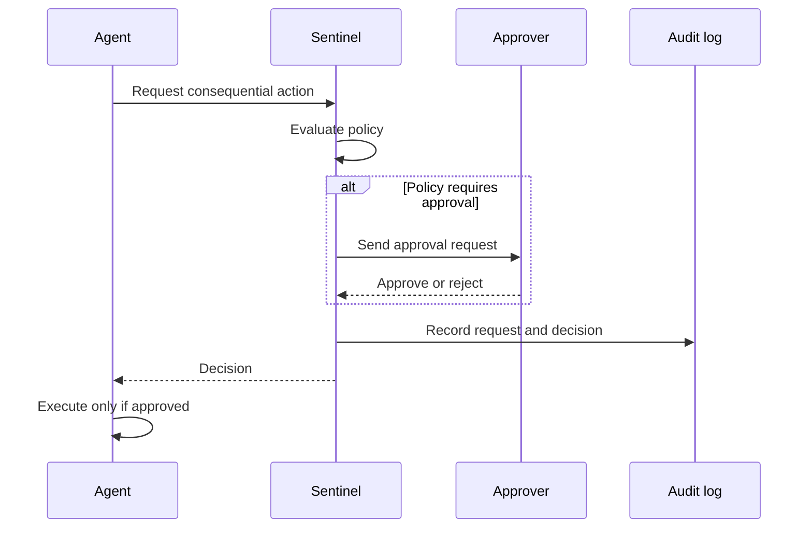
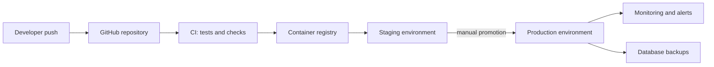
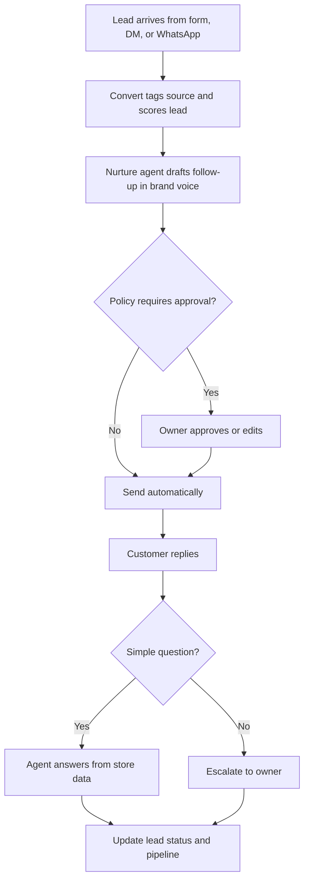

# VISTARO — MASTER BLUEPRINT

**Product, business and engineering blueprint**
Version 1.0 · 17 October 2026 · Companion to `STARTUP_AI_MASTER_CONTEXT.md`

---

## How to read this document

This blueprint explains Vistaro from the real-world problem through to the technical build and business plan. It is written for founders, teammates, developers, designers, mentors, investors and partners.

**Honesty labels.** Because Vistaro is at the idea stage, this document separates what is decided from what is proposed:

| Label | Meaning |
|---|---|
| **Confirmed** | The founders stated or chose it. |
| **Planned** | Intended and in the founders' feature spec. |
| **Proposed** | Suggested during planning; not yet confirmed. |
| **Assumption / Needs validation** | Believed, but untested with real users or data. |
| **Unknown** | No information yet. |

**What this document is built from.** The planning conversation with the founder, plus stored notes summarizing the founders' *Vistaro Product Features & Functional Responsibilities Report*. The full text of that report was not available, so module detail here follows the conversation's feature list and should be reconciled with the report. No code, customers, revenue, interviews, surveys or market research were provided or performed. **Nothing described here has been confirmed as built.**

**A naming note.** Earlier in planning, the products were called Lens, Dream, Lead Master, Store Manager and Engagement Tracking. The founders' later report names them Clarity, Muse, Convert, Market and Pulse, and adds Sentinel. This blueprint uses the later names and mentions the earlier ones once, below, for traceability. The pairing is an inference that the founders should confirm.

| Current name | Earlier name | Role |
|---|---|---|
| Orbit | Orbit | Orchestration and central workspace |
| Clarity | Lens | Brand intelligence and AI-visibility |
| Muse | Dream | Content creation and publishing |
| Convert | Lead Master | Leads and CRM |
| Market | Store Manager | Store and e-commerce operations |
| Pulse | Engagement Tracking | Social listening and performance intelligence |
| Sentinel | (new) | Governance, permissions, approvals, audit |

---

## 1. Executive Summary

**What it is.** Vistaro is an agentic AI platform that helps small businesses run their marketing, customer follow-up, store and operations from one place.

**The problem.** Small business owners juggle separate tools for content, leads, their store, analytics and support. None of these tools connect, so the owner becomes the glue. Brand voice drifts, leads go cold, and data never turns into action. On top of this, customers increasingly discover businesses through AI assistants such as ChatGPT, Gemini and Perplexity, and most owners cannot see how, or whether, they appear.

**Who it serves.** Small and mid-sized businesses, with an initial emphasis on India. The first specific niche has not been chosen.

**Why it matters.** Owner time is the scarcest resource in a small business. This is a reasoned assumption that still needs validation with real owners.

**How the solution works.** The owner states a goal, for example "get 50 qualified leads this month." Orbit plans the work and delegates it to specialist products. Clarity holds the brand rules and tracks AI visibility. Muse creates and publishes on-brand content. Convert captures and nurtures leads. Market runs the store. Pulse measures performance. Sentinel makes sure nothing public, outbound or financial happens without the owner's approval.

**Why it is different (proposed positioning).** One shared brand context across all agents; goal-to-execution orchestration rather than separate tools; AI-visibility tracking designed for small businesses; and central approval and audit controls.

**How it can make money (hypothesis).** Subscription tiers by module, plus usage-based AI credits, with possible add-on modules. No price has been set.

**What to build first.** A single end-to-end slice: goal, plan, brand-aware content, approval, lead capture and follow-up draft, and a progress report. This matches the first phase of the founders' build plan, scoped for a two-person team.

**What success could look like.** A small business owner states a goal, approves a plan, and sees measurable progress with far less manual work, while staying in control. Success metrics are proposed in section 20.

### Elevator pitch (proposed)

> Vistaro is an AI growth platform for small businesses. Tell it your goal and a team of AI agents plans and runs your content, leads and operations, asking for your approval before anything goes public. One system, one brand voice, you stay in control.

### Longer overview

Today's small-business software is a pile of single-purpose tools. A content scheduler does not know your goals. A CRM does not write your follow-ups. A store dashboard does not talk to your marketing. Vistaro treats the business as one connected system. A central orchestrator, Orbit, turns an owner's goal into a plan and coordinates specialist modules. Every module reads from the same brand profile and writes to a shared record of what happened. A governance layer, Sentinel, applies permissions and approval rules to every consequential action and keeps an audit trail. The result is software that does the work between owner decisions instead of waiting to be operated.

---

## 2. Brand Story, Vision, Mission and Values

### Brand

| Element | Content | Status |
|---|---|---|
| Name | **Vistaro** | Confirmed |
| Meaning | A coined word built from Hindi *vistar* (expansion) with an English-style ending, signalling growth | Name confirmed; etymology proposed |
| Tagline | Not chosen. Candidates: "Set the goal. We handle the rest." · "Your growth team, always on." · "Goal aapka, growth hamara." · "Business ka vistar, ab automatic." · "Grow without the grind." | Open decision |
| Logo | A prompt exists for a "V" made of two curved orbit lines with a rising dot, in indigo and violet with an orange accent. No final logo. | Proposed |
| Tone | Plain, confident, helpful; mixes English with a light Hindi-English voice for Indian audiences | Proposed |

### Origin of the idea

The idea began as a set of agent capabilities the founders wanted to build: brand visibility tracking, goal-driven autopilot, experiments, lead follow-up, support, competitor watch and business operations. Together they pointed to a single product vision: a platform that does the work a small team would otherwise do. The brand was then named Vistaro, and the product structure was refined into seven products.

### Vision (proposed wording)

Every small business can operate with the capability of a full growth team.

### Mission (proposed wording)

Turn an owner's goals into executed, measurable work, while keeping the owner in control.

### Values (proposed, consistent with confirmed constraints)

1. **Owner in control.** Approval before anything consequential.
2. **Honest AI.** No invented facts; escalate when unsure.
3. **Brand-first.** Everything sounds like the business.
4. **Simplicity.** Small teams should not need training to use it.
5. **Transparency.** Every action is recorded and explainable.

---

## 3. The Problem We Are Solving

### The everyday reality (illustrative scenario, not a real testimonial)

Consider a small boutique owner. She posts on Instagram when she has time, using a design tool. Customer questions arrive through Instagram DMs, WhatsApp and a website form; she answers when she can. Orders sit in a store dashboard, stock is tracked in a notebook, and the only analytics she sees are likes. When a customer asks "do you have this in blue?" at night, the reply comes the next day, and the customer has already bought elsewhere. Meanwhile she has no idea whether an AI assistant recommends her shop when someone asks for boutiques near them.

### The problems, in plain terms

| # | Problem | What it looks like | Consequence |
|---|---|---|---|
| 1 | No view of AI-driven discovery | Customers ask AI assistants for recommendations; owner cannot see results | Lost customers the owner never knew about |
| 2 | No owner for outcomes | Tools do tasks; nobody manages the goal | Effort without direction |
| 3 | Decisions after the fact | Reviewing likes after posting | Repeating what does not work |
| 4 | Leads scored but not converted | A list of leads with no follow-up | Revenue lost to slow replies |
| 5 | Slow and inconsistent support | Late, off-tone replies | Lower trust and repeat sales |
| 6 | Blind to competitors | No time to watch the market | Surprised by competitor moves |
| 7 | Operations overhead | Manual stock checks, payment reminders | Time lost on admin |
| 8 | Brand drift | Voice varies by channel or helper | Weaker brand |
| 9 | Fear of handing work to AI | Worry about unauthorized posts or messages | Owners will not adopt automation |

### Evidence

The founders supplied three references, which have **not** been independently verified by this blueprint's authors:

- A research paper (arXiv 2606.20065) indicating that AI brand visibility can be measured and differs by platform.
- An article on agentic marketing tools describing automated experiments and adaptive lead nurturing.
- An article describing support tools acting as virtual team members.

Evidence from real owners (interviews, surveys, observation) does not yet exist. Gathering it is the first priority in the action plan (section 22).

---

## 4. Our Solution

### In one paragraph

Vistaro is a connected set of seven products. The owner states a goal and approves a plan. Orbit coordinates specialist agents that generate on-brand content, follow up with leads, run the store, and measure results. A shared brand profile keeps every output consistent. Sentinel enforces approvals and records everything.

### Problem-to-solution map

| Problem | Vistaro answer | Module | Outcome aimed for |
|---|---|---|---|
| AI discovery blind spot | Track mentions across ChatGPT, Gemini, Perplexity, Google AI Overviews; recommend and draft fixes | Clarity and Muse | Owner sees where they stand and how to improve |
| No owner for outcomes | Goal in, plan out, coordinated execution | Orbit | Goals pursued systematically |
| Decisions after the fact | Forecasts, automated experiments, anomaly alerts | Pulse | Fewer wasted posts; faster learning |
| Leads not converted | Automated personalized follow-ups, reply handling, booking, re-engagement | Convert | Fewer cold leads |
| Slow support | Grounded answers in brand voice from store data | Market and Convert | Faster, trustworthy replies |
| Blind to competitors | Monitor competitor posts, pricing, campaigns | Pulse (placement proposed) | Informed decisions |
| Operations overhead | Reorder alerts, payment reminders, weekly summary | Orbit and Market | Less admin |
| Brand drift | Central brand profile and scoring | Clarity | Consistent voice |
| Fear of AI | Approval gates and audit | Sentinel | Trust and control |

---

## 5. Target Audience and User Personas

### Segments

| Segment | Status |
|---|---|
| Small and micro businesses (general) | Confirmed as the broad target |
| First niche, such as local retailers, direct-to-consumer sellers, home-based sellers or campus entrepreneurs | Unknown. To be chosen from interviews. |
| Agencies and freelancers serving small businesses | Proposed secondary segment |

### Illustrative personas (hypothetical; not real customers)

These are thinking tools only. None has been validated.

**Persona A: "The solo seller"**
- Runs an Instagram-first product business alone.
- Needs: consistent posting, fast replies, little time.
- Constraints: tight budget, mobile-first, English plus Hindi-English.
- Willingness to pay: unknown; likely price-sensitive.
- Expected benefit: hours saved and fewer missed enquiries.

**Persona B: "The local shop owner"**
- Has a physical shop with some online presence and WhatsApp customers.
- Needs: leads and orders from local customers; simple tools.
- Constraints: low technical comfort; wants things done for them.
- Expected benefit: more repeat customers; stock and payment reminders.

**Persona C: "The small agency"**
- Manages several small clients.
- Needs: brand consistency across clients; reporting.
- Expected benefit: scale without hiring.

### Persona journey (Persona A, illustrative)

1. Hears about Vistaro, signs up, answers a short brand interview.
2. Reviews and approves the brand profile.
3. Sets a goal; approves the proposed plan.
4. Reviews drafted posts and approves them each week.
5. Sees leads arrive and follow-up drafts ready.
6. Receives a weekly summary of what happened and what is next.

---

## 6. Product Features and Modules

All features are **planned**; none is confirmed built. "MVP" below means the proposed first-release slice; "Phase" refers to the founders' four-phase plan.

### 6.1 Core platform

| | |
|---|---|
| What it does | Sign-in, workspaces for each business, connections to external accounts, roles, and the engine that runs agent tasks |
| Why | Everything else depends on it |
| Who uses it | Everyone |
| Backend | Authentication, tenant separation, secure storage of connection tokens, task runtime with retries |
| AI involved | No |
| Phase / status | Phase 1; MVP |

### 6.2 Orbit: orchestration and central workspace

| | |
|---|---|
| What it does | Takes a goal, builds a plan, delegates to modules, tracks progress, reports; also generates a weekly business summary and ops alerts such as reorder and payment reminders |
| Why | Gives the business a manager for outcomes |
| Who uses it | Owner |
| How it works | (1) Owner states goal. (2) Orbit requests brand rules from Clarity. (3) Orbit proposes a step-by-step plan. (4) Owner approves. (5) Orbit dispatches steps and tracks them. (6) Orbit reports progress. |
| User sees | A dashboard of goals, tasks, pending approvals and results |
| Backend | Plan and task store, dispatcher, shared memory (later phase) |
| AI involved | Yes: planning and summaries. State tracking is ordinary code. |
| Phase / status | Dashboard and basic goal flow in Phase 1; full goal-driven orchestration and shared memory in Phase 3; ops automation in Phase 4 |

### 6.3 Clarity: brand intelligence and AI visibility

| | |
|---|---|
| What it does | Holds the brand profile (tone, audience, banned words, examples); scores any content against it; measures how AI platforms mention the brand compared with competitors; recommends fixes |
| Why | Consistency and discovery |
| Who uses it | Owner; other modules in the background |
| How it works | Brand profile is built from a short interview plus samples. For visibility, Clarity runs a set of customer-style questions on each platform several times, records whether and how the brand appears, and reports mention rates per platform |
| User sees | Brand profile screen, consistency scores, a visibility report with fixes |
| Backend | Profile storage, scoring, query runner, result parser |
| AI involved | Yes: scoring and analysis. Scheduling and storage are ordinary code. |
| Dependencies | Platform access to AI-assistant answers is unverified and must be confirmed legally and technically |
| Phase / status | Profile and scoring in Phase 1 (MVP); visibility tracking proposed for Phase 2 |

### 6.4 Muse: content creation and publishing

| | |
|---|---|
| What it does | Drafts posts and other content in the brand voice, can draft content that closes visibility gaps, schedules and publishes after approval |
| Who uses it | Owner or editor |
| How it works | Muse drafts, Clarity scores, a low score triggers a rewrite, Sentinel asks the owner to approve, then Muse schedules and publishes |
| User sees | Draft queue with scores, approve or edit buttons, a calendar |
| Backend | Content store, scheduler, publishing connectors |
| AI involved | Yes: drafting. Scheduling and publishing are ordinary code. |
| Dependencies | Clarity, Sentinel, social connectors |
| Phase / status | Phase 1 (MVP) |

### 6.5 Convert: leads and CRM

| | |
|---|---|
| What it does | One inbox for leads from forms, DMs, WhatsApp, the store and campaigns; scoring; contact profiles and pipeline; automatic follow-ups; reply handling; call booking; re-engaging cold leads |
| Why | Make sure no enquiry is wasted |
| Who uses it | Owner, sales helpers |
| How it works | Leads arrive and are tagged by source; Convert scores them; the nurture agent drafts a personalized follow-up in brand voice; Sentinel applies the approval policy; replies are classified, answered if simple, or passed to the owner; calls are proposed from calendar availability |
| User sees | Lead inbox, pipeline, pending follow-ups, hot-lead list |
| Backend | Contact and conversation store, scoring, message connectors |
| AI involved | Yes: drafting, classification. Scoring may mix rules and a model. |
| Dependencies | Clarity, Sentinel, messaging connectors (WhatsApp proposed) |
| Phase / status | Core inbox, scoring and pipeline in Phase 1 (MVP); nurture in Phase 2; richer automation in Phases 3 and 4 |

### 6.6 Market: store operations and support

| | |
|---|---|
| What it does | Catalog, orders, inventory, plus a support agent that answers product, order and FAQ questions |
| How it works | The support agent searches the store's own data to answer. If the answer is not in the data, it hands over to the owner instead of guessing |
| AI involved | Yes for support; inventory rules are ordinary code |
| Phase / status | Phase 2 (store); support agent Phase 3 |

### 6.7 Pulse: performance intelligence

| | |
|---|---|
| What it does | Tracks engagement; forecasts reach and conversions before posting; runs A/B tests on hooks and posting times; flags unusual changes with a suggested action; monitors competitors (module placement still to be confirmed) |
| AI involved | Yes: forecasting, analysis, suggestions; data collection and testing mechanics are ordinary code |
| Phase / status | Basic tracking in Phase 2; forecasting and experiments in Phase 4 |

### 6.8 Sentinel: governance

| | |
|---|---|
| What it does | Decides who may do what, requires approvals for public, outbound and financial actions (rules configurable), and records an audit trail |
| Why | Trust. This is what makes autonomy safe enough to adopt |
| How it works | An agent requests an action; Sentinel checks policy; if approval is required it asks the right person; the decision and outcome are logged; the agent proceeds only if approved |
| AI involved | No. Deliberately deterministic. |
| Phase / status | Basic permissions in Phase 1; full approvals and audit in Phase 2. **Open question:** because approvals are mandatory for consequential actions, a minimal approval step should exist in Phase 1 as soon as anything publishes or sends. |

### 6.9 End-to-end product experience

| Stage | Experience |
|---|---|
| Onboarding | Sign up, create workspace, connect channels, answer the brand interview, approve the brand profile |
| Main workflow | State a goal, approve the plan, approve drafts, watch results |
| Feedback | Weekly summary; scores and forecasts explained in plain language |
| Errors | Failed steps shown clearly with a retry or "ask me" option; broken connections prompt re-linking |
| Ongoing | Owner reviews approvals daily or weekly; Orbit suggests next goals |

---

## 7. Example User Scenarios

All scenarios are **hypothetical illustrations**, not real customers or results.

### Scenario 1: Getting more enquiries (hypothetical)

1. A home-baker tells Vistaro: "Get me 30 cake enquiries this month."
2. Orbit asks Clarity for her brand rules (warm, playful, no discount language).
3. Orbit proposes: six posts, two reels, a pinned enquiry form, and automatic follow-up to anyone who asks about prices.
4. She approves the plan.
5. Muse drafts posts; Clarity scores them; two are rewritten for tone.
6. She approves the posts in the app; Muse publishes on schedule.
7. Enquiries arrive in Convert; the nurture agent drafts replies with her menu details; she approves the first few, then loosens the rule for simple price questions.
8. At week's end, Orbit reports progress against the goal and suggests what to try next.

### Scenario 2: Showing up in AI answers (hypothetical)

1. A small furniture seller enters three competitors and five questions customers might ask an AI assistant.
2. Clarity runs each question on every platform several times and reports mention rates: strong on one platform, almost absent on another.
3. Clarity suggests gaps: no clear answer pages for common questions, inconsistent business descriptions.
4. Muse drafts fix content; she approves and publishes.
5. Clarity re-checks later and reports the change, with honest notes about run-to-run variation.

### Scenario 3: A late-night customer question (hypothetical)

1. A customer asks, at night, whether a product is in stock and when it arrives.
2. The support agent checks the store's inventory and shipping data.
3. It answers in the brand voice. If delivery time is not in the data, it says the owner will confirm and notifies the owner.
4. The conversation is saved in Convert and the lead status updates.

### Scenario 4: Keeping control (hypothetical)

1. An agent drafts a promotional message to past customers.
2. Sentinel's policy requires approval for outbound messages to customers.
3. The owner sees the message, the audience size and the reason, edits one line, and approves.
4. The send and approval are recorded in the audit log.

---
## 8. How the Technology Works

**Status of everything in this section: decided on 2026-10-18 by delegated authority, and not yet built or verified.** The full, authoritative design is in `docs/ARCHITECTURE.md`; this section explains it in readable form. The founders' skills (Python, React, FastAPI, PostgreSQL) shaped the choices, and the founders may change any of them. Where the two differ, `docs/ARCHITECTURE.md` wins.

### Layer A: simple explanation

Think of Vistaro as a small company inside a computer.

- **The frontend** is the shop front: the screens the owner sees and taps.
- **The backend** is the office: it receives requests, checks who you are and what you are allowed to do, and does the work.
- **The database** is the filing cabinet: businesses, leads, orders, drafts and history, each business's files kept strictly apart.
- **The AI agents** are the staff: one writes, one follows up with leads, one watches the numbers. They use language models, which are the "brain" that understands and writes text.
- **Sentinel** is the manager's signature: staff may prepare anything, but public, outbound or financial actions need sign-off.
- **The scheduler** is the calendar and alarm clock: it triggers posts, follow-ups and reminders at the right time.
- **External services** are the outside suppliers: social platforms, WhatsApp, payment providers, and the AI platforms whose answers Clarity checks.
- **Deployment** is where the office is housed, with backups so nothing is lost.

### Layer B: engineering explanation

| Area | Proposal | Notes |
|---|---|---|
| Frontend | React, TypeScript, Tailwind CSS | Component library shared across module screens |
| Backend | FastAPI (Python), versioned REST API with generated OpenAPI docs | Workspace derived from the session, never trusted from the client |
| Orchestration | Planner-executor pattern in Orbit | Explicit typed steps, retry caps, single task store |
| Agent runtime | Worker processes consuming a queue | Idempotent steps; every run traced |
| Database | PostgreSQL as the only database; `workspace_id` on every row with row-level security | MongoDB is not used; flexible data goes in PostgreSQL JSONB |
| Cache and queue | Redis | Job queue, rate limiting |
| Retrieval | Vector or hybrid index (for example pgvector) | Used for brand rules and support answers |
| Jobs | Celery, RQ or equivalent | Scheduling and retries |
| Storage | S3-compatible object storage | Brand assets and uploads |
| Auth | Email or OAuth sign-in; roles: Owner, Admin, Editor, Approver, Viewer | Permissions centralized in Sentinel |
| Observability | Structured logs with trace IDs; metrics for queue depth, success rate, latency, model cost | Tools undecided |
| Deployment | Containers; GitHub Actions; development, staging and production | Hosting provider undecided |
| LLMs | Provider-agnostic interface | Provider and models undecided |

Architectural choices and their reasons:

1. **Modular monolith first.** Two builders cannot operate many services; separate services only when load requires.
2. **Deterministic code for rules, AI for language and judgement.** Permissions, approvals, schedules and arithmetic stay predictable.
3. **Planner-executor, not free-form agent chat.** This reduces the risk of loops and conflicting actions.
4. **Central Sentinel.** One place to enforce and audit rules is safer than rules scattered across modules.

---

## 9. System Architecture and Technical Diagrams

### 9.1 Overall system architecture



**In plain English.** The owner uses a web app. Every request passes through a gateway that checks who they are. The backend asks Sentinel whether the action is allowed, then reads or writes the database. Heavy or timed work, such as generating content or sending follow-ups, is handed to agent workers, which talk to language models and outside services. Orbit keeps track of plans and tasks, and the scheduler wakes work up at the right time. Each component exists so that the app stays responsive, rules are enforced in one place, and slow or unreliable external calls never freeze the screen.

### 9.2 Request lifecycle (frontend to backend)



**In plain English.** Before anything is read or changed, the system confirms who is asking and whether they may do it, and it restricts every database operation to that one business's data.

### 9.3 Data and content flow



**In plain English.** A goal becomes a plan. Content is drafted, checked against the brand, approved by the owner, then published. Leads and results flow back to Orbit, which tells the owner how the goal is going.

### 9.4 Agent workflow (goal execution)



**In plain English.** This is the main storyline of the product. The owner is asked twice: once to approve the plan and once to approve what goes public. Everything between is handled by the agents.

### 9.5 Approval and authorization flow



**In plain English.** An agent cannot act on its own on anything consequential. It asks Sentinel, Sentinel applies the owner's rules, and the decision is written to a permanent record before anything happens.

### 9.6 Deployment and infrastructure



**In plain English.** Code changes are tested automatically, tried in a staging copy, and only then released to the live app by a person. The live app is monitored, and the database is backed up so it can be restored.

### 9.7 Key user journey: lead follow-up



**In plain English.** Every lead gets a timely, on-brand follow-up. Simple questions are answered automatically; anything uncertain goes to the owner.

---

## 10. Data, AI and Automation Strategy

| Question | Answer (proposed unless stated) |
|---|---|
| What data is needed? | Brand profile, content, leads and conversations, products and orders, platform metrics, competitor observations, approvals and audit records |
| Where does it come from? | Owner input, uploads, connected accounts (social, messaging, store), website forms, platform APIs, AI-platform query results |
| How is it processed and stored? | Structured data in PostgreSQL, scoped by business; files in object storage; retrieval indexes for brand rules and support context |
| How does AI decide or generate? | Language models draft content, classify messages, plan goals, summarize and recommend. Rules and arithmetic remain ordinary code |
| How are AI outputs validated? | Outputs must match a schema; content is scored against the brand profile; support answers must be grounded in store data |
| Where is human review required? | Any public, outbound or financial action (confirmed constraint); plan approval; ambiguous lead merges; low-confidence cases |
| Errors, hallucinations, uncertainty? | Ungrounded answers are escalated rather than sent; failed validations are retried then surfaced; confidence thresholds will be set from evaluation results (not yet known) |
| Privacy and security? | Strict separation per business; encrypted data and tokens; minimal data collection; deletion on request; honoring messaging opt-outs; legal requirements to be confirmed with qualified advice |
| Quality measurement? | Evaluation sets per agent, including brand consistency, support groundedness, plan validity, visibility parsing accuracy; cost and latency tracked per run |

**Security point worth stating plainly.** Customer messages are untrusted text. An agent that reads a customer message must treat it as information, never as instructions, and should have limited tools while doing so.

**Implemented versus future.** Nothing is implemented. All of the above is design intent.

---

## 11. Business Model and Monetization

**Status: nothing decided or validated.**

### Revenue streams under consideration

| Stream | Description | Notes |
|---|---|---|
| Tiered subscription | Plans by modules, seats or workspaces | Simple and fits the modular product |
| Usage-based AI credits | Metered generation, visibility checks, agent actions | Matches price to model cost |
| Messaging pass-through | WhatsApp or SMS cost plus margin | Provider pricing to be checked |
| Add-on modules | Market, Pulse experiments and AI visibility as paid extras | Land and expand |
| Agency plan | Multi-business management | Needs validation |

Free versus paid, plan names and prices are unknown. A sensible starting hypothesis is a limited free or trial tier to prove value, with paid tiers unlocking more modules, more agent actions and more connected channels.

### Acquisition, retention, partnerships, expansion

- **Acquisition:** founder-led outreach to local businesses; campus, incubator and business-association networks; educational content about AI visibility.
- **Retention:** visible goal progress, weekly summary, time-saved reporting.
- **Partnerships:** agencies, messaging providers, store-platform ecosystems.
- **Expansion:** more modules per customer, more businesses per agency, additional regions and languages.

### Illustrative financial framework

The available context does not support a numeric financial model, so none is invented. To build one, the founders should fill this framework from real data:

```
Monthly revenue        = paying workspaces × average revenue per workspace
Variable cost          = (model cost per goal × goals) + messaging cost + hosting share + support share
Gross margin           = (monthly revenue − variable cost) / monthly revenue
Break-even workspaces  = fixed monthly costs / (average revenue per workspace − variable cost per workspace)
```

| Variable | Source to obtain it | Current value |
|---|---|---|
| Average revenue per workspace | Pricing research and pilots | Unknown |
| Model cost per goal | Measured in prototype | Unknown |
| Messaging cost per message | Provider price list | Unknown |
| Hosting and tooling cost | Provider quotes | Unknown |
| Fixed monthly cost | Team and tool plan | Unknown |

Any revenue figure derived before pilots is a hypothesis, not a forecast.

---

## 12. Market and Competitive Analysis

**Research status:** no market research was performed for this blueprint. Competitor information below is general background, written on 17 October 2026 from general knowledge, and **must be verified with current, cited sources before external use.** No market size or growth figures are included because none have been sourced.

### Target market

Small and mid-sized businesses, emphasizing India. Size, spending on marketing tools, and adoption of AI tools in this segment are unknown.

### Competitive landscape (unverified)

| Category | Examples | Where Vistaro aims to differ |
|---|---|---|
| Content tools | Canva, Buffer, Hootsuite | Goal-driven plans and shared brand context |
| CRM | HubSpot, Zoho | Follow-up done by agents; lighter for tiny businesses |
| Store builders | Shopify and similar | Stores linked to marketing and leads |
| Chat support tools | Tidio and similar | Brand voice plus live store data |
| AI-visibility tools | Specialist and enterprise SEO tools | Small-business focus and pricing (to be validated) |
| Doing it manually or with generic AI chat | Spreadsheets, WhatsApp, general chatbots | Connected, governed, persistent |

### Differentiation and defensibility (hypotheses)

- Integrated brand context and cross-module memory increase switching costs over time.
- Governance (approvals and audit) could be a trust advantage.
- Niche and local-market knowledge, including Hindi-English and WhatsApp workflows, could be an edge if validated.
- Weaknesses to be honest about: large incumbents can add similar features; AI-visibility measurement depends on platform access that may be restricted.

### Market-entry strategy (proposed)

Pick one niche, run assisted pilots, learn deeply, then widen.

---

## 13. Go-to-Market Strategy

All elements are proposals; none has been validated.

| Element | Plan |
|---|---|
| Initial niche and ideal first users | To be chosen from interviews. Selection criteria: high pain, active on social and WhatsApp, reachable through the founders' networks, willing to try software |
| Early adopters | Founder-led outreach; campus and incubator networks; local business groups |
| Pilot and beta | Small number of businesses, hands-on onboarding, weekly feedback calls, honest measurement |
| Feedback collection | Interviews, in-product prompts, tracking of approvals and edits (these show where agents miss) |
| Channels | Direct outreach, content about AI visibility and small-business growth, partnerships with agencies |
| Conversion to paid | After clear time-saved or lead results during the pilot |
| Support and retention | Responsive human support at first; weekly summaries; proactive suggestions |
| Expansion | More modules per customer; adjacent niches; agencies; other regions and languages |

**Validated so far:** nothing. The first step is interviews (section 22).

---

## 14. Complete Development Plan

The founders' confirmed plan has four phases (core platform; Market, Pulse and Sentinel approvals; goal-driven orchestration and shared memory; advanced automation). This blueprint adds a validation phase before, a prototype slice for the SEVA 2026 competition window, and a beta phase after.

> The task-level roadmap with IDs, dependencies and acceptance criteria is `docs/PROJECT_ROADMAP.md`; the build how-to is `docs/DEVELOPMENT_GUIDE.md`. This section is the readable summary.

### What belongs in the MVP, and why

The MVP is one complete loop: **goal → plan → on-brand content → approval → publish → lead capture → drafted follow-up → progress report.** It proves the central idea (an agent team that works toward a goal under owner control) without building every module. Deferred: store operations, experiments, competitor watch, and advanced automation.

One caution: because approvals are a confirmed requirement for anything public or outbound, the MVP needs at least a minimal approval step even though the founders' plan places full approvals in Phase 2.

### Phase 0: Validation and definition (proposed)

| | |
|---|---|
| Goals | Confirm the problem with real owners; choose a niche; reconcile module names with the founders' report; check the name |
| Tasks | Interviews; short survey; trademark, domain and handle checks; confirm feature spec |
| Deliverables | Interview notes, chosen niche, name-check results, reconciled spec |
| Completion | Findings documented; assumptions updated |
| Risks | Hard to reach owners; biased sample. Contingency: use campus entrepreneurs, local markets and online seller groups |

### Phase 1: Core platform (confirmed scope)

| | |
|---|---|
| Goals | Sign-in, workspaces, integrations framework, basic permissions, agent task runtime, initial Orbit dashboard, initial Clarity, Muse, Convert |
| Frontend | Authentication screens, workspace setup, brand profile screen, content draft queue, lead inbox, dashboard |
| Backend | Auth, tenant scoping, connector framework, task runtime, brand profile and scoring APIs, content APIs, lead APIs |
| AI and data | Brand-profile structuring, scoring, content generation, structured outputs and validation |
| Infrastructure | Repository, CI, staging, secrets handling, database and migrations |
| Testing | Unit tests for permissions and scoring; integration tests for connectors and tasks; tenant-isolation tests |
| Deliverables | Working app in staging running the core loop with real data |
| Dependencies | Cloud account, model access, at least one connector approved or sandboxed |
| Completion | A user registers, builds a brand profile, generates scored content, and captures a lead, with no cross-business data exposure in tests |
| Risks | Scope; connector approval delays. Contingency: sandbox data clearly labeled as such |

### Phase 1-S: SEVA prototype slice (75 days, only if selected; proposed)

| Days | Focus | Output |
|---|---|---|
| 1–15 | Validate and design: interviews, architecture, brand-profile schema, repository and cloud | Evidence summary, architecture doc, running skeleton |
| 16–40 | Build core: workspaces, brand profile, content generation, Orbit planner, minimal approval | Goal to approved content working in staging |
| 41–60 | Add lead capture and drafted follow-ups, basic tracking, first visibility check where access exists | End-to-end demo |
| 61–75 | Pilot with a few real businesses; measure; fix; prepare demo | Pilot results and demo |

Capacity is the main risk: two people. Contingency is to cut scope, not quality, and never to present simulated results as real.

### Phase 2: Market, Pulse, Sentinel approvals and audit

| | |
|---|---|
| Goals | Store basics, performance tracking, full approvals and audit |
| Frontend | Catalog and orders screens, metrics views, approval rules editor, audit viewer |
| Backend | Product, inventory, order services; metrics ingestion; policy engine; append-only audit |
| AI and data | Forecasting baseline; visibility tracking if access is confirmed |
| Infrastructure | Payment gateway integration (gateway to be chosen), metrics pipelines |
| Testing | Policy tests; audit completeness tests; sandbox payment tests |
| Completion | Every consequential action passes through Sentinel and is logged (verified by tests) |
| Risks | Payment compliance; platform API limits |

### Phase 3: Goal-driven orchestration and shared memory

| | |
|---|---|
| Goals | Full goal planning across modules; workspace memory; support agent |
| AI and data | Plan-validity evaluations; memory storage and retrieval; grounded support |
| Testing | Evaluation sets; loop and step-limit tests; regression suites |
| Completion | Plans meet evaluation thresholds set beforehand |
| Risks | Plan quality; cost growth. Contingency: tighter step limits and cheaper models for routine steps |

### Phase 4: Advanced automation

| | |
|---|---|
| Goals | Experiments, anomaly handling, competitor monitoring, business-ops automation, call booking, re-engagement |
| Completion | Automation stays inside policy; pilot users confirm usefulness; audit review shows no violations |
| Risks | Over-automation harming trust. Contingency: keep approvals on by default |

### Phase 5: Beta, hardening and launch (proposed)

Security review, performance testing, billing, support runbooks, backup restore test, go or no-go decision.

---
## 15. Testing, Quality, Security and Reliability

All proposed; none implemented.

| Area | Approach |
|---|---|
| Unit tests | Permissions, scoring logic, scheduling, lead deduplication, approval rules |
| Integration tests | Connectors with sandbox accounts, task runtime, approval flow, database migrations |
| End-to-end tests | The core loop: goal, plan, content, approval, publish, lead, follow-up, report |
| AI evaluations | Fixed test sets per agent: brand consistency, support groundedness, plan validity, visibility parsing accuracy; re-run on every prompt or model change |
| Performance | Load tests on task queues and API; cost-per-goal measurement |
| Access control | Tests proving one business can never read another's data; tests that agents cannot bypass Sentinel |
| Privacy and data protection | Data minimization, encryption, deletion on request, retention limits, honoring messaging opt-outs |
| Monitoring | Traces for every agent run, error tracking, alerts on failures and cost spikes |
| Backups and recovery | Daily database backups with periodic restore tests; documented recovery steps |
| Incident response | Simple runbook: detect, contain (disable affected connector or agent), notify affected owners, fix, review |

Targets for availability and recovery time are not yet set.

---

## 16. Deployment and Operations

| Topic | Proposal |
|---|---|
| Environments | Development, staging, production |
| CI/CD | Automated tests on every change; staging deploys automatically; production release after manual approval |
| Environment variables and secrets | Validated at startup; stored in a managed secret store; never committed to the repository |
| Database migrations | Versioned, reviewed, tested on realistic data, reversible where possible |
| Release procedure | Merge to main, pass CI, deploy to staging, run smoke tests, promote to production, watch dashboards |
| Monitoring | Logs, metrics, alerts on queue depth, failed tasks, model cost and latency |
| Cost management | Per-workspace usage budgets, caching of repeated visibility queries, cheaper models for simple tasks, step limits |
| Maintenance | Dependency updates, token-expiry handling, platform API change tracking |

Hosting provider, regions and tooling are undecided.

---

## 17. Team, Roles and Collaboration

### Established team

| Person | Role | Background |
|---|---|---|
| Anushka Varshney | Frontend and platform lead | 3rd-year B.Tech Information Technology, IGDTUW |
| Dimple | AI and backend lead | 3rd-year B.Tech Information Technology, IGDTUW |

Competition team name: **Midnight Slayers** (DTU SEVA 2026, Diploma & Higher Education track). Mentor: not identified.

An earlier suggestion of a five-role split no longer applies because the team has two members.

### Roles needed beyond the two founders (recommendations only; none are filled)

| Role | Why |
|---|---|
| Mentor with small-business or SaaS experience | Validate niche and pricing |
| Product designer | Approval and dashboard screens carry the product's trust |
| Pilot-business champions | Real feedback |
| Legal and compliance advisor (as needed) | Data protection, messaging rules, trademarks |
| Marketing or growth help | Go-to-market |

### Collaboration practice (proposed)

Short weekly planning; one shared decision log; pull requests with reviews; every change references a feature ID; demos at the end of each phase.

---

## 18. Costs, Resources and Financial Considerations

No prices are quoted because none have been researched for this blueprint. The categories below should be costed using current provider price lists, with the date of each quote recorded.

| Category | What drives it | Notes |
|---|---|---|
| Language-model usage | Tokens per generation, plan and visibility run | Likely the largest variable cost; measure early |
| AI-visibility queries | Number of questions × platforms × repeat runs | Repeated runs multiply cost |
| Hosting and compute | App servers, workers | Start small |
| Database and storage | Data size, backups | Managed services trade money for time |
| Messaging | Per-message or per-conversation fees | Depends on provider; check consent rules |
| Social and store connectors | Usually free API access with approval requirements | Verify per platform |
| Payment processing | Gateway fees | Only when Market handles payments |
| Development tools | Repository, CI, error tracking | Often free tiers early |
| Domains and branding | Domain, design assets | After name check |
| Marketing and pilots | Outreach, small incentives | Keep lean |
| Legal and compliance | Trademark filing, advice | Budget before launch |
| Team time | Founders' hours | The real constraint |

**Resources already available:** the founders' skills and, if selected, the SEVA programme's support. Credits and mentorship from competitions or incubators should be pursued.

---

## 19. Risks, Challenges and Mitigation

| Type | Risk | Mitigation |
|---|---|---|
| Technical | Scope too large for two builders | One vertical slice first; defer modules |
| Technical | AI-platform visibility data hard to obtain legally and reliably | Verify access and terms before committing; report rates, not single results |
| Technical | Platform API approvals delayed | Apply early; use labeled sandbox data for demos |
| AI | Hallucinated replies | Grounding in store data; escalate when unsure; evaluations |
| AI | Agents loop or conflict | Planner-executor, step caps |
| AI | Prompt injection from customer messages | Treat messages as data; limit tools; validate outputs |
| Security | Data leaking between businesses | Row-level scoping and isolation tests |
| Security | Stolen connection tokens | Encryption, least privilege, rotation |
| Market | Owners do not value or pay | Early interviews and paid pilots |
| Market | Incumbents add similar features | Niche focus, integrated workflow, trust features |
| Operational | Tiny team, single points of failure | Managed services, simple architecture, runbooks |
| Adoption | Owners distrust autonomy | Approval-first defaults, transparency, audit |
| Financial | Model and messaging costs exceed revenue | Usage budgets; price from measured costs |
| Compliance | Data protection and messaging consent obligations | Data minimization; consent tracking; qualified advice |
| Brand | Name conflicts | Run name checks before investing in branding |
| Credibility | Claims without evidence in competition or investor materials | Label assumptions; use only real evidence |

---

## 20. Success Metrics and Milestones

### Proposed metrics (targets are unknown until baselines exist)

| Area | Metric |
|---|---|
| North star (proposed) | Goals achieved per active workspace per month |
| Activation | Time to first approved publish; share of workspaces with an approved brand profile |
| Engagement | Weekly active workspaces; approvals handled; median approval time |
| Retention | Week-4 and week-12 retention |
| Value | Lead response time; share of leads followed up on time; owner-reported hours saved |
| Monetization | Trial-to-paid conversion; revenue per workspace; churn (after pricing exists) |
| AI quality | Brand-consistency score distribution; support groundedness rate; plan-validity rate; visibility parser accuracy |
| AI operations | Cost per goal; latency per step; failure and retry rates |
| Reliability | Task success rate; incident count; restore-test success |

### Milestones (proposed)

| Milestone | Evidence of completion |
|---|---|
| M1: Problem validated | Real interview evidence documented |
| M2: Niche and name settled | Niche chosen; name checks done |
| M3: Core loop working | End-to-end flow in staging with approvals |
| M4: First pilot | Real businesses using it; honest results |
| M5: Phase 2 complete | Approvals and audit enforced everywhere; store and metrics basics |
| M6: Beta | Security checklist complete; billing ready |

**Measured results so far:** none. All numbers above are proposals.

---

## 21. Long-Term Roadmap

**Discussed in planning (planned):** goal-driven orchestration across all modules, shared workspace memory, advanced automation, experiments, competitor monitoring, business operations automation, WhatsApp-based customer communication.

**Proposed possibilities (not discussed in detail, not committed):**

| Direction | Idea |
|---|---|
| Segments | Agencies; additional small-business verticals |
| Geography and language | More Indian languages; other markets |
| Integrations | More social, messaging, marketplace and accounting tools |
| Product | Deeper AI-visibility improvement workflows; industry-specific templates |
| Monetization | Marketplace of playbooks; partner programs |
| Scale | Move from a single application to separate services when load justifies it |

---

## 22. Immediate Action Plan

In order:

1. **Reconcile names and obtain the full feature report.** Confirm the pairing of old and new module names so every document and the code use one vocabulary.
2. **Interview real business owners.** Prepare a short script. Record exact quotes and numbers. This is the strongest evidence for the SEVA submission and for the product.
3. **Choose the first niche** from what the interviews show.
4. **Run name checks:** web search, domains, social handles, trademark classes, app stores.
5. **Finish the SEVA submission with real evidence only,** using the two-person team and clearly labeled assumptions.
6. **Create the repository and CI.** The technology stack is already decided (`docs/ARCHITECTURE.md`); verify hosting plans and record any surprises.
7. **Check how AI-platform visibility data can be obtained legally and reliably** before promising that feature.
8. **Build the core loop** with a minimal approval step.

### Decisions to make first

| Decision | Why it matters |
|---|---|
| First niche | Shapes everything else |
| Stack and hosting | Starts the build |
| Where competitor monitoring lives | Clean architecture |
| Minimal approvals in Phase 1 | Safety versus scope |
| Pricing hypothesis to test | Business viability |

### What to validate first

Pain and willingness to pay with real owners; trust in approval-gated agents; whether AI-visibility tracking is something owners recognize as a problem.

### What to avoid building prematurely

The store module, experiments, competitor watch, advanced automation, and multi-language support. Also avoid committing to AI-visibility features until data access is confirmed.

---

## 23. Appendices

### A. Glossary

| Term | Meaning |
|---|---|
| Agent | Software that uses a language model and tools to perform a defined task |
| Orbit | Orchestrator and central workspace |
| Clarity | Brand intelligence and AI-visibility module |
| Muse | Content creation and publishing module |
| Convert | Leads and CRM module |
| Market | Store and e-commerce module |
| Pulse | Social listening and performance module |
| Sentinel | Governance, approvals and audit module |
| Workspace | One business's separate space in Vistaro |
| Approval gate | A required human decision before an action runs |
| AI visibility | How often and how AI assistants mention a brand compared with competitors |
| TRL | Technology Readiness Level |
| SEVA | DTU's Seva First Innovation Challenge, 2026 |

### B. Complete feature inventory

| ID | Feature | Module | Status |
|---|---|---|---|
| F-CORE-01 to 05 | Authentication, workspaces, integrations framework, basic permissions, agent task runtime | Core | Planned |
| F-ORB-01 | Goal intake and planning | Orbit | Planned |
| F-ORB-02 | Cross-module delegation | Orbit | Planned |
| F-ORB-03 | Central dashboard | Orbit | Planned |
| F-ORB-04 | Weekly business summary | Orbit | Planned |
| F-ORB-05 | Business ops alerts (reorder, payment reminders) | Orbit | Planned |
| F-ORB-06 | Shared memory | Orbit | Planned |
| F-CLA-01 | Brand profile | Clarity | Planned |
| F-CLA-02 | Brand consistency scoring | Clarity | Planned |
| F-CLA-03 | AI-visibility tracking | Clarity | Planned |
| F-CLA-04 | Content-fix recommendations | Clarity | Planned |
| F-MUS-01 | On-brand content generation | Muse | Planned |
| F-MUS-02 | Auto-generated visibility fixes | Muse | Planned |
| F-MUS-03 | Scheduling and publishing | Muse | Planned |
| F-MUS-04 | Approval-gated publishing | Muse | Planned |
| F-CON-01 | Lead capture and unified inbox | Convert | Planned |
| F-CON-02 | Lead scoring | Convert | Planned |
| F-CON-03 | Contact profiles and pipeline | Convert | Planned |
| F-CON-04 | Nurture and follow-up | Convert | Planned |
| F-CON-05 | Reply handling | Convert | Planned |
| F-CON-06 | Call and meeting booking | Convert | Planned |
| F-CON-07 | Cold-lead re-engagement | Convert | Planned |
| F-CON-08 | WhatsApp channel | Convert | Proposed |
| F-MKT-01 | Catalog and orders | Market | Planned |
| F-MKT-02 | Inventory | Market | Planned |
| F-MKT-03 | Customer support agent | Market | Planned |
| F-SEN-01 | Permissions | Sentinel | Planned |
| F-SEN-02 | Approval workflows | Sentinel | Planned |
| F-SEN-03 | Audit log | Sentinel | Planned |
| F-PUL-01 | Engagement tracking | Pulse | Planned |
| F-PUL-02 | Forecasting | Pulse | Planned |
| F-PUL-03 | Automated experiments | Pulse | Planned |
| F-PUL-04 | Anomaly detection | Pulse | Planned |
| F-PUL-05 | Competitor and market watch | Pulse (placement proposed) | Proposed |

### C. Technology stack inventory

| Technology | Role | Status |
|---|---|---|
| React, TypeScript, Tailwind CSS | Frontend | Proposed |
| FastAPI (Python) | Backend | Proposed |
| Node.js | Integration workers | Proposed |
| PostgreSQL | Primary database | Proposed |
| MongoDB | Not used (PostgreSQL JSONB instead) | Rejected |
| Redis | Queue and cache | Proposed |
| pgvector or similar | Retrieval | Proposed |
| Celery, RQ or similar | Background jobs | Proposed |
| GitHub and GitHub Actions | Source control and CI | Proposed |
| Docker | Packaging | Proposed |
| LLM provider layer (Anthropic default) | Language models | Decided as default; model names after evaluation |
| Cloudflare Pages, Render, Cloudflare R2 | Deployment and storage | Decided; plan and region to verify |
| Payment gateway | Commerce | Unknown |

### D. Important business assumptions

| ID | Assumption | Status |
|---|---|---|
| A-01 | Owners feel tool fragmentation is a top pain | Needs validation |
| A-02 | Owners will trust agents with approval gates | Needs validation |
| A-03 | AI visibility is a recognized and paid-for need | Needs validation |
| A-04 | WhatsApp is the main follow-up channel for the target segment | Needs validation |
| A-05 | Legal and reliable access to AI-platform answers exists | Needs validation |
| A-06 | Owners will pay recurring fees for the combined product | Needs validation |
| A-07 | A two-person team can deliver a convincing slice | Needs validation |

### E. Open questions

| ID | Question |
|---|---|
| OQ-01 | Is the name Vistaro free to use (web, domain, handles, trademark, app stores)? |
| OQ-02 | Do the old and new module names map as listed? What does the full feature report say? |
| OQ-03 | Which first niche? |
| OQ-04 | Which tagline? |
| OQ-05 | How will AI-platform visibility data be obtained legally and reliably? |
| OQ-06 | ~~Does competitor monitoring live in Pulse or Clarity?~~ Resolved: Pulse |
| OQ-07 | ~~Is a minimal approval step included in Phase 1?~~ Resolved: yes |
| OQ-08 | ~~Which technology stack and hosting?~~ Resolved (verify hosting plan and region) |
| OQ-09 | Which pricing model and price points? |
| OQ-10 | Default provider chosen; model names need evaluation |
| OQ-11 | Who else joins the team (mentor, design, business)? |
| OQ-12 | What is the legal position on customer data and messaging? |

### F. Decision history

| ID | Decision | Status |
|---|---|---|
| D-001 | Brand name is Vistaro | Confirmed |
| D-002 | Build the seven agent capabilities | Confirmed |
| D-003 | Product set: Orbit, Clarity, Muse, Convert, Market, Sentinel, Pulse | Confirmed |
| D-004 | Approval required for public, outbound and financial actions | Confirmed |
| D-005 | Four-phase build plan from the founders' report | Confirmed |
| D-006 | Enter DTU SEVA 2026 Stage 1 as team Midnight Slayers | Confirmed |
| D-007 | Stack | Decided 2026-10-18 by delegation (see `docs/ARCHITECTURE.md`) |
| D-008 to D-010 | Pricing, niche, tagline | Unknown |
| D-012 to D-016 | Architecture finalized; minimal approvals in Phase 1; competitor watch in Pulse; LLM default; full roadmap in `docs/PROJECT_ROADMAP.md` | Confirmed by delegation |
| D-011 | Old-to-new module name mapping | Needs validation |

Superseded items: the five-role team split (replaced by the two-person team) and the earlier module names (replaced by the later names).

### G. External references

Provided by the founder and **not independently verified**:

1. arXiv 2606.20065: research on measuring AI brand visibility across platforms.
2. interviewkickstart.com article on agentic AI tools for marketing.
3. tech4ssd.beehiiv.com article on AI agent tools for small-business growth.

Competitor and market claims in section 12 are general background and require current, dated, cited sources.

### H. Supporting technical specifications

Detailed data models, API conventions, agent boundaries, the risk register, and structured YAML are in `STARTUP_AI_MASTER_CONTEXT.md` (sections 5 to 8, 12 and 15). Entity list proposed for the database: users, workspaces, memberships, connections, brand profiles and scores, visibility queries, runs and results, goals, plans, tasks, agent runs, memory items, content items and schedules, contacts, leads, conversations and messages, products, inventory, orders, metrics, experiments, competitor observations, approval requests and decisions, policies, and audit logs. All are proposed.

---

*End of STARTUP_MASTER_BLUEPRINT.md*
