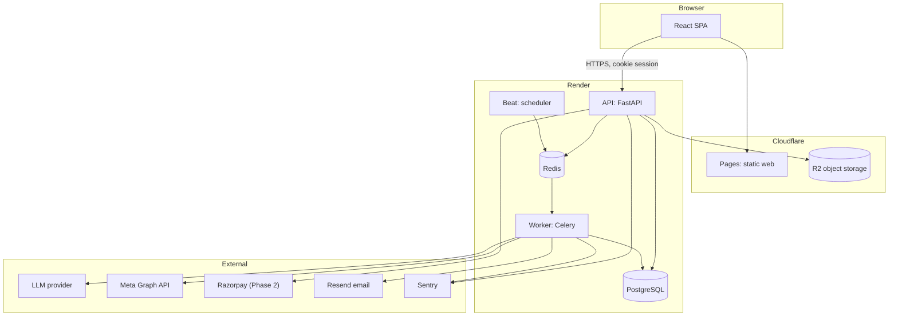
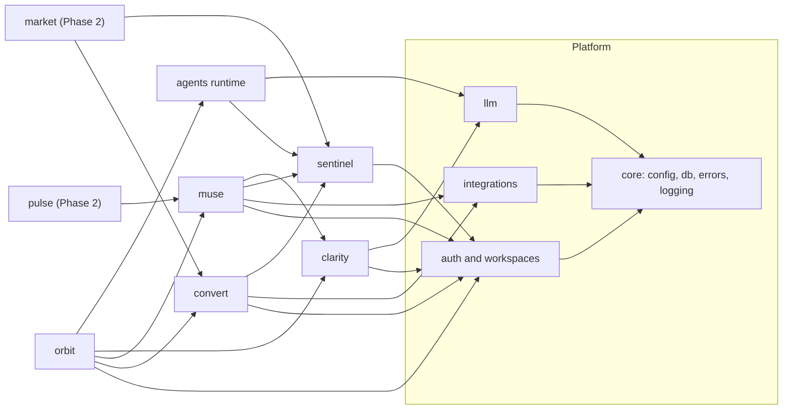
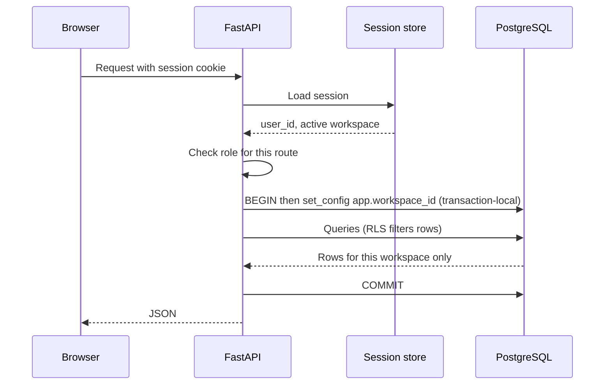
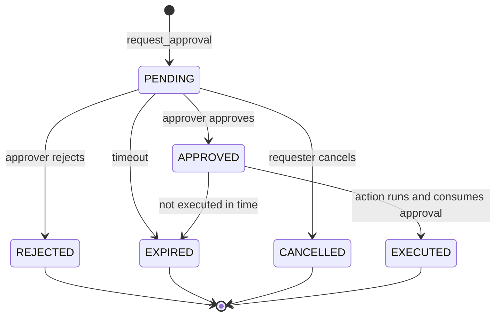
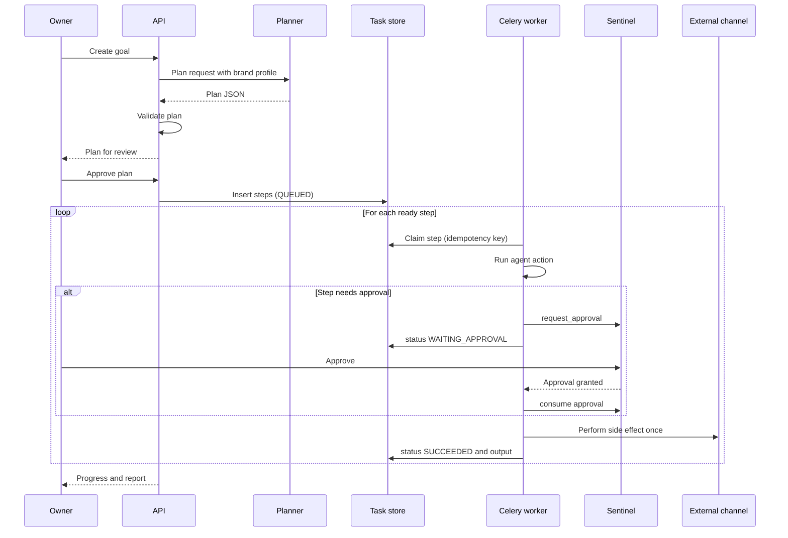
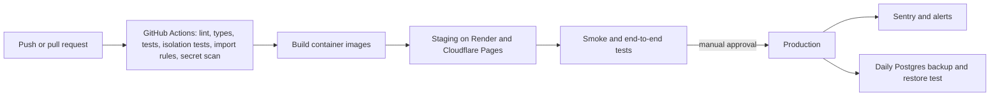

# ARCHITECTURE — Vistaro (FINAL)

Version 1.0 · 2026-10-18 · Authority: **decided by delegated authority** (the founders asked Claude on 2026-10-18 to finalize architecture and tech stack; they may veto or change any item).
Rules: `/CLAUDE.md`. Roadmap: `/docs/PROJECT_ROADMAP.md`. Build how-to: `/docs/DEVELOPMENT_GUIDE.md`. Product context: `STARTUP_AI_MASTER_CONTEXT.md`.

**Honesty note.** This is a *design*. `REPO-001` (2026-10-23) created a minimal FastAPI and React/Vite bootstrap, but no product feature is implemented. Every "verify" item below must be checked when the relevant task starts (provider offerings, prices, versions and policies change). Library and model versions are intentionally not pinned here: pin exact versions in lockfiles at install time, and prefer releases at least two weeks old.

**Disclosure.** The LLM recommendation (ADR-010) names Anthropic models. The author of this document is an Anthropic model, so weigh that choice accordingly. The provider interface (ADR-010) keeps the choice cheap to reverse, and `DEC-002` evaluates it before commitment.

---

## 1. Decision summary (ADR register)

| ADR | Decision | Main alternatives rejected | Why | Reversibility |
|---|---|---|---|---|
| ADR-001 | **Modular monolith in one monorepo** (`apps/web`, `apps/api`, `infra`, `docs`) | Microservices; separate repos | Two builders; one deploy; strong module boundaries without network cost | Easy to split later |
| ADR-002 | **Backend: Python 3.12, FastAPI, SQLAlchemy 2.x, Alembic, Pydantic v2**; tooling `uv`, Ruff, mypy, pytest | Node/NestJS; Django | Matches Dimple's stack; best AI/LLM ecosystem; OpenAPI for free | Medium |
| ADR-003 | **Frontend: React + TypeScript + Vite (SPA), Tailwind, shadcn/ui, TanStack Query, React Router**; generated API client (`openapi-typescript`); Vitest, Testing Library, Playwright | Next.js; Vue | Matches Anushka's stack; app is behind login so SSR/SEO is unnecessary | Medium |
| ADR-004 | **PostgreSQL only** (JSONB for semi-structured data; `pgvector` when retrieval is needed). **MongoDB not used.** | Postgres + MongoDB; MongoDB only | One datastore, transactions, RLS, constraints; JSONB covers flexible data | Hard once data exists |
| ADR-005 | **Multi-tenancy: shared schema, `workspace_id` on every tenant row, Postgres Row-Level Security enforced** | Schema-per-tenant; DB-per-tenant | Simple operations; RLS gives defense in depth beyond app code | Hard |
| ADR-006 | **Background jobs: Celery + Redis (Celery Beat for schedules)**; Redis also for rate limits and short-lived cache | Arq; RQ; Dramatiq; Postgres queues; Temporal | Largest documentation base; built-in retries, ETA, periodic tasks. State lives in Postgres, so the queue is replaceable | Easy |
| ADR-007 | **Auth: own session auth** — email+password (Argon2id) and Google sign-in (Authlib), server-side sessions in HttpOnly Secure SameSite cookies, CSRF protection, email verification | Third-party auth SaaS; JWT-in-localStorage | Keeps roles and Sentinel central, no vendor cost; cookies avoid token theft via XSS | Medium |
| ADR-008 | **Sentinel is an in-process module with a synchronous policy API**; approvals and an append-only audit log persisted in Postgres | External policy engine | One enforcement point, testable, no extra service | Easy |
| ADR-009 | **Orchestration: custom planner-executor over a Postgres task store**; no LangChain, LangGraph, CrewAI | Agent frameworks | Full control of approvals, idempotency, cost caps; fewer dependencies; framework churn risk avoided | Easy |
| ADR-010 | **LLM: provider-agnostic interface; default Anthropic Claude** (larger model for planning and generation, smaller model for classification and scoring; exact model names chosen at `DEC-002`) | OpenAI; Gemini; open-source self-hosting | Strong instruction-following and structured output; swappable by design | Easy |
| ADR-011 | **Structured outputs: JSON schema or tool-call output validated with Pydantic, with one bounded repair retry** | Free-text parsing | Reliability; rejects invalid output | Easy |
| ADR-012 | **First integrations:** `ManualPublish` connector (always available) + Meta Graph API for Instagram/Facebook Pages (development mode first); lead-form webhook; Resend for email. **Later:** Razorpay (Phase 2), WhatsApp Cloud API and Google Calendar (Phase 4) | Waiting on platform approvals | Manual connector means the MVP cannot be blocked by app review | Easy |
| ADR-013 | **Hosting: Cloudflare Pages (web), Render (API, worker, beat, Postgres, Redis), Cloudflare R2 (files)**, all containerized | AWS/GCP/Azure from day one; self-hosting | Lowest ops burden for two people. Verify student or startup credits and `pgvector` support at provisioning | Easy (Docker) |
| ADR-014 | **CI/CD: GitHub Actions; staging auto-deploy, production manual promotion** | Manual deploys | Safety (CLAUDE.md rule 12) | Easy |
| ADR-015 | **Observability: structured JSON logs (structlog), Sentry, `agent_runs` and cost ledger tables; OpenTelemetry deferred** | Full APM stack early | Enough for MVP; cost visibility is critical for AI | Easy |
| ADR-016 | **API: REST + OpenAPI; polling for task status in Phase 1, Server-Sent Events from Phase 2** | GraphQL; WebSockets | Simplicity | Easy |
| ADR-017 | **Module boundaries enforced by `import-linter` in CI** | Convention only | Protects constraint C-03 automatically | Easy |
| ADR-018 | **Secrets: platform secret store; connection tokens encrypted at app level (AES-GCM or Fernet) with key IDs for rotation** | Plain storage | Limits blast radius of a DB leak | Medium |
| ADR-019 | **Feature flags: simple `feature_flags` table plus env defaults** | Third-party flag service | Minimal | Easy |
| ADR-020 | **Embeddings and vector search deferred to Phase 3** (needed first by the support agent); provider decided then | Choose now | Not needed for the MVP; avoids early cost and dependency | Easy |

Alternatives are not "bad"; they cost more for this team and stage. Section 15 lists triggers to revisit.

---

## 2. System architecture

### 2.1 Containers



### 2.2 Inside the API application (modular monolith)



**Dependency rules (enforced by import-linter, ADR-017):**
1. Arrows show allowed imports. Anything not drawn is forbidden. No cycles.
2. A module may import another module **only** from its public `service.py` (and `schemas.py` types). Never its `models.py` or tables (constraint C-03).
3. `core` imports nothing from other modules.
4. Routers call services; services call repositories; only repositories touch SQL.
5. Only `sentinel` decides approvals. No other module implements approval logic (warning WARN-B-001).

---

## 3. Repository layout (target)

```
vistaro/
├── CLAUDE.md  AGENTS.md
├── STARTUP_AI_MASTER_CONTEXT.md  STARTUP_MASTER_BLUEPRINT.md
├── docs/  (ARCHITECTURE.md, DEVELOPMENT_GUIDE.md, PROJECT_ROADMAP.md,
│           ACTIVE_TASKS.md, PROJECT_WARNINGS.md, adr/)
├── apps/
│   ├── api/
│   │   ├── pyproject.toml  uv.lock  alembic.ini
│   │   ├── alembic/versions/
│   │   ├── src/vistaro/
│   │   │   ├── main.py  worker.py
│   │   │   ├── core/         (config, db, security, errors, logging, ids)
│   │   │   ├── auth/         (users, sessions, oauth, workspaces, memberships, rbac)
│   │   │   ├── sentinel/     (policies, approvals, audit)
│   │   │   ├── agents/       (runtime, registry, tasks, budgets)
│   │   │   ├── llm/          (client interface, providers, prompts/, schemas, router)
│   │   │   ├── integrations/ (base, manual_publish, meta, email, webhooks)
│   │   │   ├── orbit/  clarity/  muse/  convert/   (each: models, schemas, repo, service, router, tasks)
│   │   │   └── market/  pulse/                      (Phase 2)
│   │   └── tests/ (unit, integration, tenancy, evals)
│   └── web/
│       ├── package.json  vite.config.ts
│       └── src/ (app, routes, features/<module>, components, lib/api, lib/auth, tests)
├── infra/ (docker-compose.yml, Dockerfile.api, render.yaml, scripts/)
└── .github/workflows/ (ci.yml, deploy-staging.yml, deploy-prod.yml)
```

---

## 4. Request lifecycle and tenancy



**Tenancy rules (ADR-005):**
- Workspace comes from the **server-side session**, never from a client-supplied ID alone. If a route has `{workspace_id}`, it must equal the session's active workspace or the user's membership is verified.
- Each request runs in one transaction. `set_config('app.workspace_id', :id, true)` (transaction-local) is set at the start. Never use a session-level setting with pooled connections.
- Tables carry `workspace_id UUID NOT NULL`, with RLS enabled **and forced**, and policy `workspace_id = current_setting('app.workspace_id')::uuid`.
- The application connects as a non-owner role (`vistaro_app`) with no `BYPASSRLS`. Migrations run as a separate role (`vistaro_migrator`).
- Workers set the same setting from the task's `workspace_id` before any query.
- A mandatory test creates two workspaces and proves cross-reads fail even when application filters are removed (`TEST-001`).

---

## 5. Authentication and authorization

| Topic | Design |
|---|---|
| Sign-in | Email+password (Argon2id) and Google OAuth. Email verification required before publishing or connecting channels |
| Sessions | Server-side rows (`sessions`), opaque random ID in an HttpOnly, Secure, SameSite=Lax cookie; idle and absolute expiry; rotate on login; revoke on logout and password change |
| CSRF | Double-submit token or same-site header check on state-changing requests |
| Rate limiting | Redis-backed limits on login, signup, password reset, and webhook endpoints |
| Roles | `owner`, `admin`, `editor`, `approver`, `viewer` on `memberships` |
| Permission checks | Route-level dependency calls `sentinel.permissions.require(user, action, workspace)`. Role-to-action map lives in one file |
| Approvers | Only `owner`, `admin`, `approver` can approve. A requester cannot approve their own agent-initiated request unless they hold an approver role |

---

## 6. Sentinel design

### 6.1 Approval state machine



### 6.2 Rules

- **Gate API (internal):** `request_approval(workspace, action_type, payload, requested_by)` returns an approval ID; `consume(approval_id, expected_payload_hash)` atomically moves `APPROVED` to `EXECUTED` and fails otherwise.
- **Payload binding:** the approval stores a hash of the exact payload shown to the approver. Executing a changed payload fails. This prevents "approve one thing, send another".
- **One-time use:** an approval can be consumed once (idempotency).
- **Default policy (Phase 1):** all `content.publish`, `message.send`, `message.bulk_send`, `connection.link`, and any financial action require approval. No relaxation in Phase 1.
- **Phase 2:** owners may relax approval for low-risk classes (for example, replies to inbound customer messages from approved templates), with the relaxation itself audited.
- **Audit:** every request, decision, execution, permission denial, and policy change writes to `audit_logs`. The app role has **INSERT and SELECT only** on `audit_logs` (no UPDATE or DELETE).
- **Expiry:** pending approvals expire after a configurable time (initial default 7 days; tune with pilots). Expiry never auto-approves.

---

## 7. Agent runtime and Orbit

### 7.1 Concepts

| Concept | Meaning |
|---|---|
| Goal | Owner's stated objective, with optional metric, target, deadline |
| Plan | A validated, owner-approved DAG of steps for a goal |
| Step (task row) | One unit of work for one agent action, with inputs, outputs, status |
| Agent | A registered handler for specific actions (for example `muse.generate_post`) |
| Agent run | A trace record of each LLM or tool call within a step |

### 7.2 Plan validation (deterministic code, not AI)

The planner (LLM) returns JSON. The system **rejects** a plan unless it passes:
1. Schema valid.
2. Every `agent.action` is in the registry whitelist.
3. Graph is acyclic and every dependency exists.
4. Step count ≤ the configured cap (initial 12).
5. Any step whose action type needs approval is flagged `requires_approval` by the **registry**, not by the model (the model cannot waive approvals).
6. Estimated cost within the workspace budget.

### 7.3 Execution



### 7.4 Reliability rules

- **Idempotency:** every step has a unique `idempotency_key`. Side-effecting calls (publish, send) record the external ID **before** acknowledging success and check for it on retry.
- **Retries:** capped (`max_attempts`, initial 3) with exponential backoff; transient errors only. Permanent errors fail the step visibly.
- **Limits:** per-goal step cap, per-step timeout, per-workspace budget; exceeding a budget pauses the goal and notifies the owner.
- **No agent chat:** agents do not call each other. Orbit's executor passes outputs between steps through the task store.
- **Untrusted text:** inbound customer or web text is wrapped as data in prompts and agents handling it have a restricted tool set (WARN-C-004).
- **Celery settings:** acks late, visibility timeout longer than the longest step, one step per task message, results not trusted as state (the DB is the source of truth).

---

## 8. LLM layer

| Topic | Design |
|---|---|
| Interface | `LLMClient.generate(messages, schema=None, tools=None, model_tier, budget)`; providers are plug-ins |
| Tiers | `large` (planning, content generation) and `small` (classification, scoring, extraction). Mapping tier to model name is configuration, set at `DEC-002` |
| Structured output | Request JSON matching a Pydantic-derived schema; validate; on failure one repair retry with the validation error; then fail the step |
| Prompts | Files under `llm/prompts/`, versioned (`name@version`); the version is stored in `agent_runs` |
| Safety | System prompt separates instructions from data; delimiters around untrusted text; output never executed as code |
| Budgets | Estimate before call; record tokens and cost after; block when workspace budget exhausted |
| Caching | Cache deterministic, repeatable calls (for example visibility queries within a window); never cache across workspaces |
| Evaluation | Fixed eval sets in `tests/evals/`; scores stored per prompt version; required before changing a prompt or model tier (`TEST-002`) |
| PII | Send the minimum necessary customer data to providers; redact where possible (WARN-E-002) |

---

## 9. Data model (Phase 1, final)

Types are PostgreSQL. All tenant tables enable and force RLS on `workspace_id`. IDs are UUIDs (v7 preferred if available, else v4). Timestamps are `timestamptz`.

```sql
-- Identity and tenancy
CREATE TABLE users (
  id UUID PRIMARY KEY, email CITEXT UNIQUE NOT NULL, password_hash TEXT,
  google_sub TEXT UNIQUE, email_verified_at TIMESTAMPTZ,
  created_at TIMESTAMPTZ NOT NULL DEFAULT now()
);
CREATE TABLE workspaces (
  id UUID PRIMARY KEY, name TEXT NOT NULL, created_by UUID NOT NULL REFERENCES users(id),
  created_at TIMESTAMPTZ NOT NULL DEFAULT now()
);
CREATE TABLE memberships (
  workspace_id UUID NOT NULL REFERENCES workspaces(id),
  user_id UUID NOT NULL REFERENCES users(id),
  role TEXT NOT NULL CHECK (role IN ('owner','admin','editor','approver','viewer')),
  PRIMARY KEY (workspace_id, user_id)
);
CREATE TABLE sessions (
  id_hash TEXT PRIMARY KEY, user_id UUID NOT NULL REFERENCES users(id),
  active_workspace_id UUID REFERENCES workspaces(id),
  created_at TIMESTAMPTZ NOT NULL DEFAULT now(),
  last_seen_at TIMESTAMPTZ NOT NULL, expires_at TIMESTAMPTZ NOT NULL
);

-- Connections (encrypted tokens)
CREATE TABLE connections (
  id UUID PRIMARY KEY, workspace_id UUID NOT NULL REFERENCES workspaces(id),
  provider TEXT NOT NULL, external_account_id TEXT,
  token_ciphertext BYTEA, key_id TEXT, scopes TEXT[],
  status TEXT NOT NULL CHECK (status IN ('active','expired','revoked','error')),
  created_at TIMESTAMPTZ NOT NULL DEFAULT now(),
  UNIQUE (workspace_id, provider, external_account_id)
);

-- Clarity
CREATE TABLE brand_profiles (
  id UUID PRIMARY KEY, workspace_id UUID NOT NULL REFERENCES workspaces(id),
  version INT NOT NULL, tone JSONB NOT NULL, audience JSONB,
  banned_terms TEXT[] NOT NULL DEFAULT '{}', required_elements JSONB, examples JSONB,
  status TEXT NOT NULL CHECK (status IN ('draft','approved','superseded')),
  approved_by UUID REFERENCES users(id), approved_at TIMESTAMPTZ,
  UNIQUE (workspace_id, version)
);
CREATE TABLE brand_scores (
  id UUID PRIMARY KEY, workspace_id UUID NOT NULL REFERENCES workspaces(id),
  content_item_id UUID NOT NULL, profile_version INT NOT NULL,
  score NUMERIC(5,2) NOT NULL, rubric JSONB NOT NULL, created_at TIMESTAMPTZ NOT NULL DEFAULT now()
);

-- Orbit and agent runtime
CREATE TABLE goals (
  id UUID PRIMARY KEY, workspace_id UUID NOT NULL REFERENCES workspaces(id),
  text TEXT NOT NULL, target_metric TEXT, target_value NUMERIC, deadline DATE,
  status TEXT NOT NULL CHECK (status IN ('draft','planning','awaiting_plan_approval','active','paused','done','cancelled')),
  created_by UUID NOT NULL REFERENCES users(id), created_at TIMESTAMPTZ NOT NULL DEFAULT now()
);
CREATE TABLE plans (
  id UUID PRIMARY KEY, workspace_id UUID NOT NULL REFERENCES workspaces(id),
  goal_id UUID NOT NULL REFERENCES goals(id), version INT NOT NULL,
  plan JSONB NOT NULL, status TEXT NOT NULL CHECK (status IN ('proposed','approved','superseded','rejected')),
  approved_by UUID REFERENCES users(id), approved_at TIMESTAMPTZ,
  UNIQUE (goal_id, version)
);
CREATE TABLE tasks (
  id UUID PRIMARY KEY, workspace_id UUID NOT NULL REFERENCES workspaces(id),
  plan_id UUID NOT NULL REFERENCES plans(id), step_key TEXT NOT NULL,
  agent_action TEXT NOT NULL, depends_on TEXT[] NOT NULL DEFAULT '{}',
  status TEXT NOT NULL CHECK (status IN ('queued','running','waiting_approval','succeeded','failed','cancelled')),
  attempt INT NOT NULL DEFAULT 0, max_attempts INT NOT NULL DEFAULT 3,
  idempotency_key TEXT NOT NULL UNIQUE,
  input JSONB NOT NULL, output JSONB, error TEXT,
  started_at TIMESTAMPTZ, finished_at TIMESTAMPTZ,
  UNIQUE (plan_id, step_key)
);
CREATE TABLE agent_runs (
  id UUID PRIMARY KEY, workspace_id UUID NOT NULL REFERENCES workspaces(id),
  task_id UUID REFERENCES tasks(id), kind TEXT NOT NULL,   -- llm_call | tool_call
  model TEXT, prompt_version TEXT, input_tokens INT, output_tokens INT,
  cost_micro BIGINT, latency_ms INT, ok BOOLEAN NOT NULL, error TEXT,
  created_at TIMESTAMPTZ NOT NULL DEFAULT now()
);
CREATE TABLE workspace_budgets (
  workspace_id UUID PRIMARY KEY REFERENCES workspaces(id),
  monthly_cost_limit_micro BIGINT NOT NULL, period_start DATE NOT NULL
);

-- Muse
CREATE TABLE content_items (
  id UUID PRIMARY KEY, workspace_id UUID NOT NULL REFERENCES workspaces(id),
  task_id UUID REFERENCES tasks(id), channel TEXT NOT NULL,
  body JSONB NOT NULL, status TEXT NOT NULL
    CHECK (status IN ('draft','scored','awaiting_approval','approved','scheduled','published','failed','rejected')),
  scheduled_for TIMESTAMPTZ, external_post_id TEXT, published_at TIMESTAMPTZ,
  created_at TIMESTAMPTZ NOT NULL DEFAULT now()
);

-- Convert
CREATE TABLE contacts (
  id UUID PRIMARY KEY, workspace_id UUID NOT NULL REFERENCES workspaces(id),
  name TEXT, email CITEXT, phone TEXT, opted_out_at TIMESTAMPTZ,
  created_at TIMESTAMPTZ NOT NULL DEFAULT now()
);
CREATE TABLE leads (
  id UUID PRIMARY KEY, workspace_id UUID NOT NULL REFERENCES workspaces(id),
  contact_id UUID NOT NULL REFERENCES contacts(id), source TEXT NOT NULL,
  stage TEXT NOT NULL CHECK (stage IN ('new','contacted','interested','negotiating','won','lost')),
  score INT NOT NULL DEFAULT 0, last_activity_at TIMESTAMPTZ,
  created_at TIMESTAMPTZ NOT NULL DEFAULT now()
);
CREATE TABLE lead_events (
  id BIGSERIAL PRIMARY KEY, workspace_id UUID NOT NULL REFERENCES workspaces(id),
  lead_id UUID NOT NULL REFERENCES leads(id), kind TEXT NOT NULL, detail JSONB,
  at TIMESTAMPTZ NOT NULL DEFAULT now()
);

-- Sentinel
CREATE TABLE policies (
  id UUID PRIMARY KEY, workspace_id UUID NOT NULL REFERENCES workspaces(id),
  action_type TEXT NOT NULL, requires_approval BOOLEAN NOT NULL DEFAULT true,
  approver_roles TEXT[] NOT NULL DEFAULT '{owner,admin,approver}',
  UNIQUE (workspace_id, action_type)
);
CREATE TABLE approval_requests (
  id UUID PRIMARY KEY, workspace_id UUID NOT NULL REFERENCES workspaces(id),
  action_type TEXT NOT NULL, payload JSONB NOT NULL, payload_hash TEXT NOT NULL,
  requested_by TEXT NOT NULL, task_id UUID REFERENCES tasks(id),
  status TEXT NOT NULL CHECK (status IN ('pending','approved','rejected','expired','cancelled','executed')),
  expires_at TIMESTAMPTZ NOT NULL, created_at TIMESTAMPTZ NOT NULL DEFAULT now()
);
CREATE TABLE approval_decisions (
  id UUID PRIMARY KEY, workspace_id UUID NOT NULL REFERENCES workspaces(id),
  approval_id UUID NOT NULL REFERENCES approval_requests(id),
  decided_by UUID NOT NULL REFERENCES users(id), decision TEXT NOT NULL CHECK (decision IN ('approve','reject')),
  note TEXT, at TIMESTAMPTZ NOT NULL DEFAULT now()
);
CREATE TABLE audit_logs (
  id BIGSERIAL PRIMARY KEY, workspace_id UUID NOT NULL,
  actor TEXT NOT NULL, action TEXT NOT NULL, resource TEXT, detail JSONB,
  at TIMESTAMPTZ NOT NULL DEFAULT now()
);
```

**Indexes (start minimal; add from measured query plans):** `(workspace_id, status)` on `tasks`, `content_items`, `approval_requests`; `(workspace_id, stage)` on `leads`; `(workspace_id, at)` on `audit_logs`; unique constraints as shown.

**Later phases (outline, schemas written when the phase starts):** `conversations`, `messages` (Convert, Phase 2); `products`, `inventory`, `orders`, `order_items` (Market, Phase 2); `metrics`, `experiments`, `experiment_variants`, `competitor_observations` (Pulse); `visibility_queries`, `visibility_runs`, `visibility_results` (Clarity, Phase 2); `memory_items` with pgvector (Phase 3); `feature_flags`.

**Lead scoring v1 (deterministic):** points for source quality, form completeness, replied, recency, explicit interest keywords; thresholds map to hot, warm, cold. Weights are initial defaults tuned from pilot data. An LLM intent classifier may be added after evaluation.

**Brand scoring v1:** deterministic checks first (banned terms, length, required elements, language), then a small-tier LLM rubric score. Initial pass threshold 70 of 100, tuned from evals.

---

## 10. API conventions and Phase 1 endpoints

- Base path `/api/v1`. JSON. Errors: `{ "error": { "code", "message", "details" } }`. OpenAPI generated; the web client is generated from it in CI (contract drift fails the build).
- Pagination: cursor-based. Idempotency: `Idempotency-Key` header on endpoints that cause external effects.
- Long operations return a task or goal ID; the client polls (Phase 1).

| Group | Endpoints (Phase 1) |
|---|---|
| Auth | `POST /auth/signup`, `/auth/login`, `/auth/logout`, `/auth/google/*`, `POST /auth/verify-email` |
| Workspaces | `POST /workspaces`, `GET /workspaces`, `POST /workspaces/{id}/switch`, `POST /workspaces/{id}/members` |
| Clarity | `GET/PUT /brand-profile`, `POST /brand-profile/approve`, `POST /content/{id}/score` |
| Orbit | `POST /goals`, `GET /goals/{id}`, `GET /goals/{id}/plan`, `POST /plans/{id}/approve`, `POST /plans/{id}/reject` |
| Muse | `GET /content`, `PATCH /content/{id}`, `POST /content/{id}/request-approval` |
| Sentinel | `GET /approvals`, `POST /approvals/{id}/decision` |
| Convert | `POST /public/lead-forms/{token}` (public, rate limited), `GET /leads`, `PATCH /leads/{id}` |
| Integrations | `GET /connections`, `POST /connections/{provider}/start`, `DELETE /connections/{id}` |
| System | `GET /healthz`, `GET /readyz` |

---

## 11. Integrations (final choices)

| Integration | Choice | Phase | Notes and risks |
|---|---|---|---|
| Publishing, always available | `ManualPublish`: generates the post package; owner confirms publication manually; system records it | 1 | Guarantees the MVP works without platform approval |
| Instagram and Facebook Pages | Meta Graph API | 1 (dev mode), prod after app review | Review requirements and limits: verify at `INT-002` (WARN-C-005) |
| Lead capture | Embeddable form plus signed webhook | 1 | Spam protection, rate limits, validation |
| Email | Resend (transactional) | 1 | Verify deliverability setup (SPF, DKIM) |
| Payments | Razorpay | 2 | Compliance and fees: verify at `MKT-003` |
| WhatsApp | WhatsApp Cloud API | 4 or later | Templates, opt-in, per-message cost: verify at `LEGAL-001` and `CON-006` |
| Calendar | Google Calendar API | 4 | OAuth scopes review |
| AI visibility | `VisibilityProvider` interface; official APIs where they exist; **no scraping** | 2 | Feasibility pending `RES-001`; API answers may differ from consumer apps; AI Overviews may need a third-party data provider or may be unsupported (WARN-C-001) |
| Files | Cloudflare R2 (S3-compatible) | 1 | Presigned URLs; size and type limits |

Connector interface: `connect()`, `refresh()`, `revoke()`, `publish()`, `fetch_metrics()`, with typed errors (`AuthError`, `RateLimited`, `Transient`, `Permanent`) and a circuit breaker.

---

## 12. Security and privacy controls

| Area | Control |
|---|---|
| Transport | HTTPS only; HSTS; secure cookies |
| Secrets | Platform secret store; `.env.example` with names only; secret scanning in CI |
| Token encryption | AES-GCM or Fernet with `key_id`; rotation supported |
| Input | Pydantic validation everywhere; size limits; upload type checks; output encoding on the frontend; Content-Security-Policy |
| Abuse | Rate limits (login, signup, public forms, webhooks); lead-form spam checks |
| Tenancy | RLS plus tests (section 4) |
| AI safety | Section 7.4 and 8 |
| Logging | Structured logs; never log tokens, passwords, message bodies, or full prompts containing personal data; redaction filter |
| Data lifecycle | Soft-delete plus scheduled hard delete after a retention period set by `LEGAL-001`; deletion-on-request path |
| Dependencies | Lockfiles, pinned versions, automated vulnerability alerts |
| Compliance | Applicability of India's data protection law and platform policies decided by `LEGAL-001` (not assumed) |

---

## 13. Observability and cost

- Logs: structlog JSON with `request_id`, `workspace_id`, `task_id`. Sentry for exceptions (API and worker).
- Metrics tracked from `agent_runs` and `tasks`: success rate, retries, latency, tokens, cost per goal and per workspace.
- Alerts (initial): task failure spikes, queue backlog, cost threshold, 5xx rate, backup failure.
- Cost ledger is derived from `agent_runs.cost_micro`; budgets enforced before LLM calls.

---

## 14. Deployment



| Item | Decision |
|---|---|
| Environments | `local` (docker-compose), `staging`, `production` |
| Migrations | Run as a release step with the migrator role; backwards-compatible (expand, then contract); backup before production migrations |
| Rollback | Previous image redeploy; database changes designed to tolerate the previous version for one release |
| Secrets | Platform environment groups; separate values per environment |
| Cost control | Smallest instance sizes; single instance each for API, worker, beat at launch |

---

## 15. Scaling path, non-goals, and when to revisit

**Scaling path (only when measured need appears):** add API instances; split worker queues by priority (interactive vs batch); add a Postgres read replica; move large metric tables to partitioning; move heavy visibility runs to a dedicated worker pool; extract a module into a service only if it needs independent scaling.

**Non-goals (first release):** microservices; Kubernetes; native mobile apps; payment processing by Vistaro as merchant; autonomous publishing without approval; multi-region; self-hosted LLMs.

**Revisit triggers:**

| Decision | Revisit if |
|---|---|
| Celery (ADR-006) | Task semantics or maintenance become a recurring problem |
| Own auth (ADR-007) | Enterprise SSO, MFA, or compliance requirements appear |
| Render (ADR-013) | Credits end, region or compliance need arises, or `pgvector` is unavailable |
| Anthropic default (ADR-010) | `DEC-002` evaluation, cost, or availability shows a better fit |
| Postgres RLS (ADR-005) | A customer requires physical isolation |
| Custom orchestration (ADR-009) | Plan complexity outgrows the executor and a framework would reduce risk |

---

## 16. Approval and change control

This architecture is final for planning. Changing any ADR needs the proposal process in `CLAUDE.md` §9 and a new entry under `docs/adr/`. Items marked "verify" are not changes; they are checks when the related task begins, and any surprise is recorded in `docs/PROJECT_WARNINGS.md`.
